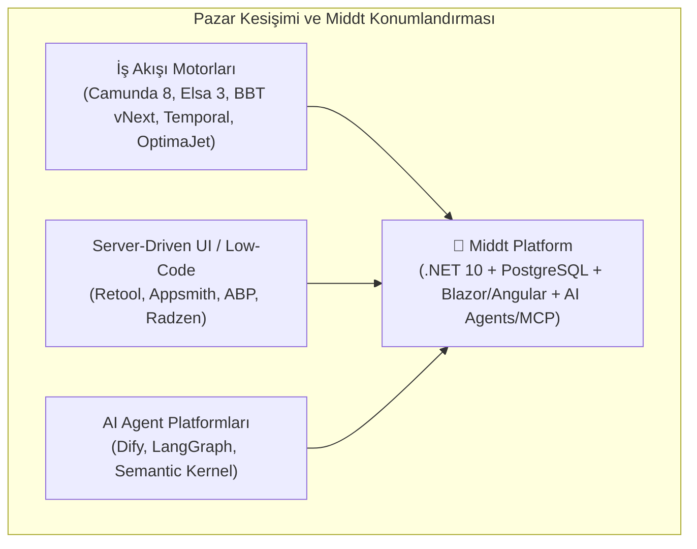
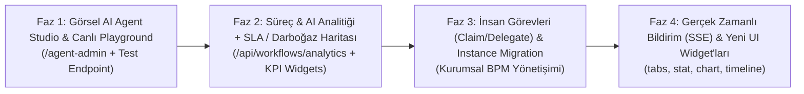

# Middt Platform: Rakip Analizi, Güçlü/Zayıf Yönler ve Özellik Yol Haritası (Roadmap)

## 1. Yönetici Özeti ve Pazar Konumlandırması

**Middt Framework**, kurumsal iş uygulamaları (Line-of-Business / LOB) dünyasında genellikle **3 ayrı ürünün** birleştirilmesiyle çözülen problemi **tek, entegre ve sıfır-kod (declarative JSON) destekli bir .NET 10 + TypeScript platformunda** birleştirmektedir:

1. **Durum Makinesi ve İş Akışı Motoru (Workflow & State Machine Engine)**: Uzun ömürlü süreçler, insan görevleri (Human Tasks), zamanlayıcılar, alt akışlar, mesaj/event korelasyonu.
2. **%100 Sunucu Güdümlü Çoklu-Frontend UI (Server-Driven Multi-Frontend JSON UI)**: Tek bir JSON şemasından hem **Blazor Server (Radzen)** hem **Angular 22 (Material)** hem de **Statik HTML** üretebilen, taşınabilir ifade dili (`spec/expressions.conformance.json`) ile korunan ekran motoru.
3. **Kurumsal AI Agent & MCP Orkestrasyonu (`Middt.Framework.Agents`)**: `Microsoft.Agents.AI` üzerine kurulu, iş akışı geçişlerini (`allowedTransitions` / `transitionInto`) yönetebilen, mevcut `IWorkflowTask` görevlerini doğrudan AI aracına (tool) dönüştürebilen ve yerel deterministik yedeklemeye (`LocalAgentChatClient`) sahip ajan mimarisi.



---

## 2. Muhtemel Rakipler ile Detaylı Karşılaştırma Matrisi

Middt Platform'un doğrudan ve dolaylı rakipleri 4 ana kategoride incelenmiştir:
- **.NET İş Akışı Motorları**: **BBT vNext Workflow**, **Elsa Workflows 3.x**, **OptimaJet WorkflowEngine.NET**
- **Dağıtık Orkestratörler**: **Camunda 8 (Zeebe)**, **Temporal.io**
- **İç Araç & Low-Code UI Platformları**: **Retool / Appsmith**, **ABP Framework**
- **AI Agent & Akış Stüdyoları**: **Dify**, **LangGraph**

| Kriter / Özellik | **Middt Platform** | **BBT vNext** | **Elsa Workflows 3.x** | **Camunda 8 (Zeebe)** | **Temporal.io (.NET)** | **Retool / Appsmith** | **Dify / LangGraph** |
| :--- | :--- | :--- | :--- | :--- | :--- | :--- | :--- |
| **Mimari & Altyapı Ayak İzi** | **Çok Düşük** (Tek süreç + PostgreSQL `SKIP LOCKED` & `LISTEN/NOTIFY`, Dapr yok) | Yüksek (Dapr, ayrı Execution/Orchestration hostları, Inbox/Outbox) | Orta (.NET 8+, EF Core, ayrı Studio paketi) | Yüksek (Zeebe cluster, Elasticsearch/OpenSearch, Operate, Tasklist) | Yüksek (Temporal Server cluster + Worker süreçleri) | Orta/Yüksek (Çoklu container + JS runtime) | Orta (Python/Node + Vector DB + Queue) |
| **Akış Tanımlama Modeli** | **Declarative JSON State Machine** (Şema doğrulamalı, versiyonlu) | JSON State Machine + Roslyn C# Scriptleri | C# Code-First veya Elsa JSON Flowchart | BPMN 2.0 / DMN XML | Code-First (C# / Go / TS) | Görsel JS/SQL sorgu zincirleri | Görsel LLM / Node grafiği |
| **Server-Driven UI & Çoklu Frontend** | **Tam Destek** (Aynı JSON layout -> Blazor + Angular 22 + Statik HTML) | Kısmi (View referansları var, çoklu-frontend kontrat testi yok) | Yok (Sadece yönetim ekranı; iş ekranlarını geliştirici yazar) | Sadece basit Camunda Forms (JSON); tam sayfa/grid UI yok | Yok (Tamamen backend orkestratörü) | Var (Sadece kendi React runtime'ında çalışır) | Sadece Chat / Form arayüzü |
| **Taşınabilir İfade Dili (Cross-Language)** | **Var** (.NET & TS aynı AST/değerlendirici + `expressions.conformance.json`) | Yok (Sunucuda Roslyn C#) | Yok (Sunucuda JS/C#/Liquid) | FEEL (Sadece sunucu/Zeebe) | Yok | Sadece tarayıcıda JS (`{{ }}`) | Python / Jinja2 |
| **Görsel Tasarımcılar (Designers)** | **Çift Yönlü** (`/workflow-admin` + `/ui-admin` hem Blazor hem Angular'da gömülü) | VS Code eklentisi (Forge Studio) | Elsa Studio (Sadece Blazor WASM/Server) | Camunda Modeler / Web Modeler | Yok (Sadece izleme UI'ı) | Sadece Ekran Tasarımcısı | Sadece Agent/Akış Tasarımcısı |
| **AI Agent & MCP Entegrasyonu** | **Yerleşik** (`Microsoft.Agents.AI`, dinamik geçiş yönlendirme, `IWorkflowTask` -> Tool köprüsü, MCP) | Harici HTTP çağrısı ile | Eklenti / Activity seviyesinde | Camunda AI Agent Connector (BPMN alt süreci) | Activity olarak kodlanmalı | AI Query blokları | **Çok Güçlü** (RAG, Agent Studio, Prompt yönetimi) |
| **Veri Depolama & Dinamik Sorgu** | **PostgreSQL Partitioned JSONB** + SQL filtre/sıralama pushdown (`WorkflowInstanceDataQuery`) | Şema-bazlı JSON + harici görünüm/fonksiyonlar | Kurumsal iş verisi için ayrı tablo/kod gerekir | Değişkenler Zeebe'de; sorgu için Elasticsearch gerekir | Payload'lar blob/proto; arama için Search Attributes gerekir | Doğrudan DB'ye SQL yazar | Uygulama verisi tutmaz |
| **Tarihçe (Audit) & JSON Patch** | **`full` / `delta` (RFC 6902 JSON Patch + Checkpoint) / `none`** + `input.format: jsonPatch` | Tam kopya / Event log | Tam aktivite logu (büyük veride şişme riski) | Event stream + Audit Log | Tam Event History (boyut limiti ~50MB/instance) | Sadece aksiyon audit logu | Çalıştırma izleme logu (Tracing) |
| **İnsan Görevleri & Yetkilendirme (RBAC)** | **Birleşik `/inbox`**, `$starter`, `$previousUser` (4-Göz ilkesi), `denyRoles`, alan bazlı `x-roles` & `x-mask` | Rol bazlı geçişler | Özel geliştirme gerektirir | Camunda Tasklist (Claim/Assign/SLA) | Sinyal (Signal) ile özel geliştirme | Sayfa bazlı RBAC | Basit Human-in-the-loop düğümü |
| **Kimlik Sağlayıcı (IdP) & BFF Güvenliği** | **Dahili OpenIddict OIDC Server** (akışları workflow olarak çalışan IdP) + **YARP BFF** (tarayıcıda 0 token) | Harici IdP gerekir | Harici IdP gerekir | Keycloak (Camunda Identity) | Harici IdP gerekir | Dahili/SSO | Dahili/SSO |
| **Simülasyon & CI/CD Taşınabilirliği** | **`POST /simulate` (Dry-Run)** + SHA-256 imzalı Bundle Export/Import (`dryRun`) | CLI araçları | Yok | Harici test kütüphaneleri | Replay testi (kod ile) | Git Sync (Ücretli kurumsal) | DSL Export/Import |

---

## 3. Güçlü Yönlerimiz (Artılarımız)

1. **Sıfır-Dapr, Tek Veritabanı ile Yüksek Performanslı ve Yalın Mimari**:
   - [`WorkflowDbContext.cs`](sdk/server/Middt.Framework.Workflow/Persistence/WorkflowDbContext.cs), [`WorkflowPartitionManager.cs`](sdk/server/Middt.Framework.Workflow/Runtime/WorkflowPartitionManager.cs) ve [`WorkflowJobProcessor.cs`](sdk/server/Middt.Framework.Workflow/Runtime/WorkflowJobProcessor.cs) sayesinde PostgreSQL `LIST` bölümleme (partitioning), `FOR UPDATE SKIP LOCKED` ile sıfır çakışmalı çoklu-node iş kuyruğu ve `LISTEN`/`NOTIFY` ([`WorkflowJobNotifier.cs`](sdk/server/Middt.Framework.Workflow/Runtime/WorkflowJobNotifier.cs)) ile milisaniyelik tetikleme sağlar. Camunda 8 veya BBT vNext gibi ağır yan bileşenlere (Dapr, Zeebe, Elasticsearch) ihtiyaç duymaz.
2. **Gerçek Çoklu-Frontend (Blazor + Angular) ve Ortak Kontrat Garantisi**:
   - Çoğu rakip tek bir frontend teknolojisine kilitlidir. Middt'te [`spec/expressions.conformance.json`](spec/expressions.conformance.json), [`spec/json-patch.conformance.json`](spec/json-patch.conformance.json) ve [`spec/ui-layout.schema.json`](spec/ui-layout.schema.json) sayesinde C# ve TypeScript motorları birebir aynı davranışı sergiler.
3. **RFC 6902 JSON Patch Mimarisi (Hem Girdi Hem Tarihçe Hem Arka Plan Birleştirme)**:
   - [`JsonPatch.cs`](sdk/shared/Middt.Framework.Expressions/JsonPatch.cs) ile `history: "delta"` modunda sadece değişen alanların saklanması + periyodik tam snapshot (`historySnapshotEvery`), `"background": true` görevlerin sonuçlarını mevcut veriyi ezmeden yama olarak birleştirmesi ve istemcinin `op: "test"` ile iyimser kilitleme (optimistic concurrency) yapabilmesi pazardaki rakiplerin çoğunda bulunmayan özgün bir mühendislik avantajıdır.
4. **İş Akışı Motoru ile Doğal AI Agent & MCP Bütünleşmesi**:
   - [`AiAgentTask.cs`](sdk/server/Middt.Framework.Agents/AiAgentTask.cs) ve [`MiddtAgentRegistry.cs`](sdk/server/Middt.Framework.Agents/MiddtAgentRegistry.cs) sayesinde bir AI ajanı bulunduğu durumdaki (state) mevcut geçişleri (`allowedTransitions`) otomatik öğrenir, `outputSchema` doğrulamasıyla karar verir, herhangi bir `IWorkflowTask`'ı (`http`, `cache`, `loadWorkflow`, `operation`) kod yazmadan tool olarak çağırabilir ve API anahtarı yokken [`LocalAgentChatClient.cs`](sdk/server/Middt.Framework.Agents/LocalAgentChatClient.cs) ile deterministik olarak test edilebilir.
5. **Kurumsal Güvenlik ve Finans/Bankacılık Uyumluluğu (4-Göz İlkesi, Maskeleme, BFF)**:
   - `$previousUser` / `$starter` / `denyRoles` ile **Maker-Checker (4-Göz)** kontrolü, `DataSchema` üzerinde `x-roles` ve `x-mask` ile alan bazlı gizleme/maskeleme, BFF katmanında dağıtık token yenileme kilidi (`TryAcquireRefreshLeaseAsync`) ve tarayıcıda sıfır token tutulması doğrudan bankacılık/fintech standartlarındadır.

---

## 4. Eksik Yönlerimiz ve Rakiplere Göre Boşluklar (Eksilerimiz)

| # | Alan | Rakip Karşılığı | Durum ve Açıklama |
| :--- | :--- | :--- | :--- |
| **1** | **Görsel AI Agent, Tool & MCP Stüdyosu (`/agent-admin`)** | Dify Studio, Camunda Web Modeler Agent Connector | **✅ Tamamlandı (Faz 1)**: Hem Blazor hem Angular'da `/agent-admin` stüdyosu, `AgentApiClient`, çalışma zamanı CRUD (`PUT/DELETE /api/agents/*`), doğrulama (`POST /api/agents/validate`) ve **Canlı Test Playground (`POST /api/agents/test`)** devreye alındı. |
| **2** | **Gerçek Zamanlı UI Bildirimi (SSE) ve Canlı Akış** | Temporal Web, Camunda Tasklist, Dify Streaming | **✅ Tamamlandı (Faz 4)**: `WorkflowEventStreamHub` ile `GET /api/workflows/events` ve `GET /api/workflows/{workflow}/instances/{id}/events` SSE uçları eklendi; her iki arayüzde **`🟢 Canlı (SSE)`** rozetiyle arka plan görevleri, zamanlayıcılar ve `Event` mesajları ekranı anında güncelliyor. |
| **3** | **Süreç Analitiği, SLA Takibi ve Darboğaz Isı Haritası (Process Analytics) Yok** | Camunda Optimize, OptimaJet Analytics | **📋 Planlandı (Faz 2)**: OpenTelemetry trace/metric üretiliyor fakat uygulama içinde hangi iş akışının hangi durumunda (state) ortalama ne kadar beklendiğini, SLA/timeout aşım oranlarını ve AI ajanlarının toplam token/maliyet istatistiklerini gösteren bir **Analitik & Darboğaz API / Ekranı** eklenecek. |
| **4** | **Çalışan Akışları Yeni Versiyona Taşıma (Instance Version Migration)** | Elsa 3 Alterations, Camunda 8 Process Instance Migration | **✅ Tamamlandı (Faz 3)**: `POST /api/workflows/{workflow}/migrate` ve `/workflow-admin` içindeki **`🔄 Sürüm & Göç`** sekmesiyle açık (`Active` / `Faulted`) kayıtları `stateMap` (`eskiAdım -> yeniAdım`) ve `dryRun` önizleme desteğiyle yeni sürüme taşıma ve `$migrate` tarihçe kaydı devreye alındı. |
| **5** | **Server-Driven UI Widget Çeşitliliği (16 Widget)** | Retool, Appsmith, Radzen Studio | **✅ Tamamlandı (Faz 4)**: Mevcut 13 widget'a ek olarak yönetim panelleri ve süreç izleme için **`stat` (KPI Kartı)**, **`tabs` (Etkileşimli Sekmeler)** ve **`timeline` (Süreç/Aktivite Zaman Çizelgesi)** her üç renderer'a (Blazor, Angular, Static HTML) ve `/ui-admin` tasarımcısına eklendi. |
| **6** | **İnsan Görevlerinde Üstlenme (Claim/Unclaim) ve Çoklu Kişi / Rol Vekalet (`Assign`)** | Camunda Tasklist, OptimaJet Approval Matrix | **✅ Tamamlandı (Faz 3)**: `POST .../claim` (`🙋 Üzerime Al`), `POST .../unclaim` (`🔓 Görevi Bırak`), `POST .../assign` (`↪️ Devret / Ata` — tekil kişi, çoklu `users` ve `roles` / `role:<ad>` / `@<ad>` desteği), `$assignee` rol belirteci ve `/api/workflows/inbox?assignment=all\|mine\|unassigned\|claimed` filtreleri her iki arayüzde devreye alındı. |
| **7** | **Zamanlanmış Başlatıcılar (Cron Triggers) ve Gelen Webhook Doğrulaması Yok** | n8n, Elsa Cron Trigger, Temporal Schedules | Akış içindeki geçişlerde `Scheduled` (`after`/`at`) var; ancak bir iş akışını her gece 02:00'de otomatik başlatan **Cron Schedule Trigger** veya dış sistemlerden gelen mesajlarda HMAC imza doğrulaması yapan **Webhook Trigger** yapısı gelecek fazlarda değerlendirilecek. |

---

## 5. Geliştirilmesi Önerilen Özellikler ve Uygulama Planı (Roadmap)

Aşağıdaki yol haritası, mevcut mimari kuralları (`LayeringTests`, sıfır uyarı politikası, `.NET` + `TypeScript` + `spec/` + `Blazor` + `Angular` tam eşlenikliği) bozmadan **4 Faz (Wave)** halinde tasarlanmıştır.



---

### ✅ Faz 1 (Tamamlandı): Görsel AI Agent, Tool & MCP Stüdyosu (`/agent-admin`) ve Canlı Test Playground'u

> [!IMPORTANT]
> Rakiplerle (özellikle **Dify** ve **Camunda 8**) aramızdaki en hızlı kapatılabilecek ve en yüksek vitrin değerine sahip farktır. `/workflow-admin` ve `/ui-admin` yanına üçüncü stüdyo olarak **`/agent-admin`** eklenir.

#### [MODIFY] [`sdk/server/Middt.Framework.Agents/AgentEndpoints.cs`](sdk/server/Middt.Framework.Agents/AgentEndpoints.cs)
- `GET /api/agents/catalog`: Tüm kayıtlı `agents`, `tools` (declarative) ve `mcpServers` kataloğunu tek bir `AgentCatalogFile` olarak döner.
- `PUT /api/agents/{name}` ve `DELETE /api/agents/{name}`: Tekil ajan tanımını çalışma zamanında kaydeder/siler ve `wf.WorkflowDefinitions` (`__agents__`) kaydını günceller.
- `POST /api/agents/validate`: Ajanın `outputSchema`, `tools`, `mcpServers` ve şablon ifadelerini kaydedilmeden doğrular.
- `POST /api/agents/{name}/test` (Playground Dry-Run): Seçilen ajanı örnek bir `prompt` ve örnek `data` JSON'ı ile çalıştırır; üretilen yapılandırılmış çıktıyı (`output`), seçilen geçişi (`nextTransition`), yapılan araç çağrılarını (`toolCalls`), süreyi ve harcanan token miktarını döner.

#### [MODIFY] [`sdk/client/Middt.Framework.Client`](sdk/client/Middt.Framework.Client) & [`sdk/client/ui-core`](sdk/client/ui-core)
- `AgentApiClient` (.NET ve TypeScript) eklenerek katalog okuma, kaydetme, doğrulama ve playground test metodları her iki istemciye açılır.

#### [NEW] `AgentDesigner.razor` ([`sdk/client/Middt.Framework.Blazor`](sdk/client/Middt.Framework.Blazor)) & `agent-designer.component.ts` ([`sdk/client/angular`](sdk/client/angular))
- Her iki arayüzde `/agent-admin` rotasında çalışan görsel **AI Agent & Tool Studio**:
  - Ajanların (`Instructions`, `ModelId`, `Temperature`, `MaxToolCalls`, `MaxTotalTokens`, `AllowedTransitions`, `OutputSchema`), Declarative Tool'ların (`expression`, `task`, `http`, `mcp`) ve MCP sunucularının görsel form + JSON editörüyle düzenlenmesi.
  - Sağ panelde **Canlı Playground**: Örnek veriyle ajanı anında DeepSeek/OpenAI veya Local Fallback üzerinde çalıştırıp `toolCalls` ve JSON çıktısını görme.
  - `/workflow-admin` içindeki `agent` görevlerinden tek tıkla ilgili ajanı `/agent-admin`'de açma (tıpkı `view.layout` -> `/ui-admin` bağlantısı gibi).

---

### Faz 2: Süreç Analitiği, Darboğaz Isı Haritası (Process Analytics) ve AI Maliyet/Token Gözlemlenebilirliği

> [!TIP]
> **Camunda Optimize** benzeri süreç zekasını (Process Intelligence) harici Elasticsearch kurmadan doğrudan PostgreSQL `WorkflowInstances`, `WorkflowHistory` ve `WorkflowAgentRuns` tabloları üzerinden sunar.

#### [MODIFY] [`sdk/server/Middt.Framework.Workflow/Endpoints/WorkflowEndpoints.cs`](sdk/server/Middt.Framework.Workflow/Endpoints/WorkflowEndpoints.cs) & [`sdk/server/Middt.Framework.Workflow/Runtime/WorkflowEngine.OperationsAndSimulation.cs`](sdk/server/Middt.Framework.Workflow/Runtime/WorkflowEngine.OperationsAndSimulation.cs)
- `GET /api/workflows/{workflow}/analytics`:
  - Durum (State) bazında aktif kayıt sayısı, ortalama bekleme süresi (dwell time), maksimum bekleme süresi ve hata (incident) sayısı.
  - Geçiş (Transition) bazında kullanım frekansı (hangi dal % kaç oranında seçilmiş).
  - AI Agent görevleri için (`WorkflowAgentRuns` tablosundan) ortalama yanıt süresi, toplam prompt/completion token kullanımı ve araç çağrı başarı oranları.
- **Workflow Designer (`/workflow-admin`) Isı Haritası Modu**:
  - Tasarımcıda "Canlı Analitik / Heatmap" butonu açıldığında her durum kutusunun (state node) üzerinde aktif kayıt sayısı ve ortalama bekleme süresi rozeti gösterilir; darboğaz olan durumlar görsel olarak vurgulanır.

---

### ✅ Faz 3 (Tamamlandı): Kurumsal BPM Yönetişimi (Görev Üstlenme / Vekalet & Çalışan Akış Versiyon Göçü)

#### [MODIFY] [`sdk/server/Middt.Framework.Workflow/Persistence/Entities.cs`](sdk/server/Middt.Framework.Workflow/Persistence/Entities.cs) & [`sdk/server/Middt.Framework.Workflow/Runtime/WorkflowEngine.cs`](sdk/server/Middt.Framework.Workflow/Runtime/WorkflowEngine.cs)
- **Human Task Claim / Unclaim / Assign**:
  - `WorkflowInstance` üzerine opsiyonel `AssignedTo` (`string?`) ve `AssignedAt` (`DateTime?`) alanları eklendi.
  - `POST /api/workflows/{workflow}/instances/{id}/claim` (üzerine alma), `POST .../unclaim` (bırakma) ve `POST .../assign` (tekil kullanıcı, çoklu `users` veya `roles` / `role:<ad>` / `@<ad>` atama/vekalet) uçları ve Blazor/Angular detay ekranı kontrolleri eklendi.
  - `/api/workflows/inbox?assignment=all|mine|unassigned|claimed` ve `/api/workflows/{workflow}/instances?assignedTo=...` filtreleri eklendi.
- **Running Instance Version Migration (`POST /api/workflows/{workflow}/migrate`)**:
  - Uzun süreli açık akışları eski versiyondan (`fromVersion`) yeni versiyona (`toVersion`) opsiyonel durum eşleme tablosuyla (`stateMap: { "old-state": "new-state" }`), `dryRun` seçeneğiyle ve `/workflow-admin` içindeki **`🔄 Sürüm & Göç`** sekmesiyle güvenli taşıma devreye alındı.

---

### ✅ Faz 4 (Tamamlandı): Yeni Server-Driven UI Widget'ları (`stat`, `tabs`, `timeline`) ve Gerçek Zamanlı Güncelleme (SSE)

#### [MODIFY] [`sdk/shared/Middt.Framework.Ui.Abstractions/Widgets/UiWidgets.cs`](sdk/shared/Middt.Framework.Ui.Abstractions/Widgets/UiWidgets.cs), [`spec/ui-layout.schema.json`](spec/ui-layout.schema.json), `@middt/ui-core`, `Middt.Framework.Blazor`, `@middt/angular`
- Yeni taşınabilir widget'ların hem .NET hem TypeScript kontratlarına, şema üreticisine (`MIDDT_UPDATE_SPEC=1`) ve her üç renderer'a (Blazor, Angular, Static HTML) eklenmesi:
  1. **`stat` (KPI / Metrik Kartı)**: Başlık, biçimlendirilmiş büyük değer (`value`), alt açıklama/trend (`delta`, `color`) ve ikon.
  2. **`tabs` (Sekmeli Konteyner)**: Çocuk düğümleri sekme başlıklarıyla gruplayan konteyner widget'ı.
  3. **`timeline` (Süreç/Tarihçe Zaman Çizelgesi)**: Bir dizi kaynağını (`source`) dikey zaman çizelgesi adımları olarak gösteren widget.
- **Gerçek Zamanlı Akış Bildirimi (`GET /api/workflows/{workflow}/instances/{id}/events` - Server-Sent Events)**:
  - Arka plan görevi (`"background": true`), zamanlayıcı veya `Event` mesajı bir akışı güncellediğinde açık olan Blazor ve Angular detay ekranlarının sayfa yenilemeye gerek kalmadan anında güncellenmesi.

---

### ✅ Faz 5 (Tamamlandı): Yüksek Erişilebilirlik (HA), Multi-Pod Küme Senkronizasyonu ve Çoklu Veritabanı (MS SQL, MySQL, Oracle) Desteği

#### [MODIFY] [`WorkflowJobNotifier.cs`](sdk/server/Middt.Framework.Workflow/Runtime/WorkflowJobNotifier.cs), [`WorkflowJobProcessor.cs`](sdk/server/Middt.Framework.Workflow/Runtime/WorkflowJobProcessor.cs), [`WorkflowPartitionManager.cs`](sdk/server/Middt.Framework.Workflow/Runtime/WorkflowPartitionManager.cs), [`WorkflowDbContext.cs`](sdk/server/Middt.Framework.Workflow/Persistence/WorkflowDbContext.cs), [`UiLayoutStore.cs`](sdk/server/Middt.Framework.Ui.Server/Runtime/UiLayoutStore.cs)
- **Pod'lar Arası Gerçek Zamanlı SSE ve Katalog Önbellek Senkronizasyonu**:
  - Bir pod üzerinde gerçekleşen akış olayları (`WorkflowEventStreamHub`) ve çalışma zamanı katalog güncellemeleri (`WorkflowRegistry`, `MiddtAgentRegistry`, `MiddtMcpClient`, `UiLayoutStore`) PostgreSQL `LISTEN`/`NOTIFY` (`middt_wf_events_*`, `middt_wf_catalog_*`, `middt_ui_layouts`) ve veritabanından bağımsız `IWorkflowClusterBus` üzerinden kümedeki tüm pod'lara anında yayılır.
  - Ayrıca `WorkflowRegistry` ve `MiddtAgentRegistry` için `UpdatedAt` zaman damgası su izi (watermark) kontrolü eklendi.
- **Sıfır Kesintili (Graceful) Pod Kapanışı ve Başlangıç Kilidi**:
  - Pod kapanışında (`SIGTERM` / `OperationCanceledException`) çalışmakta olan arka plan işlerinin 5 dakikalık kira süresi (`LockedUntil`) anında serbest bırakılır (`LockedUntil = null`, `Attempts - 1`) ve `RabbitMqTask` bağlantıları endpoint bazında havuzlanır (`IConnection` pooling).
  - Çoklu pod soğuk başlangıçlarında (`WorkflowStartup`, `UiStartup`, `IdentitySeeder`) eşzamanlı şema/tablo oluşturma ve seed yarışları veritabanı danışma kilitleriyle (`pg_advisory_lock`, `sp_getapplock`, `GET_LOCK`) seri hale getirildi.
- **Tam Çoklu Veritabanı (PostgreSQL, MS SQL Server, MySQL, Oracle, SQLite) Uyumluluğu**:
  - `WorkflowPartitionManager` içine PostgreSQL ve SQLite'a ek olarak **MS SQL Server (`JSON_VALUE` / `TRY_CAST` / `CHARINDEX`)**, **MySQL (`JSON_EXTRACT` / `JSON_UNQUOTE` / `LOCATE`)** ve **Oracle (`JSON_VALUE` / `TO_NUMBER` / `INSTR` / `NCLOB`)** yerel SQL pushdown desteği ve diğer tüm EF Core sağlayıcıları için bellek-içi fallback (`MatchesAllConditions`) eklendi.
  - MS SQL Server için `WITH (UPDLOCK, READPAST, ROWLOCK)` kuyruk tüketimi ve Oracle için parçalı `BusinessKey` function-based unique index koruması eklendi.

---

## 6. Doğrulama Planı (Verification Plan)

Her faz tamamlandığında çalıştırılacak doğrulama adımları:

```bash
# 1. Şema güncellemesi (kontrat değiştiyse) ve tüm .NET birim/entegrasyon testleri
MIDDT_UPDATE_SPEC=1 dotnet test --project tests/Middt.Framework.Tests

# 2. Sıfır uyarı ile CI derlemesi
dotnet build Middt.Framework.slnx -p:ContinuousIntegrationBuild=true

# 3. TypeScript çekirdek derleme ve konformans testleri
(cd sdk/client/ui-core && npm run build && npm test)

# 4. Angular kütüphane ve demo uygulaması production derlemesi
(cd sdk/client/angular && npx ng build middt-angular)
(cd demo/angular-app && npx ng build sample --configuration production)
```

