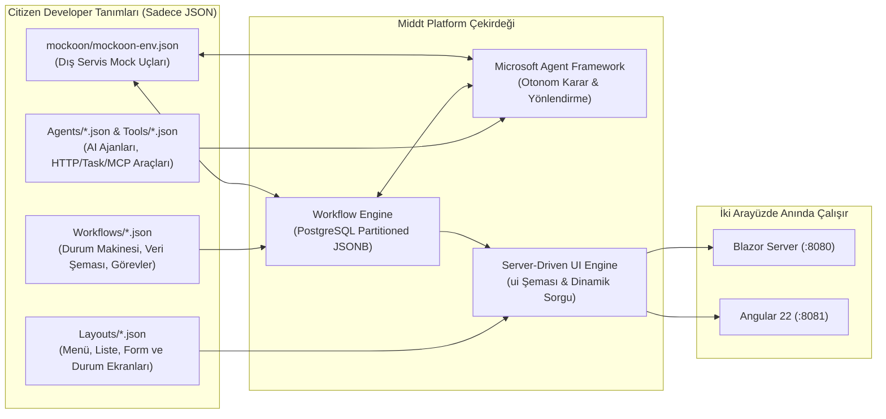

# Citizen Developer Rehberi – Middt Platform ile Kod Yazmadan (Zero-Code) Uygulama Geliştirme

Bu rehber, **Middt Platform** üzerinde C# veya TypeScript/HTML kodu yazmadan; yalnızca **JSON tanımları** ve çalışma zamanı **Ekran Tasarımı Editörü** kullanarak uçtan uca kurumsal uygulamaların (veri modeli, iş akışı motoru, iş kuralları, dış servis entegrasyonları, yapay zeka ajanları ve Blazor/Angular ekranları) nasıl geliştirileceğini adım adım anlatır.

---

## İçindekiler

1. [Mimari Genel Bakış: Citizen Developer Neleri Tanımlar?](#1-mimari-genel-bakış-citizen-developer-neleri-tanımlar)
2. [Proje Klasör Yapısı (Nereye Ne Eklenir?)](#2-proje-klasör-yapısı-nereye-ne-eklenir)
3. [Bölüm 1: İş Akışı Motoru (Workflow Engine) Kullanımı](#3-bölüm-1-iş-akışı-motoru-workflow-engine-kullanımı)
   - [3.1. Temel İş Akışı İskeleti ve Güvenlik](#31-temel-iş-akışı-iskeleti-ve-güvenlik)
   - [3.2. Veri Şeması, Otomatik İndeksleme ve Arama (`dataSchema`)](#32-veri-şeması-otomatik-indeksleme-ve-arama-dataschema)
   - [3.3. Başlangıç Formu ve Giriş Kuralları (`start`)](#33-başlangıç-formu-ve-giriş-kuralları-start)
   - [3.4. Durumlar (`states`), Sihirbaz Adımları ve Ekran Bağlama](#34-durumlar-states-sihirbaz-adımları-ve-ekran-bağlama)
   - [3.5. Geçişler (`transitions`) ve Tetikleyiciler (`trigger`)](#35-geçişler-transitions-ve-tetikleyiciler-trigger)
   - [3.6. Yerleşik Görevler (Built-in Tasks) ve Ayarları Referansı](#36-yerleşik-görevler-built-in-tasks-ve-ayarları-referansı)
     - [0. Tüm Görevlerde Ortak Ayarlar (`key`, `when`, `background`, `onError`)](#0-tüm-görevlerde-ortak-ayarlar-key-when-background-onerror)
     - [1. `set` — Veri Hesaplama ve Atama](#1-set--veri-hesaplama-ve-atama)
     - [2. `setKey` — İş Anahtarı (Business Key) Üretme](#2-setkey--iş-anahtarı-business-key-üretme)
     - [3. Akışlar Arası Veri Paylaşımı Görevleri (`loadWorkflow`, `queryWorkflow`, `updateWorkflow`, `triggerWorkflow`)](#3-akışlar-arası-veri-paylaşımı-görevleri-loadworkflow-queryworkflow-updateworkflow-triggerworkflow)
     - [4. `http` — Dış Servis Çağrısı](#4-http--dış-servis-çağrısı)
     - [5. `startWorkflow` — Yeni Bir Alt İş Akışı (Sub-Process) Başlatma](#5-startworkflow--yeni-bir-alt-iş-akışı-sub-process-başlatma)
     - [6. `fanOut` — Dizi Üzerinde Paralel Görev Çalıştırma](#6-fanout--dizi-üzerinde-paralel-görev-çalıştırma)
     - [7. `cache` — Önbellekleme (Cache-Aside)](#7-cache--önbellekleme-cache-aside)
     - [8. `publish` & `rabbitmq` — Mesaj Kuyruğuna Olay Yayınlama](#8-publish--rabbitmq--mesaj-kuyruğuna-olay-yayınlama)
     - [9. `operation` — Kayıtlı İş Operasyonu (`IWorkflowOperation`) Çalıştırma](#9-operation--kayıtlı-iş-operasyonu-iworkflowoperation-çalıştırma)
     - [10. `agent` / `aiAgent` — Yapay Zeka Ajanı Çalıştırma](#10-agent--aiagent--yapay-zeka-ajanı-çalıştırma)
     - [11. `mcp` — Model Context Protocol Sunucusu Çağrısı](#11-mcp--model-context-protocol-sunucusu-çağrısı)
     - [12. `log` — Yapılandırılmış Log Yazma](#12-log--yapılandırılmış-log-yazma)
4. [Bölüm 2: Yapay Zeka Ajanları (AI Agents), Araçlar (Tools) ve MCP](#4-bölüm-2-yapay-zeka-ajanları-ai-agents-araçlar-tools-ve-mcp)
   - [4.1. AI Ajanı Tanımlama (`Agents/*.json`)](#41-ai-ajanı-tanımlama-agentsjson)
   - [4.2. Kodsuz AI Araçları (`Agents/Tools/*.json`) — Expression, Task (`http`, `set`, `cache`) ve MCP](#42-kodsuz-ai-araçları-agentstoolsjson--expression-task-http-set-cache-ve-mcp)
   - [4.3. Akış İçinde Ajan Çağırma ve Otomatik Geçiş Kararı (`selectedTransition`)](#43-akış-içinde-ajan-çağırma-ve-otomatik-geçiş-kararı-selectedtransition)
5. [Bölüm 3: İfade Dili (Expression Language) Rehberi](#5-bölüm-3-ifade-dili-expression-language-rehberi)
6. [Bölüm 4: Sunucu Güdümlü Ekran Tasarımı (`Layouts/*.json`) ve Canlı Tasarımcılar](#6-bölüm-4-sunucu-güdümlü-ekran-tasarımı-layoutsjson)
   - [6.1. Ekran Bileşenleri (Widgets) Kataloğu](#61-ekran-bileşenleri-widgets-kataloğu)
   - [6.2. Canlı Ekran Tasarımı Editörü (`/ui-admin`)](#62-canlı-ekran-tasarımı-editörü-ui-admin)
   - [6.3. Görsel İş Akışı ve Görev Tasarımcısı (`/workflow-admin`)](#63-görsel-iş-akışı-ve-görev-tasarımcısı-workflow-admin)
7. [Bölüm 5: Dış Servis Simülasyonu (Mockoon) ve Başlangıç Verileri (Seeds)](#7-bölüm-5-dış-servis-simülasyonu-mockoon-ve-başlangıç-verileri-seeds)
8. [Bölüm 6: Uçtan Uca Örnek Proje — "Tedarikçi Satınalma Talebi" Modülü](#8-bölüm-6-uçtan-uca-örnek-proje--tedarikçi-satınalma-talebi-modülü)
9. [Kontrol Listesi ve Doğrulama Komutları](#9-kontrol-listesi-ve-doğrulama-komutları)

---

## 1. Mimari Genel Bakış: Citizen Developer Neleri Tanımlar?

Middt Platform'da veritabanı tablosu açmak, C# Entity/Controller yazmak veya Blazor/Angular sayfası kodlamak gerekmez. Platform tüm iş mantığını ve ekranları deklaratif JSON dosyalarından üretir:



Bir iş akışı (`Workflows/*.json`) tanımladığınızda platform otomatik olarak:
1. PostgreSQL'de o akışa özel bölümlenmiş (`wf."WorkflowInstances_<Akis>"`, `wf."WorkflowInstanceData_<Akis>"`, vb.) tabloları ve `dataSchema` içindeki alanlara göre arama indekslerini oluşturur.
2. `/api/workflows/<akis-anahtari>` ve `/api/v1/<PascalCaseAkisAdi>/getitems|getall|getbyid` REST uçlarını açar.
3. Hem Blazor (`/workflow/<akis-anahtari>`) hem Angular arayüzünde **Liste**, **Arama Filtreleri**, **Yeni Kayıt Başlatma Formu**, **Sihirbaz (Wizard) Adımları**, **Durum Görünümü**, **Aksiyon Butonları** ve **Geçmiş Zaman Çizelgesi** ekranlarını hazır hale getirir.

---

## 2. Proje Klasör Yapısı (Nereye Ne Eklenir?)

Citizen Developer olarak tüm geliştirmelerinizi `demo/Middt.Demo.Api` (veya kendi API projenizin) altındaki şu klasörlerde yaparsınız:

| Klasör / Dosya | Amacı |
|---|---|
| `demo/Middt.Demo.Api/Workflows/*.json` | İş akışı tanımları (durumlar, geçişler, formlar, görevler, veri şeması). |
| `demo/Middt.Demo.Api/Agents/*.json` | Yapay zeka ajanı tanımları (sistem talimatları, kullandığı araçlar, çıktı şeması). |
| `demo/Middt.Demo.Api/Agents/Tools/*.json` | AI ajanlarının çağırdığı kodsuz araçlar (`expression`, `http`, `task`, `mcp`). |
| `demo/Middt.Demo.Api/Agents/McpServers/*.json` | Model Context Protocol (MCP) sunucu tanımları, kaynakları ve şablonları. |
| `demo/Middt.Demo.Api/Layouts/*.json` | Sunucu güdümlü ekran tasarımları (`nav-menu.json`, durum görünümleri, özel sayfalar). |
| `demo/Middt.Demo.Api/Seeds/*.json` | Uygulama ilk kalktığında otomatik oluşturulacak örnek iş akışı kayıtları. |
| `demo/mockoon/mockoon-env.json` | `http` görevleri ve AI `http` araçları için Mockoon dış servis simülasyon uçları. |

---

## 3. Bölüm 1: İş Akışı Motoru (Workflow Engine) Kullanımı

### 3.1. Temel İş Akışı İskeleti ve Güvenlik

Her iş akışı `Workflows/` klasöründe bir `.json` dosyasıdır:

```json
{
  "key": "credit-allocation",
  "version": 1,
  "title": "Kredi Tahsis & 4-Göz Onay",
  "icon": "account_balance",
  "historyMode": "Full",
  "readRoles": ["manager"],
  "ownerField": "createdBy",
  "branchField": "branchCode",
  "timeout": {
    "duration": "24:00:00",
    "target": "expired"
  }
}
```

- **`key`**: Akışın benzersiz kimliği (`kebab-case`). URL'lerde (`/workflow/credit-allocation`) ve alt akış çağrılarında kullanılır.
- **`title` & `icon`**: Ekran başlığı ve Material ikon adı (`account_balance`, `verified_user`, `receipt_long`, `smart_toy`, vb.).
- **`historyMode`**: `"Full"` (varsayılan; her geçişte tüm veriyi tarihçeye yazar), `"Delta"` (sadece değişen alanların RFC 6902 farkını yazar) veya `"None"`.
- **Satır Bazlı Güvenlik (Row-Level Security)**:
  - `readRoles`: Tüm kayıtları görebilecek roller (ör. `["manager"]`).
  - `ownerField`: Kayıt sahibinin tutulduğu alan (ör. `"createdBy"`). Bu роle sahip olmayan kullanıcılar yalnızca kendi oluşturdukları kayıtları görebilir.
  - `branchField`: Şube bazlı izolasyon alanı.

---

### 3.2. Veri Şeması, Otomatik İndeksleme ve Arama (`dataSchema`)

`dataSchema`, iş akışının sakladığı iş verilerini (`instance.data`), liste ekranındaki sütunları, arama filtrelerini ve veri maskelemeyi tanımlar:

```json
"dataSchema": {
  "type": "object",
  "properties": {
    "customerName": {
      "type": "string",
      "title": "Müşteri Adı",
      "x-search": true
    },
    "identityNumber": {
      "type": "string",
      "title": "TCKN / VKN",
      "x-search": true,
      "x-mask": "last4",
      "x-DynamicMaskRoles": ["manager", "idp-admin"]
    },
    "segment": {
      "type": "string",
      "title": "Segment",
      "enum": ["Bireysel", "KOBİ", "Kurumsal"],
      "x-search": true
    },
    "amount": {
      "type": "number",
      "title": "Tutar (₺)",
      "x-search": true
    },
    "internalRiskNote": {
      "type": "string",
      "title": "İç Risk Notu",
      "x-roles": ["manager"]
    }
  }
}
```

- **`"x-search": true`**:
  - `string` alanlarda büyük/küçük harf duyarsız arama kutusu (veya `enum` ise açılır kutu) oluşturur.
  - `number` / `integer` alanlarda otomatik olarak **Min (≥)** ve **Max (≤)** aralık filtreleri oluşturur.
- **Alan Gizleme ve Maskeleme**:
  - `"x-mask": "last4"`: Yetkisiz kullanıcılara alanı `*******8901` şeklinde maskeler.
  - `"x-DynamicMaskRoles": ["manager"]`: Belirtilen rollere sahip kullanıcılara maskesiz tam değeri gösterir.
  - `"x-roles": ["manager"]`: Yetkisiz kullanıcılardan alanı tamamen gizler (API yanıtından çıkarır).
- **`"x-list": false`**: Alanın liste tablosunda sütun olarak görünmesini engeller, yalnızca detayda kullanılır.

---

### 3.3. Başlangıç Formu ve Giriş Kuralları (`start`)

Kullanıcı **"Yeni Başlat"** butonuna bastığında açılan form `start.input.schema` üzerinden otomatik üretilir:

```json
"start": {
  "key": "start",
  "target": "scoring",
  "input": {
    "rule": "input.collateralAmount >= input.amount * 0.5m",
    "ruleMessage": "Teminat tutarı kredi tutarının en az %50'si olmalıdır.",
    "schema": {
      "type": "object",
      "additionalProperties": false,
      "required": ["customerKey", "amount", "termMonths"],
      "properties": {
        "customerKey": {
          "type": "string",
          "title": "Müşteri",
          "x-lookup": {
            "entity": "CustomerOnboarding",
            "valueField": "key",
            "textField": "fullName"
          }
        },
        "amount": {
          "type": "number",
          "minimum": 1000,
          "maximum": 10000000,
          "title": "Talep Tutarı (₺)",
          "default": 250000
        },
        "termMonths": {
          "type": "integer",
          "title": "Vade (Ay)",
          "enum": [6, 12, 24, 36, 48],
          "default": 24
        },
        "notes": {
          "type": "string",
          "format": "textarea",
          "title": "Açıklama"
        }
      }
    }
  },
  "onExecute": [
    {
      "task": "set",
      "config": {
        "values": {
          "createdBy": "user.Name",
          "createdAt": "now"
        }
      }
    }
  ]
}
```

- **`x-lookup`**: Başka bir iş akışının aktif kayıtlarını açılır liste (Dropdown) olarak bağlar (`entity`: diğer akışın PascalCase adı, `valueField`: kaydedilecek alan, `textField`: gösterilecek metin).
- **`input.rule` & `input.ruleMessage`**: Form gönderildiğinde sunucu tarafında çalışan iş kuralı. Sağlanmazsa kullanıcıya `ruleMessage` gösterilir.
- **`input.sensitive`**: `["cardPin", "cvv"]` gibi tanımlanan alanlar yalnızca görev çalışırken bellekte kullanılır; veritabanına ve tarihçeye **asla** kaydedilmez.

---

### 3.4. Durumlar (`states`), Sihirbaz Adımları ve Ekran Bağlama

```json
{
  "key": "specialist-review",
  "title": "Uzman İncelemesi & AI Copilot",
  "type": "Intermediate",
  "subType": "Human",
  "step": 2,
  "view": {
    "layout": "ai-dispute-detail"
  },
  "onEntry": [ ... ],
  "onExit": [ ... ],
  "transitions": [ ... ]
}
```

- **`type`**:
  - `"Intermediate"`: Ara durum.
  - `"SubFlow"`: Alt iş akışı (`subFlow.workflow`) tamamlanana kadar bekleyen durum.
  - `"Finish"`: Bitiş durumu (akış tamamlanır veya iptal olur).
- **`subType`**:
  - `"Human"`: Kullanıcı aksiyonu bekler.
  - `"Success"` / `"Error"` / `"Cancelled"` / `"Timeout"`: Bitiş durumunun rengini ve statüsünü belirler.
- **`step`**: `1, 2, 3...` verildiğinde ekranın üst kısmında otomatik olarak **Sihirbaz (Wizard) Adım Çubuğu** gösterilir.
- **`view.layout`**: Bu durumda hangi JSON ekran tasarımının (`Layouts/<key>.json`) gösterileceğini belirler.

---

### 3.5. Geçişler (`transitions`) ve Tetikleyiciler (`trigger`)

Bir durumdan diğerine (veya `"$self"` ile aynı durumun kendisine) geçişler 4 farklı şekilde tetiklenebilir:

| `trigger` | Açıklama | Önemli Alanlar |
|---|---|---|
| `"Manual"` (Varsayılan) | Kullanıcının ekranda gördüğü aksiyon butonlarıdır. | `title`, `description`, `style` (`primary`, `success`, `warning`, `danger`, `secondary`, `light`), `icon`, `roles`, `inline` (`true` ise popup yerine sayfa içinde form açar), `rule` (butonun görünme koşulu). |
| `"Automatic"` | `onEntry` görevleri biter bitmez motor tarafından otomatik değerlendirilir. | `rule` (koşul ifadesi; ör. `"data.amount <= 5000"` veya `"instance.agents.aiUnderwriter.selectedTransition == \"to-approved\""`), `default: true` (hiçbir kural tutmazsa seçilecek geçiş). |
| `"Scheduled"` | Belirtilen süre sonunda arka plan zamanlayıcısı ile tetiklenir (SLA / Hatırlatma). | `after`: `"00:15:00"` veya dinamik `"{{ data.slaDuration }}"`. |
| `"Event"` | Dış sistemden veya başka akıştan mesaj geldiğinde tetiklenir. | `event`: `"payment.received"`, `rule`: `"input.amount > 0"`. |

**4-Göz (Four-Eyes) Onay Kuralı Örneği**:
Bir önceki adımı onaylayan kişinin ikinci adımı onaylayamaması için:
```json
{
  "key": "approve-stage2-four-eyes",
  "title": "2. Kademe Onay (4-Göz)",
  "target": "disbursed",
  "roles": ["manager"],
  "rule": "user.Id != instance.previousUser"
}
```

**Aynı Durumda Veri Güncelleme (`target: "$self"`)**:
Durumu değiştirmeden not eklemek, SLA uzatmak veya AI ajanını yeniden çalıştırmak için `"target": "$self"` kullanılır. `"reenter": true` verilirse durumun `onEntry` görevleri ve zamanlayıcıları yeniden çalıştırılır.

---

### 3.6. Yerleşik Görevler (Built-in Tasks) ve Ayarları Referansı

Görevler `start.onExecute`, `state.onEntry`, `state.onExit` veya `transition.onExecute` dizilerinde tanımlanır. Her görev bloğu; tüm görevlerde geçerli **ortak üst düzey ayarlar** (`key`, `when`, `background`, `onError`) ve göreve özel **`config`** ayarlarından oluşur.

#### 0. Tüm Görevlerde Ortak Ayarlar (`key`, `when`, `background`, `onError`)

| Ayar | Tip | Alabileceği Değerler / Açıklama |
|---|---|---|
| `task` | `string` | Çalıştırılacak görevin adı (`set`, `setKey`, `loadWorkflow`, `queryWorkflow`, `updateWorkflow`, `triggerWorkflow`, `http`, `startWorkflow`, `fanOut`, `cache`, `publish`, `rabbitmq`, `operation`, `agent`, `mcp`, `log`). |
| `key` | `string` | Görevin benzersiz adım anahtarı. Tarihçede (`History`), hata kayıtlarında (`Incidents`) ve AI ajan çıktılarında (`instance.agents.<key>`) bu anahtar görünür. Belirtilmezse `task` adı kullanılır. |
| `when` | `string` | C# mantıksal koşul ifadesi (`"data.amount >= 100000"`). Koşul `false` dönerse görev **atlanır (skip)**. |
| `background` | `boolean` | `false` (varsayılan) \| `true`. Yalnızca durumların `onEntry` dizisinde kullanılır (`Finish` veya `SubFlow` durumlarında ve `setKey` görevinde kullanılamaz). `true` olduğunda durum geçişi hemen kaydedilir, görev arka planda (`WorkflowJobProcessor`) asenkron çalıştırılır. |
| `onError.action` | `string` | Görev tüm tekrar denemelerden (`maxAttempts`) sonra yine hata verirse ne yapılacağını belirler:<br>• **`"Fault"`** *(varsayılan)*: Akışı `Faulted` durumuna alır ve `WorkflowIncidents` tablosuna hata kaydı açar (UI/API üzerinden `retry` edilebilir).<br>• **`"Transition"`**: Akışı hata durumunda `onError.transition` alanında belirtilen geçişe yönlendirir (alternatif/telafi yoluna sokar).<br>• **`"Continue"`**: Hatayı incident olarak kaydeder fakat akışı durdurmadan sıradaki göreve devam eder. |
| `onError.transition` | `string` | `onError.action: "Transition"` seçildiğinde tetiklenecek geçişin `key` adı (ör. `"gateway-fallback"`). |
| `onError.maxAttempts` | `number` | Toplam deneme sayısı (`1` = tekrar deneme yapma, `3` = ilk deneme + 2 tekrar). |
| `onError.delay` | `string` | İlk tekrar deneme öncesi bekleme süresi (`"00:00:01"` veya ISO 8601 `"PT2S"`). |
| `onError.backoffMultiplier` | `number` | Her başarısız denemede bekleme süresinin çarpılacağı üstel katsayı (varsayılan `2.0`; ör. 1s -> 2s -> 4s). |
| `onError.maxDelay` | `string` | Üstel bekleme süresinin çıkabileceği üst sınır (`"00:00:30"`). |
| `onError.useJitter` | `boolean` | `false` (varsayılan) \| `true`. Aynı anda hata alan yüzlerce akışın dış servisi aynı saniyede tekrar vurmasını (thundering herd) önlemek için bekleme süresine `±%20` rastgele sapma ekler. |
| `onError.retryOnStatusCodes` | `string[]` | Yalnızca belirtilen HTTP durum kodlarında tekrar deneme yapar. Tam kod (`"408"`, `"429"`), grup (`"5xx"`) veya hariç tutma (`"!400"`) destekler. |

**Ortak Ayarlar (`when`, `background`, `onError`) JSON Örnekleri:**

```json
// Örnek A: Koşullu (when), arka planda (background) ve hata durumunda alternatif geçişe (Transition) yönlendiren görev
{
  "key": "send-erp-order",
  "task": "http",
  "when": "data.amount >= 50000 && data.requiresErpSync == true",
  "background": true,
  "onError": {
    "maxAttempts": 3,
    "delay": "00:00:02",
    "backoffMultiplier": 2.0,
    "maxDelay": "00:00:30",
    "useJitter": true,
    "retryOnStatusCodes": ["408", "429", "5xx"],
    "action": "Transition",
    "transition": "erp-manual-fallback"
  },
  "config": {
    "method": "POST",
    "url": "http://mockoon:3000/api/v1/erp/orders",
    "body": { "orderCode": "{{ data.orderCode }}" }
  }
}
```
```json
// Örnek B: Hata olsa bile akışı durdurmadan devam eden (Continue) görev
{
  "key": "optional-crm-notify",
  "task": "http",
  "onError": {
    "maxAttempts": 2,
    "delay": "00:00:01",
    "action": "Continue"
  },
  "config": {
    "method": "POST",
    "url": "http://mockoon:3000/api/v1/crm/notify",
    "body": { "customerKey": "{{ data.customerKey }}" }
  }
}
```

---

#### 1. `set` — Veri Hesaplama ve Atama
```json
{
  "task": "set",
  "config": {
    "values": {
      "ltvRatio": "data.collateralAmount > 0 ? Math.Round((data.amount * 100m) / data.collateralAmount, 2) : 100m",
      "statusNote": "\"Onaylayan: \" + user.Name",
      "approvedAt": "now"
    }
  }
}
```
| `config` Ayarı | Tip | Alabileceği Değerler / Açıklama |
|---|---|---|
| `values` | `object` | `{ "hedefAlanYolu": "C# İfadesi" }` çiftlerinden oluşur. Noktalı yol (`"risk.score"`) verilirse iç içe JSON nesnesi oluşturur. |

---

#### 2. `setKey` — İş Anahtarı (Business Key) Üretme
```json
{
  "task": "setKey",
  "config": {
    "key": "CUST-{{ data.identityNumber }}",
    "ensureUnique": true
  }
}
```
| `config` Ayarı | Tip | Alabileceği Değerler / Açıklama |
|---|---|---|
| `key` | `string` | Kayda atanacak iş anahtarı şablonu (maksimum 256 karakter). Aynı anahtarla akış tekrar başlatılmak istenirse yeni kayıt açılmaz, mevcut kayıt döner (idempotent). |
| `ensureUnique` | `boolean` | `false` (varsayılan) \| `true`:<br>• **`false`**: Aynı iş anahtarı başka bir kayıtta varsa görev hata fırlatır.<br>• **`true`**: Aynı iş anahtarı başka bir kayıtta zaten varsa çakışmayı önlemek için anahtarın sonuna otomatik olarak `-<6HaneliInstanceId>` (ör. `CUST-12345678901-4A9F1C`) ekler; kaydın zaten bir anahtarı varsa dokunmaz. |

---

#### 3. Akışlar Arası Veri Paylaşımı Görevleri (`loadWorkflow`, `queryWorkflow`, `updateWorkflow`, `triggerWorkflow`)

Middt Platform'da farklı iş akışları birbirinin verisini okuyabilir, filtreleyip özet (toplam/ortalama/adet) çıkarabilir, başka bir akışın verisini güncelleyebilir veya diğer akışta geçiş/olay (`event`) tetikleyebilir.
Tüm akışlar arası görevlerde hedef kayıt(lar) şu seçicilerle belirlenir:

| Ortak Hedef Seçici | Tip | Alabileceği Değerler / Açıklama |
|---|---|---|
| `workflow` | `string` | *(Zorunlu)* Hedef iş akışının anahtarı (ör. `"customer-onboarding"`, `"credit-allocation"`). |
| `id` | `string` | Hedef kaydın benzersiz `Guid` kimliği (`"{{ data.customerInstanceId }}"`). |
| `key` | `string` | Hedef kaydın `BusinessKey` değeri (`"{{ data.customerKey }}"`). |
| `where` | `string` | Hedef akışın **Instance Data (`WorkflowInstanceData`)** alanları üzerinde tek bir birleşik C# koşul ifadesi (`"target.taxNumber == data.taxNumber && target.segment == \"Corporate\""`). Motor, `where` içindeki eşitlik ve büyüktür/küçüktür koşullarını otomatik olarak PostgreSQL bölüm (partition) indekslerine indirger ve kalan ifadeyi JSON verisi üzerinde çalıştırır. |
| `state` | `string` | Yalnızca belirli bir durumda olan kayıtları filtreler (ör. `"approved"`, `"waiting-payment"`). |
| `status` | `string` | Yalnızca belirli yaşam döngüsü statüsündeki kayıtları filtreler:<br>• **`"Active"`**: Devam eden akışlar<br>• **`"Completed"`**: Tamamlanmış (`Finish`) akışlar<br>• **`"Cancelled"`**: İptal edilmiş akışlar<br>• **`"Faulted"`**: Hataya düşmüş akışlar |

##### 3a. `loadWorkflow` (veya `getWorkflow`) — Tekil Akış Kaydı ve AI Çıktılarını Okuma
Başka bir iş akışı kaydını `key`, `id` veya `where` (instance data filtresi) ile bulur; seçilen alanları (`select`), varsa AI ajanı çıktılarını (`includeAgents: true`) ve geçiş tarihçesini (`includeHistory: true`) mevcut akışın içerisine yükler:

```json
{
  "task": "loadWorkflow",
  "config": {
    "workflow": "customer-onboarding",
    "where": "target.identityNumber == data.identityNumber",
    "includeAgents": true,
    "includeHistory": true,
    "failIfNotFound": false,
    "select": {
      "companyName": "companyName",
      "creditScore": "creditScore",
      "availableLimit": "(target.approvedLimit ?? 0) - (target.usedLimit ?? 0)",
      "kycAiSummary": "agents.kycRiskAgent.summary"
    },
    "into": "customer"
  }
}
```
| `loadWorkflow` Ayarı | Tip | Alabileceği Değerler / Açıklama |
|---|---|---|
| `select` | `string[]` veya `object` | • **Belirtilmezse**: Hedef kaydın tüm `data` alanlarını ve üst verilerini (`id`, `key`, `state`, `status`, `found`) kopyalar.<br>• **Dizi (`["companyName", "creditScore"]`)**: Yalnızca listedeki alanları ve üst verileri kopyalar.<br>• **Nesne (`{ "hedefAlan": "ifade" }`)**: Hedef akışın verisi (`target.*`) ve mevcut akışın verisi (`data.*`) üzerinden C# ifadesi hesaplayarak alanı dönüştürür. |
| `includeAgents` | `boolean` | `false` (varsayılan) \| `true`. `true` ise hedef akışta çalışmış AI ajanlarının çıktılarını `target.agents.<ajanKey>` ve `target.agentRuns` altında getirir. |
| `includeHistory` | `boolean` | `false` (varsayılan) \| `true`. `true` ise hedef akışın durum geçiş tarihçesini `target.history` dizisi olarak getirir. |
| `failIfNotFound` | `boolean` | `false` (varsayılan) \| `true`:<br>• **`false`**: Kayıt bulunamazsa akışı durdurmaz; `into` içerisine `{ "found": false, "state": null, "status": null }` yazar.<br>• **`true`**: Kayıt bulunamazsa `WorkflowTaskException` fırlatır (`onError` politikasını tetikler). |
| `into` | `string` | Sonucun `data` içinde yazılacağı alan yolu (ör. `"customer"`). `select` nesne olarak verilmiş ve `into` boş bırakılmışsa alanlar doğrudan `data` kök nesnesine yazılır. |

##### 3b. `queryWorkflow` (veya `searchWorkflow` / `findWorkflow`) — Çoklu Akış Sorgulama, Filtreleme ve Toplama (`aggregate`)
Başka bir akışın (veya aynı akışın geçmiş kayıtlarının) birden fazla kaydını tek bir **`where`** koşuluyla (PostgreSQL partition indekslerini otomatik kullanarak) sorgular, sıralar ve `sum`, `avg`, `min`, `max`, `count` toplamalarını hesaplar:

```json
{
  "task": "queryWorkflow",
  "config": {
    "workflow": "credit-allocation",
    "state": "approved",
    "excludeSelf": true,
    "where": "target.customerKey == data.customerKey && target.amount >= 50000 && target.termMonths >= 12",
    "orderBy": "amount",
    "descending": true,
    "take": 20,
    "select": ["id", "key", "amount", "termMonths", "state", "createdAt"],
    "aggregate": {
      "totalExposure": { "op": "sum", "field": "amount" },
      "maxLoanAmount": { "op": "max", "field": "amount" },
      "avgLoanAmount": "avg:amount",
      "activeLoanCount": "count"
    },
    "into": "customerLoanSummary"
  }
}
```
| `queryWorkflow` Ayarı | Tip | Alabileceği Değerler / Açıklama |
|---|---|---|
| `excludeSelf` *(veya `excludeCurrent`)* | `boolean` | `false` (varsayılan) \| `true`. Aynı akış (`workflow == instance.workflow`) sorgulanırken, şu an çalışmakta olan kaydın kendisini sonuçlardan ve toplamalardan (`sum`/`count`) hariç tutar. |
| `orderBy` | `string` | Sıralama alanı: `"createdAt"` (varsayılan), `"updatedAt"`, `"key"`, `"state"`, `"status"` veya hedef kaydın `data` içindeki herhangi bir alanı (ör. `"amount"`). |
| `descending` | `boolean` | `true` (varsayılan: azalan / en yeniden eskiye) \| `false` (artan). |
| `take` *(veya `limit`)* | `number` | Getirilecek maksimum kayıt sayısı (`1` ile `500` arası, varsayılan `50`). |
| `first` | `boolean` | `false` (varsayılan) \| `true`. `true` verilirse `into` alanına liste özeti yerine doğrudan **eşleşen ilk kaydın nesnesi** (bulunamazsa `{ "found": false }`) yazılır. |
| `select` | `string[]` veya `object` | Her bir kayıt için hangi alanların seçileceğini veya dönüştürüleceğini belirler. |
| `aggregate` | `object` | Eşleşen kayıtlar üzerinde toplama hesaplar. İki yazım biçimini destekler:<br>1. Nesne: `{ "op": "sum", "field": "amount" }`<br>2. Kısa metin: `"sum:amount"`, `"avg:amount"`, `"min:amount"`, `"max:amount"`, `"count"`<br>**Desteklenen `op` değerleri**:<br>• **`"count"`**: Kayıt adedi (veya `field` verilirse o alanı dolu olanların adedi)<br>• **`"sum"`**: Sayısal alanın toplamı<br>• **`"avg"`**: Sayısal alanın ortalaması<br>• **`"min"`**: En küçük değer<br>• **`"max"`**: En büyük değer |
| `into` | `string` | *(Zorunlu)* Sonucun yazılacağı alan. İçerisine `{ count, exists, items, first, aggregates, <toplamaAlanlari> }` nesnesi yazılır. |

##### 3c. `updateWorkflow` (veya `patchWorkflow` / `setWorkflowData`) — Başka Bir Akışın Verisini Güncelleme
Mevcut akış içerisinden başka bir akış kaydını (veya `"all": true` ile eşleşen tüm kayıtları) `key`, `id` ya da **`where`** (instance data koşulu) ile bulup `values` ifadeleriyle, `merge` şablonuyla veya RFC 6902 `patch` dizisiyle güvenli biçimde günceller ve versiyonunu (`DataVersion`) artırır:

```json
// Örnek 1: Tekil kaydı (all: false) Instance Data (where) ile bulup C# ifadeleriyle (values) güncelleme
{
  "task": "updateWorkflow",
  "config": {
    "workflow": "customer-onboarding",
    "where": "target.customerNumber == data.customerNumber && target.segment == \"Corporate\"",
    "all": false,
    "values": {
      "usedLimit": "(target.usedLimit ?? 0) + data.amount",
      "lastAllocationKey": "instance.key",
      "lastAllocationAt": "now"
    },
    "into": "updatedCustomer"
  }
}
```
```json
// Örnek 2: Eşleşen TÜM kayıtları (all: true) topluca güncelleme
{
  "task": "updateWorkflow",
  "config": {
    "workflow": "invoice-collection",
    "state": "waiting-payment",
    "where": "target.customerKey == data.customerKey && target.remainingAmount <= 5000",
    "all": true,
    "values": {
      "discountApplied": "true",
      "remainingAmount": "Math.Round(target.remainingAmount * 0.90m, 2)"
    },
    "into": "bulkDiscountResult"
  }
}
```
```json
// Örnek 3: JSON şablonu birleştirme (merge) veya RFC 6902 JSON Patch (patch) ile güncelleme
{
  "task": "updateWorkflow",
  "config": {
    "workflow": "customer-onboarding",
    "key": "{{ data.customerKey }}",
    "merge": {
      "contact": {
        "email": "{{ data.newEmail }}",
        "phone": "{{ data.newPhone }}"
      }
    },
    "patch": [
      { "op": "replace", "path": "/riskSegment", "value": "{{ data.calculatedSegment }}" }
    ],
    "validateSchema": true,
    "into": "patchedCustomer"
  }
}
```
| `updateWorkflow` Ayarı | Tip | Alabileceği Değerler / Açıklama |
|---|---|---|
| `all` | `boolean` | `false` (varsayılan) \| `true`:<br>• **`false`**: `where` koşuluyla eşleşen **en güncel tek kaydı** günceller.<br>• **`true`**: `where` koşulunu sağlayan **tüm aktif/eşleşen kayıtları** tek seferde günceller ve `into` içerisine `{ "updatedCount": N, "items": [...] }` yazar. |
| `values` | `object` | `{ "hedefAlan": "C# İfadesi" }`. İfade içinde **`target`** (güncellenen karşı akışın mevcut verisi) ve **`data`** (içinde bulunduğumuz akışın verisi) birlikte kullanılabilir. |
| `merge` *(veya `data`)* | `object` | `{{ }}` şablonları içeren JSON nesnesi; hedef akışın verisiyle derinlemesine birleştirilir (deep-merge). |
| `patch` | `array` | RFC 6902 JSON Patch operasyon dizisi (`[{ "op": "replace", "path": "/limit", "value": "{{ data.newLimit }}" }]`). |
| `targetInto` | `string` | `merge` ile gönderilen nesnenin hedef kaydın kök verisi yerine belirli bir alt alanına (ör. `"paymentSummary"`) yazılmasını sağlar. |
| `validateSchema` | `boolean` | `false` (varsayılan) \| `true`. `true` ise güncelleme sonrası hedef akışın `dataSchema` kurallarını yeniden doğrular. |
| `failIfNotFound` | `boolean` | `true` (varsayılan) \| `false`. Hedef kayıt bulunamazsa hata fırlatılıp fırlatılmayacağını belirler. |
| `into` | `string` | Güncelleme sonucunun (`{ updated, id, key, state, status, dataVersion, data }`) yazılacağı alan. |

##### 3d. `triggerWorkflow` (veya `transitionWorkflow` / `sendWorkflowEvent`) — Başka Bir Akışta Geçiş veya Olay Tetikleme
Başka bir akış kaydını `key`, `id` veya **`where`** (instance data koşulu) ile bulup doğrudan bir geçişi (`transition`) çalıştırır veya o akışa bir olay mesajı (`event`) gönderir:

```json
// Örnek 1: Hedef akışa olay mesajı (event) gönderme ve hazır değilse 5 dakika kuyrukta bekletme (bufferFor)
{
  "task": "triggerWorkflow",
  "config": {
    "workflow": "order-payment-orchestration",
    "where": "target.orderCode == data.orderCode",
    "event": "PaymentCaptured",
    "bufferFor": "00:05:00",
    "all": false,
    "input": {
      "paymentReference": "{{ data.paymentId }}",
      "paidAmount": "{{ data.amount }}"
    },
    "into": "orderStateAfterPayment"
  }
}
```
```json
// Örnek 2: Hedef akışta doğrudan geçiş (transition) tetikleme (senkron veya runAsync: true ile asenkron)
{
  "task": "triggerWorkflow",
  "config": {
    "workflow": "credit-allocation",
    "key": "{{ data.allocationKey }}",
    "transition": "approve-stage1",
    "runAsync": false,
    "input": {
      "approvalNote": "Üst akış tarafından otomatik onaylandı."
    },
    "into": "allocationTransitionResult"
  }
}
```
| `triggerWorkflow` Ayarı | Tip | Alabileceği Değerler / Açıklama |
|---|---|---|
| `transition` | `string` | Hedef akışta doğrudan tetiklenecek geçişin anahtarı (ör. `"approve"`, `"cancel"`). `event` ile birlikte kullanılmaz. |
| `event` | `string` | Hedef akışta `"trigger": "Event"` olan geçişe gönderilecek olay adı (ör. `"PaymentCaptured"`). |
| `bufferFor` | `string` | Yalnızca `event` modunda geçerlidir (`"00:05:00"` veya `"PT5M"`). Hedef akış o anda başka bir işlemle meşgulse veya **henüz o olayı bekleyen duruma (`state`) gelmemişse**, mesajı çöpe atmak yerine belirtilen süre boyunca `WorkflowMessageBuffers` tablosunda bekletir; hedef akış ilgili duruma girdiği anda mesaj otomatik işlenir. |
| `runAsync` | `boolean` | `false` (varsayılan) \| `true`. Yalnızca `transition` modunda geçerlidir:<br>• **`false`**: Geçişi anında senkron çalıştırır ve yeni durumu `into` alanına yazar.<br>• **`true`**: Geçişi arka plan işi (`WorkflowJobs`) olarak kuyruğa alır ve mevcut akışı bekletmeden devam eder (`into` içinde `"queued": true` döner). |
| `all` | `boolean` | `false` (varsayılan) \| `true`. `where` kullanıldığında eşleşen **tüm** kayıtlarda geçişi/olayı tetikler. |
| `input` *(veya `data`)* | `object` | Hedef geçişe veya olaya gönderilecek girdi verisi (`input`). |
| `failIfNotFound` | `boolean` | `true` (varsayılan) \| `false`. Hedef kayıt bulunamazsa hata fırlatılıp fırlatılmayacağını belirler. |
| `into` | `string` | Tetikleme sonucunun (`{ triggered, id, key, state, status, data }`) yazılacağı alan. |

---

#### 4. `http` — Dış Servis Çağrısı
> [!IMPORTANT]
> `http` görevlerinde her zaman `http://` veya `https://` ile başlayan **tam (absolute) URL** kullanılmalıdır. Güvenlik (SSRF koruması) gereği URL'nin `host` (alan adı) kısmında `{{ }}` şablonu kullanılamaz; şablonlar yalnızca yol (path) ve `queryParams` içinde kullanılabilir.

```json
{
  "key": "charge-http",
  "task": "http",
  "onError": {
    "maxAttempts": 3,
    "delay": "00:00:01",
    "backoffMultiplier": 2.0,
    "retryOnStatusCodes": ["408", "429", "5xx"],
    "action": "Transition",
    "transition": "gateway-fallback"
  },
  "config": {
    "method": "POST",
    "url": "http://mockoon:3000/api/v1/OrderPaymentOrchestration/ping",
    "queryParams": {
      "channel": "web"
    },
    "headers": {
      "X-Channel": "Middt-Workflow"
    },
    "body": {
      "orderCode": "{{ data.orderCode }}",
      "amount": "{{ data.amount }}"
    },
    "acceptedStatusCodes": [200, 201],
    "failOnError": true,
    "timeoutSeconds": 30,
    "into": "gatewayResponse"
  }
}
```
| `http` Ayarı | Tip | Alabileceği Değerler / Açıklama |
|---|---|---|
| `url` | `string` | *(Zorunlu)* `http://` veya `https://` ile başlayan tam URL. |
| `method` | `string` | `"GET"` (varsayılan), `"POST"`, `"PUT"`, `"PATCH"`, `"DELETE"`. |
| `queryParams` *(veya `query`)* | `object` | URL sonuna güvenli (`Uri.EscapeDataString`) olarak eklenecek sorgu parametreleri. |
| `headers` | `object` | İsteğe eklenecek HTTP başlıkları (`{{ }}` şablonu destekler). |
| `body` | `any` | Gönderilecek JSON gövdesi veya metin (`{{ }}` şablonu destekler). |
| `contentType` | `string` | Gövde içerik tipi (varsayılan `"application/json"`). |
| `acceptedStatusCodes` | `number[]` veya `string[]` | Başarılı kabul edilecek HTTP durum kodları (ör. `[200, 201, 404]` veya `["2xx", "404"]`). Belirtilmezse tüm `2xx` kodları başarılı sayılır. |
| `failOnError` | `boolean` | `true` (varsayılan) \| `false`:<br>• **`true`**: Kabul edilmeyen durum kodlarında veya ağ hatalarında `WorkflowTaskException` fırlatır (`onError` devreye girer).<br>• **`false`**: Hata fırlatmaz; akışı kesmeden `into` içerisine `{ "statusCode": 503, "isSuccess": false, "error": "...", "body": ... }` yazar. |
| `timeoutSeconds` | `number` | İstek zaman aşımı süresi (saniye, varsayılan `30`, üst sınır `300`). |
| `into` | `string` | Yanıtın (`{ statusCode, isSuccess, headers, body }` ve üst düzeyde gövde alanlarının) yazılacağı alan yolu. |

---

#### 5. `startWorkflow` — Yeni Bir Alt İş Akışı (Sub-Process) Başlatma
Başka bir iş akışını yeni bir kayıt olarak başlatır ve oluşan kaydın `id` değerini `into` alanına yazar:
```json
{
  "key": "start-shipping-flow",
  "task": "startWorkflow",
  "config": {
    "workflow": "order-payment-orchestration",
    "key": "ORD-{{ data.orderCode }}",
    "data": {
      "orderCode": "{{ data.orderCode }}",
      "customerKey": "{{ data.customerKey }}",
      "amount": "{{ data.amount }}"
    },
    "into": "spawnedOrderInstanceId"
  }
}
```
| `startWorkflow` Ayarı | Tip | Alabileceği Değerler / Açıklama |
|---|---|---|
| `workflow` | `string` | *(Zorunlu)* Başlatılacak akışın anahtarı. |
| `key` | `string` | Yeni kayda verilecek `BusinessKey` şablonu (aynı anahtarla kayıt zaten varsa mevcut kaydın `id` değerini döndürür). |
| `data` | `object` | Yeni akışa başlangıç verisi (`input`) olarak gönderilecek JSON şablonu. |
| `into` | `string` | Başlatılan akış kaydının `Guid` (`id`) değerinin yazılacağı alan. |

---

#### 6. `fanOut` — Dizi Üzerinde Paralel Görev Çalıştırma
Bir dizi (`items`) içindeki her eleman için `subTask` görevini izole bir kopya üzerinde paralel çalıştırır ve tüm sonuçları `into` dizisinde toplar:
```json
{
  "key": "parallel-risk-checks",
  "task": "fanOut",
  "config": {
    "items": "new string[] { \"Fraud Kontrolü\", \"Stok Kontrolü\", \"Limit Kontrolü\" }",
    "maxConcurrency": 3,
    "into": "parallelChecks",
    "subTask": {
      "task": "startWorkflow",
      "when": "item.value != null",
      "config": {
        "workflow": "risk-limit-eval",
        "data": {
          "checkType": "{{ item.value }}",
          "checkIndex": "{{ index }}",
          "amount": "{{ data.amount }}"
        },
        "into": "checkResult"
      }
    }
  }
}
```
| `fanOut` Ayarı | Tip | Alabileceği Değerler / Açıklama |
|---|---|---|
| `items` | `string` | *(Zorunlu)* Üzerinde dönülecek diziyi üreten C# ifadesi (`"data.orderLines"` veya `"new string[] { \"A\", \"B\" }"`). Alt görev (`subTask`) içinde dizinin o anki elemanına **`item`** (ilkel metin/sayı dizilerinde `item.value`), 0 tabanlı sırasına **`index`** değişkeni ile erişilir. |
| `maxConcurrency` | `number` | Aynı anda paralel çalışacak maksimum alt görev sayısı (varsayılan `5`, üst sınır `64`). |
| `subTask` *(veya `task` / `innerTask`)* | `TaskDefinition` | *(Zorunlu)* Her eleman için çalıştırılacak görev tanımı. `subTask.when` kullanılarak belirli dizi elemanları filtrelenebilir. |
| `into` | `string` | Tüm paralel alt görevlerin ürettiği çıktıların sırasıyla `JsonArray` olarak yazılacağı alan. |

---

#### 7. `cache` — Önbellekleme (Cache-Aside)
Önce `key` ile dağıtık önbelleği (`IDistributedCache` / `IMemoryCache`) kontrol eder; veri önbellekte varsa `subTask` görevini **hiç çalıştırmadan** doğrudan `into` alanına yazar, yoksa `subTask` görevini çalıştırıp ürettiği sonucu `ttl` süresi boyunca önbelleğe kaydeder:
```json
{
  "key": "cache-payment-receipt",
  "task": "cache",
  "config": {
    "key": "payment:{{ data.orderCode }}",
    "ttl": "00:20:00",
    "into": "paymentReceipt",
    "subTask": {
      "task": "set",
      "config": {
        "values": {
          "paymentReceipt": "data.gatewayResponse.body.referenceCode"
        }
      }
    }
  }
}
```
| `cache` Ayarı | Tip | Alabileceği Değerler / Açıklama |
|---|---|---|
| `key` | `string` | *(Zorunlu)* Önbellek anahtarı şablonu (ör. `"fx:{{ data.currency }}"`). Sistemde `middt:wf:cache:<key>` önekiyle saklanır. |
| `ttl` | `string` | Önbellekte tutulma süresi (`"00:15:00"` veya ISO 8601 `"PT15M"`, varsayılan `"PT5M"` / 5 dakika). |
| `into` | `string` | *(Zorunlu)* Önbellekten okunan veya `subTask` tarafından `into` yoluna üretilen verinin yazılacağı alan yolu. |
| `subTask` *(veya `task` / `innerTask`)* | `TaskDefinition` | *(Zorunlu)* Önbellekte veri bulunamadığında (cache miss) çalıştırılacak görev (`http`, `loadWorkflow`, `queryWorkflow`, `set` vb.). |

---

#### 8. `publish` & `rabbitmq` — Mesaj Kuyruğuna Olay Yayınlama
```json
{
  "key": "publish-domain-event",
  "task": "publish",
  "config": {
    "type": "OrderPaymentCaptured",
    "payload": {
      "orderCode": "{{ data.orderCode }}",
      "amount": "{{ data.amount }}"
    }
  }
}
```
```json
{
  "key": "publish-rabbitmq-topic",
  "task": "rabbitmq",
  "config": {
    "exchange": "banking.events",
    "routingKey": "credit.approved.{{ data.segment }}",
    "headers": {
      "X-Workflow-Instance": "{{ instance.id }}"
    },
    "payload": {
      "customerKey": "{{ data.customerKey }}",
      "amount": "{{ data.amount }}"
    },
    "into": "rabbitPublishResult"
  }
}
```
| Görev & Ayar | Tip | Alabileceği Değerler / Açıklama |
|---|---|---|
| `publish.type` | `string` | *(Zorunlu)* `IWorkflowMessagePublisher` (Rebus) üzerinden yayınlanacak olay tipi. Diğer akışlardaki `"trigger": "Event"` geçişlerini tetiklemek için kullanılır. |
| `publish.payload` | `object` | Olay gövdesi (`workflow` ve `instanceId` alanları otomatik eklenir). |
| `rabbitmq.routingKey` *(veya `queue` / `topic`)* | `string` | *(Zorunlu)* Mesajın yönlendirileceği RabbitMQ kuyruk veya routing anahtarı (`{{ }}` şablonu destekler). |
| `rabbitmq.exchange` | `string` | RabbitMQ exchange adı (varsayılan `"middt.workflow.events"`). |
| `rabbitmq.headers` | `object` | Mesaj üst bilgileri (`x-workflow`, `x-instance-id`, `x-routing-key` otomatik eklenir). |
| `rabbitmq.payload` *(veya `body` / `message`)* | `any` | Gönderilecek JSON mesaj gövdesi. |
| `rabbitmq.into` | `string` | Yayınlama onay bilgisinin (`{ published: true, exchange, routingKey, publishedAt }`) yazılacağı alan. |

---

#### 9. `operation` — Kayıtlı İş Operasyonu (`IWorkflowOperation`) Çalıştırma
```json
{
  "key": "run-ledger-operation",
  "task": "operation",
  "config": {
    "operation": "calculate-amortization",
    "input": {
      "principal": "{{ data.amount }}",
      "termMonths": "{{ data.termMonths }}"
    },
    "into": "amortizationSchedule"
  }
}
```
| `operation` Ayarı | Tip | Alabileceği Değerler / Açıklama |
|---|---|---|
| `operation` *(veya `name`)* | `string` | *(Zorunlu)* DI konteynerine kaydedilmiş `IWorkflowOperation` sınıfının adı. |
| `input` *(veya `params`)* | `object` | Operasyona geçirilecek girdi parametreleri (`{{ }}` şablonu destekler). |
| `into` | `string` | Operasyonun döndürdüğü JSON çıktısının `data` içinde yazılacağı alan. |

---

#### 10. `agent` / `aiAgent` — Yapay Zeka Ajanı Çalıştırma
```json
// Örnek 1: Tekil ajan (mode: "single") ve otomatik geçiş yönlendirme
{
  "key": "aiUnderwriter",
  "task": "agent",
  "config": {
    "agent": "risk-limit-underwriter",
    "mode": "single",
    "allowedTransitions": ["auto-approve", "send-to-committee", "auto-reject"],
    "transitionProperty": "nextTransition",
    "transitionInto": "aiSelectedRoute",
    "prompt": "Müşteri: {{ data.customerKey }}, Tutar: {{ data.amount }} TL, Mevcut Açık Risk: {{ data.customerLoanSummary.totalExposure }} TL. Başvuruyu değerlendir."
  }
}
```
```json
// Örnek 2: Çoklu ajan orkestrasyonu (mode: "sequential" | "concurrent" | "handoff")
{
  "key": "committeeMultiAgentReview",
  "task": "agent",
  "config": {
    "mode": "sequential",
    "agents": [
      "kyc-compliance-agent",
      "risk-limit-underwriter",
      "dispute-resolution-specialist"
    ],
    "prompt": "Kurumsal kredi başvurusunu uyum, kredi riski ve hukuki açıdan sırayla değerlendirip nihai komite kararını oluşturun."
  }
}
```
| `agent` Ayarı | Tip | Alabileceği Değerler / Açıklama |
|---|---|---|
| `mode` | `string` | Ajan orkestrasyon çalışma modu:<br>• **`"single"`** *(varsayılan)*: Tek bir AI ajanını (`agent` / `name`) çalıştırır.<br>• **`"sequential"`**: `agents` dizisindeki ajanları sırayla (boru hattı / pipeline olarak, birinin çıktısını diğerine aktararak) çalıştırır.<br>• **`"concurrent"`** *(veya `"parallel"`)*: `agents` dizisindeki ajanları aynı anda paralel çalıştırır ve tüm görüşleri birleştirir.<br>• **`"handoff"`**: `agents` dizisindeki ajanlar arasında dinamik görev devri (triage -> uzman ajan devri) yapar. |
| `agent` *(veya `name`)* | `string` | `mode: "single"` iken çalıştırılacak kayıtlı ajan adı (`Agents/*.json`) veya satır içi ajan adı. |
| `agents` | `array` | `mode: "sequential" \| "concurrent" \| "handoff"` iken çalıştırılacak ajan adları dizisi (`["fraud-agent", "credit-agent"]`) veya ajan nesneleri dizisi. |
| `prompt` *(veya `input` / `message`)* | `string` | Ajana gönderilecek kullanıcı istemi (`{{ }}` şablonu destekler). Çok turlu mesaj dizisi için `messages` kullanılabilir. |
| `instructions` *(veya `system`)* | `string` | Kayıtlı ajanın sistem talimatlarını (`instructions`) bu görev özelinde ezmek veya satır içi ajan tanımlamak için kullanılır. |
| `tools` | `string[]` | Ajana tanımlı araçlara ek olarak bu adımda açılacak araç (`Tools/*.json`) listesi. |
| `mcpServers` | `string[]` | Ajana bu adımda bağlanacak MCP sunucu adları listesi. |
| **Otomatik Geçiş Yönlendirme (Auto-Routing)** | | Ajanın bulunduğu durumdaki (`state`) `Automatic` geçişler motor tarafından **otomatik olarak keşfedilir** ve ajanın JSON çıktı şemasına (`outputSchema`) enum olarak enjekte edilir. Ajanın seçtiği geçiş `instance.agents.<key>.nextTransition` üzerinden akışı yönlendirir: |
| `allowedTransitions` | `string[]` | Ajanın seçmesine izin verilen geçiş anahtarlarının açık listesi (ör. `["auto-approve", "auto-reject"]`). Belirtilmezse durumdaki uygun tüm geçişler otomatik verilir. |
| `transitionProperty` | `string` | Ajanın JSON yanıtındaki hangi alanın geçiş kararı olarak okunacağını belirler (varsayılan **`"nextTransition"`**). |
| `transitionInto` | `string` | Ajanın seçtiği geçiş anahtarının ayrıca `instance.data` içinde yazılacağı alan yolu (ör. `"aiSelectedRoute"`). |
| `sessionKey` | `string` | Çok turlu (multi-turn) konuşma geçmişi anahtarı (varsayılan: görev `key` değeri). Aynı `sessionKey` kullanılan adımlar önceki konuşma geçmişini hatırlar. |
| `model` *(veya `modelId`)* | `string` | Varsayılan LLM modelini bu görev için değiştirir. |
| `temperature` | `number` | Yaratıcılık/deterministiklik katsayısı (ör. `0.1`). |
| `maxOutputTokens` | `number` | Maksimum yanıt token sınırı. |
| `outputSchema` | `object` | Ajanın yanıtını zorunlu kılacak JSON Schema tanımı. |
| `into` | `string` | Ajan çıktıları varsayılan olarak `instance.agents.<key>` tablosuna kaydedilir; ayrıca `instance.data` içine de kopyalanması isteniyorsa hedef alan yolu verilir. |

---

#### 11. `mcp` — Model Context Protocol Sunucusu Çağrısı
Dış veya yerel bir MCP sunucusuna bağlanarak araç çağırır (`callTool`), kaynak okur (`readResource`), hazır istem şablonu alır (`getPrompt`) veya sunucu yeteneklerini listeler (`listTools`, `listResources`):
```json
// Örnek 1: MCP Aracı Çağırma (action: "callTool")
{
  "key": "call-banking-mcp",
  "task": "mcp",
  "config": {
    "server": "core-banking-mcp",
    "action": "callTool",
    "tool": "get_customer_exposure",
    "arguments": {
      "customerKey": "{{ data.customerKey }}"
    },
    "into": "mcpExposureResult",
    "metaInto": "mcpCallMeta"
  }
}
```
```json
// Örnek 2: MCP Kaynağı Okuma (action: "readResource")
{
  "key": "read-policy-resource",
  "task": "mcp",
  "config": {
    "server": "core-banking-mcp",
    "action": "readResource",
    "uri": "banking://policies/credit-limits/{{ data.segment }}",
    "into": "segmentPolicyDoc"
  }
}
```
```json
// Örnek 3: MCP İstem Şablonu Alma (action: "getPrompt")
{
  "key": "get-underwriting-prompt",
  "task": "mcp",
  "config": {
    "server": "core-banking-mcp",
    "action": "getPrompt",
    "prompt": "corporate_credit_review",
    "arguments": {
      "companyName": "{{ data.companyName }}",
      "requestedAmount": "{{ data.amount }}"
    },
    "into": "preparedPrompt"
  }
}
```
| `mcp` Ayarı | Tip | Alabileceği Değerler / Açıklama |
|---|---|---|
| `server` | `string` | *(Zorunlu)* `appsettings.json` (`AgentSettings.McpServers`) içinde tanımlı MCP sunucu anahtarı. |
| `action` *(veya `op`)* | `string` | MCP sunucusunda gerçekleştirilecek işlem türü:<br>• **`"callTool"`** *(veya `"call"`, `"tool"` — varsayılan)*: MCP sunucusundaki bir aracı (`tool`) `arguments` parametreleriyle çalıştırır.<br>• **`"listTools"`**: MCP sunucusunun sunduğu tüm araçların listesini ve JSON şemalarını döndürür.<br>• **`"readResource"`** *(veya `"resource"`)*: MCP sunucusundaki bir veri kaynağını (`uri`) okur.<br>• **`"listResources"`**: MCP sunucusundaki tüm okunabilir kaynakların listesini döndürür.<br>• **`"getPrompt"`** *(veya `"prompt"`)*: MCP sunucusundaki hazır bir istem şablonunu (`prompt`) `arguments` parametreleriyle alır. |
| `tool` *(veya `name`)* | `string` | `action: "callTool"` seçildiğinde çağrılacak MCP aracının adı. |
| `uri` *(veya `resource`)* | `string` | `action: "readResource"` seçildiğinde okunacak kaynağın URI adresi (`{{ }}` şablonu destekler). |
| `prompt` *(veya `name`)* | `string` | `action: "getPrompt"` seçildiğinde alınacak istem şablonunun adı. |
| `arguments` *(veya `args` / `input`)* | `object` | `callTool` veya `getPrompt` işlemine gönderilecek parametreler (`{{ }}` şablonu destekler). |
| `into` | `string` | MCP yanıtının `data` içinde yazılacağı alan yolu (varsayılan `"mcpResult"`). |
| `metaInto` | `string` | Çağrı üst verisinin (`{ server, action, executedAt }`) yazılacağı alan yolu. |

---

#### 12. `log` — Yapılandırılmış Log Yazma
```json
{
  "key": "log-decision",
  "task": "log",
  "config": {
    "level": "Information",
    "message": "Kredi başvurusu ({{ instance.key }}) {{ data.customer.companyName }} için değerlendirildi."
  }
}
```
| `log` Ayarı | Tip | Alabileceği Değerler / Açıklama |
|---|---|---|
| `message` | `string` | *(Zorunlu)* Loglanacak metin şablonu (`{{ }}` destekler). |
| `level` | `string` | `"Trace"`, `"Debug"`, `"Information"` *(varsayılan)*, `"Warning"`, `"Error"`, `"Critical"`. |

---

## 4. Bölüm 2: Yapay Zeka Ajanları (AI Agents), Araçlar (Tools) ve MCP

Middt Platform, **Microsoft Agent Framework** (`Microsoft.Agents.AI`) üzerinde çalışan, tamamen JSON ile tanımlanan yapay zeka ajanlarını destekler.

> [!NOTE]
> Ajan çıktı verileri, çok turlu konuşma geçmişi (Session) ve araç çağrıları (Tool Calls) iş akışının `instance.data` nesnesini kirletmez; PostgreSQL'de ayrı bölümlenmiş tablolarda (`wf."WorkflowAgentSessions"`, `wf."WorkflowAgentRuns"`, `wf."WorkflowAgentToolCalls"`) saklanır ve `instance.agents.<taskKey>`, `instance.agentRuns`, `instance.toolCalls` üzerinden okunur.

### 4.1. AI Ajanı Tanımlama (`Agents/*.json`)

`demo/Middt.Demo.Api/Agents/risk-limit-underwriter.json` örneği:

```json
{
  "name": "risk-limit-underwriter",
  "description": "Müşterinin KKB risk skorunu, ödeme geçmişini ve TCMB sicilini analiz eden AI Tahsis Ajanı.",
  "instructions": "Sen otonom bir Kredi Tahsis ajanısın. Araçları çağırarak müşteriyi analiz et ve uygun geçişi (nextTransition) seç.",
  "tools": [
    "query_customer_risk_score",
    "lookup_customer_payment_history",
    "verify_central_bank_registry_http",
    "evaluate_collateral_and_sector_exposure"
  ],
  "outputSchema": {
    "type": "object",
    "required": ["decision", "riskLevel", "riskScore", "recommendedLimit", "summary", "recommendation"],
    "properties": {
      "decision": { "type": "string", "default": "Otomatik Limit Onayı" },
      "riskLevel": { "type": "string", "enum": ["Düşük", "Orta", "Yüksek"], "default": "Düşük" },
      "riskScore": { "type": "integer", "minimum": 0, "maximum": 1900, "default": 810 },
      "recommendedLimit": { "type": "number", "minimum": 0, "default": 250000 },
      "summary": { "type": "string" },
      "recommendation": { "type": "string" }
    }
  }
}
```

### 4.2. Kodsuz AI Araçları (`Agents/Tools/*.json`) — Expression, Task (`http`, `set`, `cache`) ve MCP

Bir AI ajanının kullanabileceği araçlar `Agents/Tools/*.json` altında C# kodu yazmadan tanımlanır:

#### Tür A: İfade / Hesaplama Aracı (`"kind": "expression"`)
```json
{
  "name": "query_customer_risk_score",
  "kind": "expression",
  "description": "Müşterinin KKB kredi risk skorunu ve önerilen limiti sorgular.",
  "parameters": {
    "type": "object",
    "properties": {
      "customerKey": { "type": "string" },
      "amount": { "type": "number" }
    }
  },
  "output": {
    "riskScore": "{{ args.amount > 500000 ? 640 : 810 }}",
    "creditGrade": "{{ args.amount > 500000 ? \"B+ (Yakın İzleme)\" : \"A+ (Prime)\" }}",
    "recommendedLimit": "{{ args.amount * 1.25 }}"
  }
}
```

#### Tür B: HTTP Task Aracı (`"kind": "task", "task": "http"`)
İş akışı motorunun `http` görevini doğrudan bir AI aracı olarak çalıştırır (tam URL zorunludur):

```json
{
  "name": "verify_central_bank_registry_http",
  "kind": "task",
  "task": "http",
  "description": "TCMB Risk Merkezi ve KKB HTTP Gateway servisine HTTP POST çağrısı yapar.",
  "parameters": {
    "type": "object",
    "properties": {
      "customerKey": { "type": "string" },
      "amount": { "type": "number" },
      "checkType": { "type": "string" }
    }
  },
  "config": {
    "method": "POST",
    "url": "http://mockoon:3000/api/v1/credit-bureau/check",
    "headers": {
      "X-Bureau-Channel": "TCMB-KKB-Gateway-v1"
    },
    "body": {
      "customerKey": "{{ args.customerKey ?? data.customerKey ?? \"CUST-GENEL\" }}",
      "amount": "{{ args.amount ?? data.amount ?? 0 }}",
      "checkType": "{{ args.checkType ?? data.checkType ?? \"Kredi Limit Analizi\" }}"
    }
  }
}
```

> [!TIP]
> `"kind": "task"` ile sadece `http` değil; `"task": "loadWorkflow"`, `"task": "set"`, `"task": "cache"`, `"task": "publish"` gibi **tüm** iş akışı görevlerini AI ajanına araç olarak verebilirsiniz. `"writeToWorkflowData": true` eklerseniz aracın ürettiği alanlar doğrudan iş akışının `data` nesnesine de yazılır.

### 4.3. Akış İçinde Ajan Çağırma ve Otomatik Geçiş Kararı (`selectedTransition`)

Bir durumun `onEntry` adımında `aiAgent` görevi çalıştırıldığında:
1. Motor, o durumdan çıkabilecek `Automatic` geçişleri (`key`, `title`, `description`, `target`) otomatik olarak bulur ve ajana bildirir.
2. Ajan araçlarını çalıştırır, `outputSchema` formatında raporunu üretir ve geçilecek hedefi `selectedTransition` olarak kaydeder.
3. Durumun `transitions` listesinde bu karar okunarak akış yönlendirilir:

```json
{
  "key": "evaluate",
  "title": "AI Risk Skoru & Ödeme Geçmişi Analizi",
  "onEntry": [
    {
      "key": "riskLimitUnderwriter",
      "task": "aiAgent",
      "config": {
        "agent": "risk-limit-underwriter",
        "prompt": "{{ data.customerKey }} müşterisi için {{ data.amount }} TL tutarlı talebi analiz et ve uygun geçişi (nextTransition) seç.",
        "context": {
          "customerKey": "{{ data.customerKey }}",
          "amount": "{{ data.amount }}",
          "requireUnderwriting": "{{ data.requireUnderwriting }}"
        }
      }
    }
  ],
  "transitions": [
    {
      "key": "to-rejected",
      "title": "Otomatik Red (Limit Aşımı)",
      "description": "Talep edilen tutar 5.000.000 TL kurum üst limitini aşıyorsa doğrudan reddedilir.",
      "target": "rejected",
      "trigger": "Automatic",
      "rule": "instance.agents.riskLimitUnderwriter != null && instance.agents.riskLimitUnderwriter.selectedTransition == \"to-rejected\""
    },
    {
      "key": "to-underwriting",
      "title": "Tahsis Uzmanı İncelemesine Sevk",
      "description": "Talep tutarı 500.000 TL üzerindeyse tahsis uzmanı incelemesine yönlendirilir.",
      "target": "manual-underwriting",
      "trigger": "Automatic",
      "rule": "instance.agents.riskLimitUnderwriter != null && instance.agents.riskLimitUnderwriter.selectedTransition == \"to-underwriting\""
    },
    {
      "key": "to-approved",
      "title": "Otomatik Limit Onayı",
      "description": "500.000 TL ve altı standart talepler otomatik onaylanır.",
      "target": "approved",
      "trigger": "Automatic",
      "default": true
    }
  ]
}
```

> [!IMPORTANT]
> Otomatik geçişlerde `title` ve `description` alanlarını açıkça yazın. AI ajanı hangi geçişi seçeceğine karar verirken geçişlerin `key`, `title` ve `description` bilgilerini birlikte değerlendirir.

---

## 5. Bölüm 3: İfade Dili (Expression Language) Rehberi

Middt Platform'da iki yerde ifade kullanılır:

| Kapsam | Kullanıldığı Yerler | Erişilebilen Değişkenler | Örnek |
|---|---|---|---|
| **Taşınabilir UI İfadeleri** (.NET & TypeScript ortak) | `Layouts/*.json` (`{{ }}` şablonları, `visibleWhen`), `Agents/Tools/*.json` (`output` şablonları) | `data`, `instance` (`id`, `key`, `state`, `stateTitle`, `workflow`, `status`, `agents`, `agentRuns`, `toolCalls`), `row` (liste/tablo satırı), `user` (`name`, `isAuthenticated`, `roles`), `query` | `"visibleWhen": "instance.state == \"approved\" && data.amount > 10000"` |
| **Sunucu İş Akışı İfadeleri** | `Workflows/*.json` (`transition.rule`, `input.rule`, `set.values`, `http` URL/body şablonları) | `data`, `input`, `instance` (`Id`, `Key`, `State`, `Workflow`, `Creator`, `PreviousUser`, `Agents`), `user` (`Id`, `Name`, `Roles`, `HasRole("manager")`), `now`, `Math` | `"rule": "data.amount > 50000 && user.HasRole(\"manager\")"` |

**Sık Kullanılan İfade Örnekleri**:
- Sayı formatlama (UI): `{"label": "Tutar", "value": "{{ data.amount }}", "format": "N2"}`
- Tarih formatlama (UI): `{"label": "Tarih", "value": "{{ data.createdAt }}", "format": "g"}`
- Boş değer kontrolü (Null-coalescing): `{{ data.customerName ?? "Belirtilmedi" }}`
- Koşullu metin (Ternary): `{{ data.amount > 500000 ? "Yüksek Tutar" : "Standart" }}`
- Dizi eleman sayısı: `instance.toolCalls != null && instance.toolCalls.Count > 0`

---

## 6. Bölüm 4: Sunucu Güdümlü Ekran Tasarımı (`Layouts/*.json`)

Tüm ekranlar `demo/Middt.Demo.Api/Layouts/*.json` altında tanımlanır ve `spec/ui-layout.schema.json` şemasına göre doğrulanır.

### 6.1. Ekran Bileşenleri (Widgets) Kataloğu

| Widget | Amacı | Temel Özellikler |
|---|---|---|
| `section` | Başlıklı kart/bölüm kutusu | `title`, `visibleWhen`, `children` |
| `columns` | Yan yana sütun yerleşimi | `widths` (ör. `[2, 1]`), `children` |
| `fields` | Etiket–Değer (`dt`/`dd`) özet listesi | `items`: `[{ "label": "...", "value": "{{ ... }}", "format": "N2", "visibleWhen": "..." }]` |
| `list` | Dizi (`JsonArray`) öğelerini tekrarlı listeleme | `source` (ör. `"instance.toolCalls"` veya `"data.partialPayment"`), `empty`, `children` (her öğe `row` değişkeniyle okunur) |
| `alert` | Bilgi/Uyarı/Hata kutusu | `severity` (`info`, `success`, `warning`, `danger`), `text`, `visibleWhen` |
| `badge` | Renkli durum etiketi | `color` (`primary`, `success`, `warning`, `danger`, `info`, `secondary`), `text` |
| `text` | Paragraf veya başlık metni | `text`, `variant` (`body`, `lead`, `muted`, `code`) |
| `action` | İş akışı geçişini tetikleyen buton | `transition` (geçiş `key`'i), `text`, `style`, `confirm` |
| `kpi-row` | Sayfa üstü özet KPI sayaç kartları | `entity`, `cards`: `[{ "label": "...", "aggregate": "count\|sum\|avg", "field": "amount", "filter": { ... } }]` |
| `data-grid` | Sunucu sayfalamalı, sıralamalı, aramalı tablo | `entity`, `pageSize`, `columns`, `searchFields`, `createFields`, `editFields`, `deleteConfirm` |
| `crud-page` | KPI + Arama + Tablo birleşik yönetim ekranı | `title`, `entity`, `kpis`, `columns`, `fields` |
| `layout` | Başka bir layout'u alt bileşen olarak gömme | `key` (ör. `{"widget": "layout", "key": "workflow-footer"}`) |

**Durum Görünümü (`view`) Örneği (`Layouts/risk-detail.json`)**:
```json
{
  "$schema": "../../../spec/ui-layout.schema.json",
  "key": "risk-detail",
  "title": "Risk & Limit Değerlendirme Özeti",
  "kind": "view",
  "version": 1,
  "body": [
    {
      "widget": "alert",
      "severity": "success",
      "text": "Risk değerlendirmesi onaylandı.",
      "visibleWhen": "instance.state == \"approved\""
    },
    {
      "widget": "section",
      "title": "AI Tahsis Analizi",
      "visibleWhen": "instance.agents != null && instance.agents.riskLimitUnderwriter != null",
      "children": [
        {
          "widget": "fields",
          "items": [
            { "label": "AI Kararı", "value": "{{ instance.agents.riskLimitUnderwriter.decision }}" },
            { "label": "Risk Skoru", "value": "{{ instance.agents.riskLimitUnderwriter.riskScore }}" },
            { "label": "TCMB Memzuç Kaydı", "value": "{{ instance.agents.riskLimitUnderwriter.centralBankRecord }}" }
          ]
        }
      ]
    },
    {
      "widget": "section",
      "title": "Çağrılan AI Araçları (Tool Calls)",
      "visibleWhen": "instance.toolCalls != null && instance.toolCalls.Count > 0",
      "children": [
        {
          "widget": "list",
          "source": "instance.toolCalls",
          "children": [
            {
              "widget": "fields",
              "items": [
                { "label": "Ajan", "value": "{{ row.agent }}" },
                { "label": "Araç Adı", "value": "{{ row.name }}" },
                { "label": "Çağrı No", "value": "{{ row.callId }}" }
              ]
            }
          ]
        }
      ]
    },
    { "widget": "layout", "key": "workflow-footer" }
  ]
}
```

### 6.2. Canlı Ekran Tasarımı Editörü (`/ui-admin`)

Sol menüdeki **Ekran Tasarımı** (`/ui-admin`) sayfasından:
- Sistemdeki tüm `Layouts/*.json` ekranlarını görüntüleyebilir,
- JSON ağacını veya bileşen özelliklerini tarayıcıda düzenleyip **"Kaydet"** diyerek hem Blazor (`:8080/ui-admin`) hem Angular (`:8081/ui-admin`) üzerinde **konteyner yeniden başlatmadan** anında devreye alabilirsiniz.

### 6.3. Görsel İş Akışı ve Görev Tasarımcısı (`/workflow-admin`)

Sol menüdeki **Akış Tasarımı** (`/workflow-admin`) sayfası, Citizen Developer'ların JSON ezberlemeden iş akışlarını ve 16 yerleşik görevi (`set`, `setKey`, `loadWorkflow`, `queryWorkflow`, `updateWorkflow`, `triggerWorkflow`, `startWorkflow`, `http`, `publish`, `rabbitmq`, `operation`, `fanOut`, `cache`, `agent`, `mcp`, `log`) **sürükle-bırak (drag-and-drop)** yöntemiyle 2B tuval üzerinde çizip yapılandırmasını sağlayan 3 sütunlu bir stüdyodur:

1. **Sol Sürükle-Bırak Bileşen Paleti (`middt-wf-palette`)**:
   - **Durum Şablonları (Tuvale Sürükle)**: `👤 İnsan Görevi Durumu`, `⚙️ Otomatik Sistem Durumu`, `🔀 Alt İş Akışı Durumu`, `✅ Başarılı Bitiş Durumu`, `❌ Red / Hata Bitişi`, `🚫 İptal Bitiş Durumu` kartlarını sürükleyip 2B tuvalin istediğiniz `(x, y)` noktasına bırakarak yeni durum düğümü oluşturabilirsiniz.
   - **16 Görev Bloğu (Durum veya Geçiş Üzerine Sürükle)**: Kategorilere ayrılmış ve aranabilir 16 yerleşik görevi paletten sürükleyerek:
     - Herhangi bir durumun **`onEntry`** veya **`onExit`** bırakma alanına (dropzone),
     - **`Başlangıç (start)`** düğümünün **`onExecute`** alanına,
     - Tuval üzerindeki herhangi bir **SVG geçiş (transition) etiketinin** üzerine,
     - Veya doğrudan **boş tuval alanına** (otomatik olarak o görevi içeren yeni bir sistem durumu oluşturur) bırakabilirsiniz.
     - Mevcut görev haplarını da durumlar ve kancalar (`onEntry`, `onExit`, `onExecute`) arasında sürükleyip taşıyabilirsiniz.
2. **Orta 2B Sürükle-Bırak Tuvali, Canlı Ok Çizimi ve Grup Seçimi (`middt-wf-board`)**:
   - **Canlı Fare İle Ok Çizimi (`pointerdown` → `pointermove` → `pointerup`)**: Bir durumun sağındaki **çıkış noktasından (`●`)** fareyle basılı tutup sürüklediğinizde imlecinizi takip eden **canlı önizleme oku (SVG Bezier)** çizilir; hedef durumun üzerine bıraktığınızda ilişki (`transition`) anında kurulur.
   - **Okları Seçme ve Tek Tıkla Silme**: Doğrudan SVG ok eğrisinin kendisine veya üzerindeki etikete tıklayarak oku seçebilirsiniz (`Shift/Ctrl/Cmd + Tık` ile birden fazla oku seçebilirsiniz). Her ok etiketinin sağındaki **`✕`** butonuyla veya klavyeden **`Delete` / `Backspace`** tuşuyla seçili okları silebilirsiniz.
   - **Kutu Seçimi (Rubber-Band / Marquee Lasso) ve Gruplama**: Tuvalin boş bir alanına tıklayıp fareyi sürükleyerek **seçim dikdörtgeni (`middt-wf-lasso`)** çizebilir, kutunun içine giren tüm durumları ve geçiş oklarını tek seferde gruplayarak seçebilirsiniz (veya üst araç çubuğundaki **"Tümünü Seç"** butonunu kullanabilirsiniz).
   - **Grup Taşıma, Hizalama, Çoğaltma ve Toplu Silme (`middt-wf-selection-bar`)**:
     - Birden fazla durum seçiliyken herhangi birinin başlığından tutup sürüklediğinizde **tüm grup birlikte gerçek zamanlı olarak taşınır** ve bağlı tüm oklar canlı güncellenir.
     - Çoklu seçim yapıldığında tuvalin üst kısmında yüzen **Grup İşlem Çubuğu** belirir: **`📐 Yatay Hizala`**, **`📐 Dikey Hizala`**, **`📑 Çoğalt`** (seçili durumları kopyalar) ve **`🗑️ Seçilenleri Sil`** (seçili tüm durumları, okları ve yetim kalan bağlantıları tek tıkla veya `Delete` tuşuyla siler).
   - **Otomatik Hizalama & Yakınlaştırma**: **"Otomatik Hizala"** (`Auto-Layout`) butonu tüm düğümleri topolojik katmanlarına göre otomatik dizer; `Zoom (+/-)` ile tuvali yakınlaştırıp uzaklaştırabilirsiniz.
3. **Sağ Bağlama Duyarlı Özellikler Denetçisi (`middt-wf-inspector`)**:
   - Tuvalde bir **Göreve** tıkladığınızda: Görevin ortak ayarları (`key`, `when`, `background`, `onError.action`, `maxRetries`, `delay`, `transition`), sıra değiştirme (`↑`/`↓`) ve `GET /api/workflows/tasks` kataloğundan gelen tipe özel parametre kontrolleri açılır.
   - Bir **Geçişe (Transition)** tıkladığınızda: `key`, `title`, `target`, `trigger` (`Manual`, `Automatic`, `Scheduled`, `Event`), `rule`, `description`, buton stili/rolleri, `default`, `after`, `event` ve `onExecute` görev listesi açılır.
   - Bir **Duruma (State)** tıkladığınızda: `key` (değiştirildiğinde tüm geçiş referanslarını otomatik günceller), `title`, `type`, `subType`, `step`, `view.layout` ve çıkan geçişler açılır.
4. **Veri Şeması (`dataSchema`) ve Çift Yönlü JSON Editörü**:
   - **`🗂️ Veri Şeması (dataSchema)`** sekmesinden akış alanlarını (`string`, `number`, `integer`, `boolean`, `array`, `object`), maskeleme kuralını (`x-mask`), zorunluluğu (`required`), liste kolonunu (`x-list`) ve otomatik PostgreSQL indeks + arama filtresini (`x-search`) yönetebilirsiniz.
   - **`{ } JSON Kodu`** sekmesi 2B tuvalle çift yönlü senkronizedir. **"Doğrula"** (`POST /api/workflows/validate`) tüm ifadeleri kontrol eder; **"Kaydet"** (`PUT /api/workflows/{workflow}/definition`) akışı bellekteki `WorkflowRegistry`'ye canlı yükler ve PostgreSQL bölüm/indekslerini otomatik oluşturur.

---

## 7. Bölüm 5: Dış Servis Simülasyonu (Mockoon) ve Başlangıç Verileri (Seeds)

### 7.1. Mockoon ile Dış HTTP Servisi Ekleme (`demo/mockoon/mockoon-env.json`)
`docker-compose.yml` içerisinde `mockoon/cli:latest` konteyneri (`http://mockoon:3000`, host üzerinde `http://127.0.0.1:3080`) çalışır. Yeni bir dış servis simülasyonu gerektiğinde API koduna dokunmadan `demo/mockoon/mockoon-env.json` dosyasındaki `routes` dizisine yeni uç ekleyebilirsiniz:
- İş akışı `http` görevlerinden ve AI `http` araçlarından `http://mockoon:3000/api/v1/...` tam adresiyle çağrılır.
- Mockoon Handlebars şablonlarını (`{{body 'amount' 0}}`, `{{urlParam 'entity'}}`, `{{faker 'string.alphanumeric' length=8 casing='upper'}}`, `{{now}}`) destekler.

### 7.2. Başlangıç Verileri (`demo/Middt.Demo.Api/Seeds/initial-instances.json`)
Uygulama ilk kez ayağa kalktığında listelerin boş gelmemesi için `Seeds/initial-instances.json` içine başlangıç kayıtları eklenir:
```json
[
  {
    "workflow": "risk-limit-eval",
    "data": {
      "customerKey": "CUST-12345678901",
      "amount": 250000,
      "checkType": "Kredi Limit Analizi",
      "requireUnderwriting": false
    }
  }
]
```

---

## 8. Bölüm 6: Uçtan Uca Örnek Proje — "Tedarikçi Satınalma Talebi" Modülü

Yeni bir iş gereksinimi geldiğinde Citizen Developer'ın izleyeceği **5 adımlı** standart geliştirme süreci:

### Adım 1: Mockoon'a Bütçe Kontrol Servisi Ekle (`demo/mockoon/mockoon-env.json`)
`routes` listesine `POST api/v1/budget/check` rotasını ekleyin (ör. `{"budgetStatus": "Uygun", "costCenterRef": "CC-2026-01"}`).

### Adım 2: AI Aracı ve Ajanını Oluştur (`Agents/Tools/` & `Agents/`)
1. `demo/Middt.Demo.Api/Agents/Tools/verify-department-budget-http.json`:
```json
{
  "name": "verify_department_budget_http",
  "kind": "task",
  "task": "http",
  "description": "Departman bütçe uygunluğunu HTTP servisi üzerinden sorgular.",
  "parameters": {
    "type": "object",
    "properties": {
      "department": { "type": "string" },
      "amount": { "type": "number" }
    }
  },
  "config": {
    "method": "POST",
    "url": "http://mockoon:3000/api/v1/budget/check",
    "body": {
      "department": "{{ args.department ?? data.department }}",
      "amount": "{{ args.amount ?? data.amount }}"
    }
  }
}
```
2. `demo/Middt.Demo.Api/Agents/procurement-approver.json`:
   - `tools`: `["verify_department_budget_http"]`
   - `outputSchema`: `decision`, `riskLevel`, `budgetStatus`, `summary`, `recommendation`.

### Adım 3: İş Akışını Tanımla (`Workflows/purchase-request.json`)
- `key`: `"purchase-request"`, `title`: `"Satınalma Talebi"`
- `dataSchema`: `requestNo`, `department`, `supplierName`, `amount` (`"x-search": true`)
- `start`: Giriş formu şeması ve `target: "ai-triage"`
- `states`:
  - `ai-triage`: `onEntry` içinde `setKey` ve `aiAgent` (`procurement-approver`), `transitions` içinde `to-auto-approved` (≤ 25.000 ₺) ve `to-manager-review` (> 25.000 ₺).
  - `manager-review` (`subType: "Human"`, `view.layout: "purchase-detail"`): `approve` ve `reject` manuel geçişleri.
  - `approved` (`type: "Finish"`, `subType: "Success"`, `view.layout: "purchase-detail"`).
  - `rejected` (`type: "Finish"`, `subType: "Error"`, `view.layout: "purchase-detail"`).

### Adım 4: Durum Ekranını ve Menüyü Tanımla (`Layouts/`)
1. `demo/Middt.Demo.Api/Layouts/purchase-detail.json` dosyasını oluşturun (`data.*`, `instance.agents.*` ve `instance.toolCalls` alanlarını gösteren `section`, `fields`, `list` bileşenleriyle).
2. Sol menüde görünmesi için `demo/Middt.Demo.Api/Layouts/nav-menu.json` içindeki `İş Akışları` grubuna ekleyin:
```json
{
  "title": "Satınalma Talepleri",
  "icon": "shopping_bag",
  "path": "/workflow/purchase-request"
}
```

### Adım 5: Çalıştır ve Görüntüle
`docker compose up -d --build` komutuyla (veya yerel geliştirmede API'yi başlatarak) hem Blazor (`http://localhost:8080/workflow/purchase-request`) hem Angular (`http://localhost:8081/workflow/purchase-request`) üzerinde yeni modülünüzü anında kullanmaya başlayabilirsiniz.

---

## 9. Kontrol Listesi ve Doğrulama Komutları

Hazırladığınız JSON dosyalarının şema kurallarına, ifade diline ve güvenlik kısıtlarına uygunluğunu tek komutla doğrulayabilirsiniz:

```bash
# 1. Tüm iş akışı JSON tanımlarını, ifadeleri ve şemaları doğrula
dotnet test --project tests/Middt.Framework.Tests -- --filter-class "*WorkflowDefinitionTests"

# 2. Tüm ekran tasarımı (Layouts/*.json) dosyalarını doğrula
dotnet test --project tests/Middt.Framework.Tests -- --filter-class "*UiSampleLayoutTests"

# 3. Demo iş akışlarını ve AI ajanlarını uçtan uca test et
dotnet test --project tests/Middt.Framework.Tests -- --filter-class "*SampleJsonWorkflowTests"
dotnet test --project tests/Middt.Framework.Tests -- --filter-class "*MiddtAgentTests"

# 4. Tüm sistemi Docker Compose ile ayağa kaldır
docker compose up -d --build
```

### Altın Kurallar
- **`http` Görevleri ve Araçları**: Her zaman `http://` veya `https://` ile başlayan **tam URL** yazın (`http://mockoon:3000/api/v1/...`). Şema ve host kısmında `{{ }}` değişkeni kullanmayın (SSRF koruması).
- **AI Yönlendirme Geçişleri**: `aiAgent` görevinin bulunduğu durumdaki `Automatic` geçişlere mutlaka anlamlı `title` ve `description` yazın; geçiş kurallarında `instance.agents.<taskKey>.selectedTransition == "<transition-key>"` kontrolü kullanın ve bir geçişi `"default": true` olarak işaretleyin.
- **Temiz İş Verisi (`instance.data`)**: AI ajanlarının çıktılarını ve araç çağrılarını `data` içine kopyalamayın; ekran tasarımlarında doğrudan `instance.agents.<taskKey>` ve `instance.toolCalls` üzerinden okuyun.
