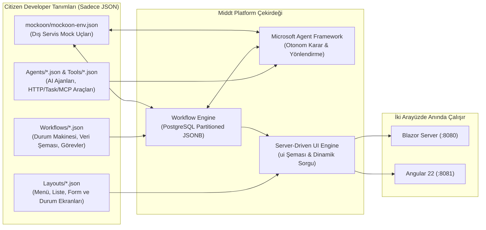

# Citizen Developer Rehberi – Middt Platform ile Kod Yazmadan (Zero-Code) Uygulama Geliştirme

Bu rehber, **Middt Platform** üzerinde C# veya TypeScript/HTML kodu yazmadan; yalnızca **JSON tanımları** ve çalışma zamanı **Ekran Tasarımı Editörü** kullanarak uçtan uca kurumsal uygulamaların (veri modeli, iş akışı motoru, iş kuralları, dış servis entegrasyonları, yapay zeka ajanları ve Blazor/Angular ekranları) nasıl geliştirileceğini adım adım anlatır.

---

## İçindekiler

1. [Mimari Genel Bakış: Citizen Developer Neleri Tanımlar?](#1-mimari-genel-bakış-citizen-developer-neleri-tanımlar)
2. [Proje Klasör Yapısı (Nereye Ne Eklenir?)](#2-proje-klasör-yapısı-nereye-ne-eklenir)
3. [Bölüm 1: İş Akışı Motoru (Workflow Engine) Kullanımı](#3-bölüm-1-iş-akışı-motoru-workflow-engine-kullanımı)
   - [3.1. Temel İş Akışı İskeleti ve Güvenlik](#31-temel-iş-akışı-iskeleti-ve-güvenlik)
   - [3.2. Veri Şeması, Otomatik İndeksleme ve Arama (`dataSchema`)](#32-veri-şeması-otomatik-indeksleme-ve-arama-dataschema)
   - [3.3. Başlangıç Formu ve Giriş Kuralları (`start`)](#33-başlangıç-formu-ve-giriş-kuralları-start)
   - [3.4. Durumlar (`states`), Sihirbaz Adımları ve Ekran Bağlama](#34-durumlar-states-sihirbaz-adımları-ve-ekran-bağlama)
   - [3.5. Geçişler (`transitions`) ve Tetikleyiciler (`trigger`)](#35-geçişler-transitions-ve-tetikleyiciler-trigger)
   - [3.6. Yerleşik Görevler (Built-in Tasks) Referansı](#36-yerleşik-görevler-built-in-tasks-referansı)
4. [Bölüm 2: Yapay Zeka Ajanları (AI Agents), Araçlar (Tools) ve MCP](#4-bölüm-2-yapay-zeka-ajanları-ai-agents-araçlar-tools-ve-mcp)
   - [4.1. AI Ajanı Tanımlama (`Agents/*.json`)](#41-ai-ajanı-tanımlama-agentsjson)
   - [4.2. Kodsuz AI Araçları (`Agents/Tools/*.json`) — Expression, Task (`http`, `set`, `cache`) ve MCP](#42-kodsuz-ai-araçları-agentstoolsjson--expression-task-http-set-cache-ve-mcp)
   - [4.3. Akış İçinde Ajan Çağırma ve Otomatik Geçiş Kararı (`selectedTransition`)](#43-akış-içinde-ajan-çağırma-ve-otomatik-geçiş-kararı-selectedtransition)
5. [Bölüm 3: İfade Dili (Expression Language) Rehberi](#5-bölüm-3-ifade-dili-expression-language-rehberi)
6. [Bölüm 4: Sunucu Güdümlü Ekran Tasarımı (`Layouts/*.json`)](#6-bölüm-4-sunucu-güdümlü-ekran-tasarımı-layoutsjson)
   - [6.1. Ekran Bileşenleri (Widgets) Kataloğu](#61-ekran-bileşenleri-widgets-kataloğu)
   - [6.2. Canlı Ekran Tasarımı Editörü (`/ui/layouts`)](#62-canlı-ekran-tasarımı-editörü-uilayouts)
7. [Bölüm 5: Dış Servis Simülasyonu (Mockoon) ve Başlangıç Verileri (Seeds)](#7-bölüm-5-dış-servis-simülasyonu-mockoon-ve-başlangıç-verileri-seeds)
8. [Bölüm 6: Uçtan Uca Örnek Proje — "Tedarikçi Satınalma Talebi" Modülü](#8-bölüm-6-uçtan-uca-örnek-proje--tedarikçi-satınalma-talebi-modülü)
9. [Kontrol Listesi ve Doğrulama Komutları](#9-kontrol-listesi-ve-doğrulama-komutları)

---

## 1. Mimari Genel Bakış: Citizen Developer Neleri Tanımlar?

Middt Platform'da veritabanı tablosu açmak, C# Entity/Controller yazmak veya Blazor/Angular sayfası kodlamak gerekmez. Platform tüm iş mantığını ve ekranları deklaratif JSON dosyalarından üretir:



Bir iş akışı (`Workflows/*.json`) tanımladığınızda platform otomatik olarak:
1. PostgreSQL'de o akışa özel bölümlenmiş (`wf."WorkflowInstances_<Akis>"`, `wf."WorkflowInstanceData_<Akis>"`, vb.) tabloları ve `dataSchema` içindeki alanlara göre arama indekslerini oluşturur.
2. `/api/workflows/<akis-anahtari>` ve `/api/v1/<PascalCaseAkisAdi>/getitems|getall|getbyid` REST uçlarını açar.
3. Hem Blazor (`/workflow/<akis-anahtari>`) hem Angular arayüzünde **Liste**, **Arama Filtreleri**, **Yeni Kayıt Başlatma Formu**, **Sihirbaz (Wizard) Adımları**, **Durum Görünümü**, **Aksiyon Butonları** ve **Geçmiş Zaman Çizelgesi** ekranlarını hazır hale getirir.

---

## 2. Proje Klasör Yapısı (Nereye Ne Eklenir?)

Citizen Developer olarak tüm geliştirmelerinizi `demo/Middt.Demo.Api` (veya kendi API projenizin) altındaki şu klasörlerde yaparsınız:

| Klasör / Dosya | Amacı |
|---|---|
| `demo/Middt.Demo.Api/Workflows/*.json` | İş akışı tanımları (durumlar, geçişler, formlar, görevler, veri şeması). |
| `demo/Middt.Demo.Api/Agents/*.json` | Yapay zeka ajanı tanımları (sistem talimatları, kullandığı araçlar, çıktı şeması). |
| `demo/Middt.Demo.Api/Agents/Tools/*.json` | AI ajanlarının çağırdığı kodsuz araçlar (`expression`, `http`, `task`, `mcp`). |
| `demo/Middt.Demo.Api/Agents/McpServers/*.json` | Model Context Protocol (MCP) sunucu tanımları, kaynakları ve şablonları. |
| `demo/Middt.Demo.Api/Layouts/*.json` | Sunucu güdümlü ekran tasarımları (`nav-menu.json`, durum görünümleri, özel sayfalar). |
| `demo/Middt.Demo.Api/Seeds/*.json` | Uygulama ilk kalktığında otomatik oluşturulacak örnek iş akışı kayıtları. |
| `demo/mockoon/mockoon-env.json` | `http` görevleri ve AI `http` araçları için Mockoon dış servis simülasyon uçları. |

---

## 3. Bölüm 1: İş Akışı Motoru (Workflow Engine) Kullanımı

### 3.1. Temel İş Akışı İskeleti ve Güvenlik

Her iş akışı `Workflows/` klasöründe bir `.json` dosyasıdır:

```json
{
  "key": "credit-allocation",
  "version": 1,
  "title": "Kredi Tahsis & 4-Göz Onay",
  "icon": "account_balance",
  "historyMode": "Full",
  "readRoles": ["manager"],
  "ownerField": "createdBy",
  "branchField": "branchCode",
  "timeout": {
    "duration": "24:00:00",
    "target": "expired"
  }
}
```

- **`key`**: Akışın benzersiz kimliği (`kebab-case`). URL'lerde (`/workflow/credit-allocation`) ve alt akış çağrılarında kullanılır.
- **`title` & `icon`**: Ekran başlığı ve Material ikon adı (`account_balance`, `verified_user`, `receipt_long`, `smart_toy`, vb.).
- **`historyMode`**: `"Full"` (varsayılan; her geçişte tüm veriyi tarihçeye yazar), `"Delta"` (sadece değişen alanların RFC 6902 farkını yazar) veya `"None"`.
- **Satır Bazlı Güvenlik (Row-Level Security)**:
  - `readRoles`: Tüm kayıtları görebilecek roller (ör. `["manager"]`).
  - `ownerField`: Kayıt sahibinin tutulduğu alan (ör. `"createdBy"`). Bu роle sahip olmayan kullanıcılar yalnızca kendi oluşturdukları kayıtları görebilir.
  - `branchField`: Şube bazlı izolasyon alanı.

---

### 3.2. Veri Şeması, Otomatik İndeksleme ve Arama (`dataSchema`)

`dataSchema`, iş akışının sakladığı iş verilerini (`instance.data`), liste ekranındaki sütunları, arama filtrelerini ve veri maskelemeyi tanımlar:

```json
"dataSchema": {
  "type": "object",
  "properties": {
    "customerName": {
      "type": "string",
      "title": "Müşteri Adı",
      "x-search": true
    },
    "identityNumber": {
      "type": "string",
      "title": "TCKN / VKN",
      "x-search": true,
      "x-mask": "last4",
      "x-DynamicMaskRoles": ["manager", "idp-admin"]
    },
    "segment": {
      "type": "string",
      "title": "Segment",
      "enum": ["Bireysel", "KOBİ", "Kurumsal"],
      "x-search": true
    },
    "amount": {
      "type": "number",
      "title": "Tutar (₺)",
      "x-search": true
    },
    "internalRiskNote": {
      "type": "string",
      "title": "İç Risk Notu",
      "x-roles": ["manager"]
    }
  }
}
```

- **`"x-search": true`**:
  - `string` alanlarda büyük/küçük harf duyarsız arama kutusu (veya `enum` ise açılır kutu) oluşturur.
  - `number` / `integer` alanlarda otomatik olarak **Min (≥)** ve **Max (≤)** aralık filtreleri oluşturur.
- **Alan Gizleme ve Maskeleme**:
  - `"x-mask": "last4"`: Yetkisiz kullanıcılara alanı `*******8901` şeklinde maskeler.
  - `"x-DynamicMaskRoles": ["manager"]`: Belirtilen rollere sahip kullanıcılara maskesiz tam değeri gösterir.
  - `"x-roles": ["manager"]`: Yetkisiz kullanıcılardan alanı tamamen gizler (API yanıtından çıkarır).
- **`"x-list": false`**: Alanın liste tablosunda sütun olarak görünmesini engeller, yalnızca detayda kullanılır.

---

### 3.3. Başlangıç Formu ve Giriş Kuralları (`start`)

Kullanıcı **"Yeni Başlat"** butonuna bastığında açılan form `start.input.schema` üzerinden otomatik üretilir:

```json
"start": {
  "key": "start",
  "target": "scoring",
  "input": {
    "rule": "input.collateralAmount >= input.amount * 0.5m",
    "ruleMessage": "Teminat tutarı kredi tutarının en az %50'si olmalıdır.",
    "schema": {
      "type": "object",
      "additionalProperties": false,
      "required": ["customerKey", "amount", "termMonths"],
      "properties": {
        "customerKey": {
          "type": "string",
          "title": "Müşteri",
          "x-lookup": {
            "entity": "CustomerOnboarding",
            "valueField": "key",
            "textField": "fullName"
          }
        },
        "amount": {
          "type": "number",
          "minimum": 1000,
          "maximum": 10000000,
          "title": "Talep Tutarı (₺)",
          "default": 250000
        },
        "termMonths": {
          "type": "integer",
          "title": "Vade (Ay)",
          "enum": [6, 12, 24, 36, 48],
          "default": 24
        },
        "notes": {
          "type": "string",
          "format": "textarea",
          "title": "Açıklama"
        }
      }
    }
  },
  "onExecute": [
    {
      "task": "set",
      "config": {
        "values": {
          "createdBy": "user.Name",
          "createdAt": "now"
        }
      }
    }
  ]
}
```

- **`x-lookup`**: Başka bir iş akışının aktif kayıtlarını açılır liste (Dropdown) olarak bağlar (`entity`: diğer akışın PascalCase adı, `valueField`: kaydedilecek alan, `textField`: gösterilecek metin).
- **`input.rule` & `input.ruleMessage`**: Form gönderildiğinde sunucu tarafında çalışan iş kuralı. Sağlanmazsa kullanıcıya `ruleMessage` gösterilir.
- **`input.sensitive`**: `["cardPin", "cvv"]` gibi tanımlanan alanlar yalnızca görev çalışırken bellekte kullanılır; veritabanına ve tarihçeye **asla** kaydedilmez.

---

### 3.4. Durumlar (`states`), Sihirbaz Adımları ve Ekran Bağlama

```json
{
  "key": "specialist-review",
  "title": "Uzman İncelemesi & AI Copilot",
  "type": "Intermediate",
  "subType": "Human",
  "step": 2,
  "view": {
    "layout": "ai-dispute-detail"
  },
  "onEntry": [ ... ],
  "onExit": [ ... ],
  "transitions": [ ... ]
}
```

- **`type`**:
  - `"Intermediate"`: Ara durum.
  - `"SubFlow"`: Alt iş akışı (`subFlow.workflow`) tamamlanana kadar bekleyen durum.
  - `"Finish"`: Bitiş durumu (akış tamamlanır veya iptal olur).
- **`subType`**:
  - `"Human"`: Kullanıcı aksiyonu bekler.
  - `"Success"` / `"Error"` / `"Cancelled"` / `"Timeout"`: Bitiş durumunun rengini ve statüsünü belirler.
- **`step`**: `1, 2, 3...` verildiğinde ekranın üst kısmında otomatik olarak **Sihirbaz (Wizard) Adım Çubuğu** gösterilir.
- **`view.layout`**: Bu durumda hangi JSON ekran tasarımının (`Layouts/<key>.json`) gösterileceğini belirler.

---

### 3.5. Geçişler (`transitions`) ve Tetikleyiciler (`trigger`)

Bir durumdan diğerine (veya `"$self"` ile aynı durumun kendisine) geçişler 4 farklı şekilde tetiklenebilir:

| `trigger` | Açıklama | Önemli Alanlar |
|---|---|---|
| `"Manual"` (Varsayılan) | Kullanıcının ekranda gördüğü aksiyon butonlarıdır. | `title`, `description`, `style` (`primary`, `success`, `warning`, `danger`, `secondary`, `light`), `icon`, `roles`, `inline` (`true` ise popup yerine sayfa içinde form açar), `rule` (butonun görünme koşulu). |
| `"Automatic"` | `onEntry` görevleri biter bitmez motor tarafından otomatik değerlendirilir. | `rule` (koşul ifadesi; ör. `"data.amount <= 5000"` veya `"instance.agents.aiUnderwriter.selectedTransition == \"to-approved\""`), `default: true` (hiçbir kural tutmazsa seçilecek geçiş). |
| `"Scheduled"` | Belirtilen süre sonunda arka plan zamanlayıcısı ile tetiklenir (SLA / Hatırlatma). | `after`: `"00:15:00"` veya dinamik `"{{ data.slaDuration }}"`. |
| `"Event"` | Dış sistemden veya başka akıştan mesaj geldiğinde tetiklenir. | `event`: `"payment.received"`, `rule`: `"input.amount > 0"`. |

**4-Göz (Four-Eyes) Onay Kuralı Örneği**:
Bir önceki adımı onaylayan kişinin ikinci adımı onaylayamaması için:
```json
{
  "key": "approve-stage2-four-eyes",
  "title": "2. Kademe Onay (4-Göz)",
  "target": "disbursed",
  "roles": ["manager"],
  "rule": "user.Id != instance.previousUser"
}
```

**Aynı Durumda Veri Güncelleme (`target: "$self"`)**:
Durumu değiştirmeden not eklemek, SLA uzatmak veya AI ajanını yeniden çalıştırmak için `"target": "$self"` kullanılır. `"reenter": true` verilirse durumun `onEntry` görevleri ve zamanlayıcıları yeniden çalıştırılır.

---

### 3.6. Yerleşik Görevler (Built-in Tasks) Referansı

Görevler `start.onExecute`, `state.onEntry`, `state.onExit` veya `transition.onExecute` dizilerinde tanımlanır:

#### 1. `set` — Veri Hesaplama ve Atama
```json
{
  "task": "set",
  "config": {
    "values": {
      "ltvRatio": "data.collateralAmount > 0 ? Math.Round((data.amount * 100m) / data.collateralAmount, 2) : 100m",
      "statusNote": "\"Onaylayan: \" + user.Name",
      "approvedAt": "now"
    }
  }
}
```

#### 2. `setKey` — İş Anahtarı (Business Key) Üretme
```json
{
  "task": "setKey",
  "config": {
    "key": "CUST-{{ data.identityNumber }}",
    "ensureUnique": true
  }
}
```

#### 3. `loadWorkflow` — Başka Bir Akışın Verisini Okuma
```json
{
  "task": "loadWorkflow",
  "config": {
    "workflow": "customer-onboarding",
    "key": "{{ data.customerKey }}",
    "into": "customer"
  }
}
```

#### 4. `http` — Dış Servis Çağrısı ve Akıllı Yeniden Deneme (`onError`)
> [!IMPORTANT]
> `http` görevlerinde her zaman `http://` veya `https://` ile başlayan **tam (absolute) URL** kullanılmalıdır.

```json
{
  "key": "charge-http",
  "task": "http",
  "onError": {
    "maxAttempts": 3,
    "delay": "00:00:01",
    "backoffMultiplier": 2.0,
    "retryOnStatusCodes": ["408", "429", "5xx"],
    "action": "Transition",
    "transition": "gateway-fallback"
  },
  "config": {
    "method": "POST",
    "url": "http://mockoon:3000/api/v1/OrderPaymentOrchestration/ping",
    "headers": {
      "X-Channel": "Middt-Workflow"
    },
    "body": {
      "orderCode": "{{ data.orderCode }}",
      "amount": "{{ data.amount }}"
    },
    "into": "gatewayResponse"
  }
}
```

#### 5. `fanOut` & `startWorkflow` — Paralel Çoklu Akış Başlatma
```json
{
  "task": "fanOut",
  "config": {
    "items": "new string[] { \"Fraud Kontrolü\", \"Stok Kontrolü\", \"Limit Kontrolü\" }",
    "maxConcurrency": 3,
    "into": "parallelChecks",
    "subTask": {
      "task": "startWorkflow",
      "config": {
        "workflow": "risk-limit-eval",
        "data": {
          "checkType": "{{ item.value }}",
          "amount": "{{ data.amount }}"
        },
        "into": "checkResult"
      }
    }
  }
}
```

#### 6. `cache` — Önbellekleme (Cache-Aside)
```json
{
  "task": "cache",
  "config": {
    "key": "payment:{{ data.orderCode }}",
    "ttl": "00:20:00",
    "into": "paymentReceipt",
    "subTask": {
      "task": "set",
      "config": {
        "values": {
          "paymentReceipt": "data.gatewayResponse.body.referenceCode"
        }
      }
    }
  }
}
```

#### 7. `publish` & `rabbitmq` — Olay Yayınlama
```json
{
  "task": "publish",
  "config": {
    "type": "OrderPaymentCaptured",
    "payload": {
      "orderCode": "{{ data.orderCode }}",
      "amount": "{{ data.amount }}"
    }
  }
}
```

---

## 4. Bölüm 2: Yapay Zeka Ajanları (AI Agents), Araçlar (Tools) ve MCP

Middt Platform, **Microsoft Agent Framework** (`Microsoft.Agents.AI`) üzerinde çalışan, tamamen JSON ile tanımlanan yapay zeka ajanlarını destekler.

> [!NOTE]
> Ajan çıktı verileri, çok turlu konuşma geçmişi (Session) ve araç çağrıları (Tool Calls) iş akışının `instance.data` nesnesini kirletmez; PostgreSQL'de ayrı bölümlenmiş tablolarda (`wf."WorkflowAgentSessions"`, `wf."WorkflowAgentRuns"`, `wf."WorkflowAgentToolCalls"`) saklanır ve `instance.agents.<taskKey>`, `instance.agentRuns`, `instance.toolCalls` üzerinden okunur.

### 4.1. AI Ajanı Tanımlama (`Agents/*.json`)

`demo/Middt.Demo.Api/Agents/risk-limit-underwriter.json` örneği:

```json
{
  "name": "risk-limit-underwriter",
  "description": "Müşterinin KKB risk skorunu, ödeme geçmişini ve TCMB sicilini analiz eden AI Tahsis Ajanı.",
  "instructions": "Sen otonom bir Kredi Tahsis ajanısın. Araçları çağırarak müşteriyi analiz et ve uygun geçişi (nextTransition) seç.",
  "tools": [
    "query_customer_risk_score",
    "lookup_customer_payment_history",
    "verify_central_bank_registry_http",
    "evaluate_collateral_and_sector_exposure"
  ],
  "outputSchema": {
    "type": "object",
    "required": ["decision", "riskLevel", "riskScore", "recommendedLimit", "summary", "recommendation"],
    "properties": {
      "decision": { "type": "string", "default": "Otomatik Limit Onayı" },
      "riskLevel": { "type": "string", "enum": ["Düşük", "Orta", "Yüksek"], "default": "Düşük" },
      "riskScore": { "type": "integer", "minimum": 0, "maximum": 1900, "default": 810 },
      "recommendedLimit": { "type": "number", "minimum": 0, "default": 250000 },
      "summary": { "type": "string" },
      "recommendation": { "type": "string" }
    }
  }
}
```

### 4.2. Kodsuz AI Araçları (`Agents/Tools/*.json`) — Expression, Task (`http`, `set`, `cache`) ve MCP

Bir AI ajanının kullanabileceği araçlar `Agents/Tools/*.json` altında C# kodu yazmadan tanımlanır:

#### Tür A: İfade / Hesaplama Aracı (`"kind": "expression"`)
```json
{
  "name": "query_customer_risk_score",
  "kind": "expression",
  "description": "Müşterinin KKB kredi risk skorunu ve önerilen limiti sorgular.",
  "parameters": {
    "type": "object",
    "properties": {
      "customerKey": { "type": "string" },
      "amount": { "type": "number" }
    }
  },
  "output": {
    "riskScore": "{{ args.amount > 500000 ? 640 : 810 }}",
    "creditGrade": "{{ args.amount > 500000 ? \"B+ (Yakın İzleme)\" : \"A+ (Prime)\" }}",
    "recommendedLimit": "{{ args.amount * 1.25 }}"
  }
}
```

#### Tür B: HTTP Task Aracı (`"kind": "task", "task": "http"`)
İş akışı motorunun `http` görevini doğrudan bir AI aracı olarak çalıştırır (tam URL zorunludur):

```json
{
  "name": "verify_central_bank_registry_http",
  "kind": "task",
  "task": "http",
  "description": "TCMB Risk Merkezi ve KKB HTTP Gateway servisine HTTP POST çağrısı yapar.",
  "parameters": {
    "type": "object",
    "properties": {
      "customerKey": { "type": "string" },
      "amount": { "type": "number" },
      "checkType": { "type": "string" }
    }
  },
  "config": {
    "method": "POST",
    "url": "http://mockoon:3000/api/v1/credit-bureau/check",
    "headers": {
      "X-Bureau-Channel": "TCMB-KKB-Gateway-v1"
    },
    "body": {
      "customerKey": "{{ args.customerKey ?? data.customerKey ?? \"CUST-GENEL\" }}",
      "amount": "{{ args.amount ?? data.amount ?? 0 }}",
      "checkType": "{{ args.checkType ?? data.checkType ?? \"Kredi Limit Analizi\" }}"
    }
  }
}
```

> [!TIP]
> `"kind": "task"` ile sadece `http` değil; `"task": "loadWorkflow"`, `"task": "set"`, `"task": "cache"`, `"task": "publish"` gibi **tüm** iş akışı görevlerini AI ajanına araç olarak verebilirsiniz. `"writeToWorkflowData": true` eklerseniz aracın ürettiği alanlar doğrudan iş akışının `data` nesnesine de yazılır.

### 4.3. Akış İçinde Ajan Çağırma ve Otomatik Geçiş Kararı (`selectedTransition`)

Bir durumun `onEntry` adımında `aiAgent` görevi çalıştırıldığında:
1. Motor, o durumdan çıkabilecek `Automatic` geçişleri (`key`, `title`, `description`, `target`) otomatik olarak bulur ve ajana bildirir.
2. Ajan araçlarını çalıştırır, `outputSchema` formatında raporunu üretir ve geçilecek hedefi `selectedTransition` olarak kaydeder.
3. Durumun `transitions` listesinde bu karar okunarak akış yönlendirilir:

```json
{
  "key": "evaluate",
  "title": "AI Risk Skoru & Ödeme Geçmişi Analizi",
  "onEntry": [
    {
      "key": "riskLimitUnderwriter",
      "task": "aiAgent",
      "config": {
        "agent": "risk-limit-underwriter",
        "prompt": "{{ data.customerKey }} müşterisi için {{ data.amount }} TL tutarlı talebi analiz et ve uygun geçişi (nextTransition) seç.",
        "context": {
          "customerKey": "{{ data.customerKey }}",
          "amount": "{{ data.amount }}",
          "requireUnderwriting": "{{ data.requireUnderwriting }}"
        }
      }
    }
  ],
  "transitions": [
    {
      "key": "to-rejected",
      "title": "Otomatik Red (Limit Aşımı)",
      "description": "Talep edilen tutar 5.000.000 TL kurum üst limitini aşıyorsa doğrudan reddedilir.",
      "target": "rejected",
      "trigger": "Automatic",
      "rule": "instance.agents.riskLimitUnderwriter != null && instance.agents.riskLimitUnderwriter.selectedTransition == \"to-rejected\""
    },
    {
      "key": "to-underwriting",
      "title": "Tahsis Uzmanı İncelemesine Sevk",
      "description": "Talep tutarı 500.000 TL üzerindeyse tahsis uzmanı incelemesine yönlendirilir.",
      "target": "manual-underwriting",
      "trigger": "Automatic",
      "rule": "instance.agents.riskLimitUnderwriter != null && instance.agents.riskLimitUnderwriter.selectedTransition == \"to-underwriting\""
    },
    {
      "key": "to-approved",
      "title": "Otomatik Limit Onayı",
      "description": "500.000 TL ve altı standart talepler otomatik onaylanır.",
      "target": "approved",
      "trigger": "Automatic",
      "default": true
    }
  ]
}
```

> [!IMPORTANT]
> Otomatik geçişlerde `title` ve `description` alanlarını açıkça yazın. AI ajanı hangi geçişi seçeceğine karar verirken geçişlerin `key`, `title` ve `description` bilgilerini birlikte değerlendirir.

---

## 5. Bölüm 3: İfade Dili (Expression Language) Rehberi

Middt Platform'da iki yerde ifade kullanılır:

| Kapsam | Kullanıldığı Yerler | Erişilebilen Değişkenler | Örnek |
|---|---|---|---|
| **Taşınabilir UI İfadeleri** (.NET & TypeScript ortak) | `Layouts/*.json` (`{{ }}` şablonları, `visibleWhen`), `Agents/Tools/*.json` (`output` şablonları) | `data`, `instance` (`id`, `key`, `state`, `stateTitle`, `workflow`, `status`, `agents`, `agentRuns`, `toolCalls`), `row` (liste/tablo satırı), `user` (`name`, `isAuthenticated`, `roles`), `query` | `"visibleWhen": "instance.state == \"approved\" && data.amount > 10000"` |
| **Sunucu İş Akışı İfadeleri** | `Workflows/*.json` (`transition.rule`, `input.rule`, `set.values`, `http` URL/body şablonları) | `data`, `input`, `instance` (`Id`, `Key`, `State`, `Workflow`, `Creator`, `PreviousUser`, `Agents`), `user` (`Id`, `Name`, `Roles`, `HasRole("manager")`), `now`, `Math` | `"rule": "data.amount > 50000 && user.HasRole(\"manager\")"` |

**Sık Kullanılan İfade Örnekleri**:
- Sayı formatlama (UI): `{"label": "Tutar", "value": "{{ data.amount }}", "format": "N2"}`
- Tarih formatlama (UI): `{"label": "Tarih", "value": "{{ data.createdAt }}", "format": "g"}`
- Boş değer kontrolü (Null-coalescing): `{{ data.customerName ?? "Belirtilmedi" }}`
- Koşullu metin (Ternary): `{{ data.amount > 500000 ? "Yüksek Tutar" : "Standart" }}`
- Dizi eleman sayısı: `instance.toolCalls != null && instance.toolCalls.Count > 0`

---

## 6. Bölüm 4: Sunucu Güdümlü Ekran Tasarımı (`Layouts/*.json`)

Tüm ekranlar `demo/Middt.Demo.Api/Layouts/*.json` altında tanımlanır ve `spec/ui-layout.schema.json` şemasına göre doğrulanır.

### 6.1. Ekran Bileşenleri (Widgets) Kataloğu

| Widget | Amacı | Temel Özellikler |
|---|---|---|
| `section` | Başlıklı kart/bölüm kutusu | `title`, `visibleWhen`, `children` |
| `columns` | Yan yana sütun yerleşimi | `widths` (ör. `[2, 1]`), `children` |
| `fields` | Etiket–Değer (`dt`/`dd`) özet listesi | `items`: `[{ "label": "...", "value": "{{ ... }}", "format": "N2", "visibleWhen": "..." }]` |
| `list` | Dizi (`JsonArray`) öğelerini tekrarlı listeleme | `source` (ör. `"instance.toolCalls"` veya `"data.partialPayment"`), `empty`, `children` (her öğe `row` değişkeniyle okunur) |
| `alert` | Bilgi/Uyarı/Hata kutusu | `severity` (`info`, `success`, `warning`, `danger`), `text`, `visibleWhen` |
| `badge` | Renkli durum etiketi | `color` (`primary`, `success`, `warning`, `danger`, `info`, `secondary`), `text` |
| `text` | Paragraf veya başlık metni | `text`, `variant` (`body`, `lead`, `muted`, `code`) |
| `action` | İş akışı geçişini tetikleyen buton | `transition` (geçiş `key`'i), `text`, `style`, `confirm` |
| `kpi-row` | Sayfa üstü özet KPI sayaç kartları | `entity`, `cards`: `[{ "label": "...", "aggregate": "count\|sum\|avg", "field": "amount", "filter": { ... } }]` |
| `data-grid` | Sunucu sayfalamalı, sıralamalı, aramalı tablo | `entity`, `pageSize`, `columns`, `searchFields`, `createFields`, `editFields`, `deleteConfirm` |
| `crud-page` | KPI + Arama + Tablo birleşik yönetim ekranı | `title`, `entity`, `kpis`, `columns`, `fields` |
| `layout` | Başka bir layout'u alt bileşen olarak gömme | `key` (ör. `{"widget": "layout", "key": "workflow-footer"}`) |

**Durum Görünümü (`view`) Örneği (`Layouts/risk-detail.json`)**:
```json
{
  "$schema": "../../../spec/ui-layout.schema.json",
  "key": "risk-detail",
  "title": "Risk & Limit Değerlendirme Özeti",
  "kind": "view",
  "version": 1,
  "body": [
    {
      "widget": "alert",
      "severity": "success",
      "text": "Risk değerlendirmesi onaylandı.",
      "visibleWhen": "instance.state == \"approved\""
    },
    {
      "widget": "section",
      "title": "AI Tahsis Analizi",
      "visibleWhen": "instance.agents != null && instance.agents.riskLimitUnderwriter != null",
      "children": [
        {
          "widget": "fields",
          "items": [
            { "label": "AI Kararı", "value": "{{ instance.agents.riskLimitUnderwriter.decision }}" },
            { "label": "Risk Skoru", "value": "{{ instance.agents.riskLimitUnderwriter.riskScore }}" },
            { "label": "TCMB Memzuç Kaydı", "value": "{{ instance.agents.riskLimitUnderwriter.centralBankRecord }}" }
          ]
        }
      ]
    },
    {
      "widget": "section",
      "title": "Çağrılan AI Araçları (Tool Calls)",
      "visibleWhen": "instance.toolCalls != null && instance.toolCalls.Count > 0",
      "children": [
        {
          "widget": "list",
          "source": "instance.toolCalls",
          "children": [
            {
              "widget": "fields",
              "items": [
                { "label": "Ajan", "value": "{{ row.agent }}" },
                { "label": "Araç Adı", "value": "{{ row.name }}" },
                { "label": "Çağrı No", "value": "{{ row.callId }}" }
              ]
            }
          ]
        }
      ]
    },
    { "widget": "layout", "key": "workflow-footer" }
  ]
}
```

### 6.2. Canlı Ekran Tasarımı Editörü (`/ui/layouts`)

Sol menüdeki **Ekran Tasarımı** (`/ui/layouts`) sayfasından:
- Sistemdeki tüm `Layouts/*.json` ekranlarını görüntüleyebilir,
- JSON ağacını veya bileşen özelliklerini tarayıcıda düzenleyip **"Kaydet"** diyerek hem Blazor hem Angular'da **konteyner yeniden başlatmadan** anında devreye alabilirsiniz.

---

## 7. Bölüm 5: Dış Servis Simülasyonu (Mockoon) ve Başlangıç Verileri (Seeds)

### 7.1. Mockoon ile Dış HTTP Servisi Ekleme (`demo/mockoon/mockoon-env.json`)
`docker-compose.yml` içerisinde `mockoon/cli:latest` konteyneri (`http://mockoon:3000`, host üzerinde `http://127.0.0.1:3080`) çalışır. Yeni bir dış servis simülasyonu gerektiğinde API koduna dokunmadan `demo/mockoon/mockoon-env.json` dosyasındaki `routes` dizisine yeni uç ekleyebilirsiniz:
- İş akışı `http` görevlerinden ve AI `http` araçlarından `http://mockoon:3000/api/v1/...` tam adresiyle çağrılır.
- Mockoon Handlebars şablonlarını (`{{body 'amount' 0}}`, `{{urlParam 'entity'}}`, `{{faker 'string.alphanumeric' length=8 casing='upper'}}`, `{{now}}`) destekler.

### 7.2. Başlangıç Verileri (`demo/Middt.Demo.Api/Seeds/initial-instances.json`)
Uygulama ilk kez ayağa kalktığında listelerin boş gelmemesi için `Seeds/initial-instances.json` içine başlangıç kayıtları eklenir:
```json
[
  {
    "workflow": "risk-limit-eval",
    "data": {
      "customerKey": "CUST-12345678901",
      "amount": 250000,
      "checkType": "Kredi Limit Analizi",
      "requireUnderwriting": false
    }
  }
]
```

---

## 8. Bölüm 6: Uçtan Uca Örnek Proje — "Tedarikçi Satınalma Talebi" Modülü

Yeni bir iş gereksinimi geldiğinde Citizen Developer'ın izleyeceği **5 adımlı** standart geliştirme süreci:

### Adım 1: Mockoon'a Bütçe Kontrol Servisi Ekle (`demo/mockoon/mockoon-env.json`)
`routes` listesine `POST api/v1/budget/check` rotasını ekleyin (ör. `{"budgetStatus": "Uygun", "costCenterRef": "CC-2026-01"}`).

### Adım 2: AI Aracı ve Ajanını Oluştur (`Agents/Tools/` & `Agents/`)
1. `demo/Middt.Demo.Api/Agents/Tools/verify-department-budget-http.json`:
```json
{
  "name": "verify_department_budget_http",
  "kind": "task",
  "task": "http",
  "description": "Departman bütçe uygunluğunu HTTP servisi üzerinden sorgular.",
  "parameters": {
    "type": "object",
    "properties": {
      "department": { "type": "string" },
      "amount": { "type": "number" }
    }
  },
  "config": {
    "method": "POST",
    "url": "http://mockoon:3000/api/v1/budget/check",
    "body": {
      "department": "{{ args.department ?? data.department }}",
      "amount": "{{ args.amount ?? data.amount }}"
    }
  }
}
```
2. `demo/Middt.Demo.Api/Agents/procurement-approver.json`:
   - `tools`: `["verify_department_budget_http"]`
   - `outputSchema`: `decision`, `riskLevel`, `budgetStatus`, `summary`, `recommendation`.

### Adım 3: İş Akışını Tanımla (`Workflows/purchase-request.json`)
- `key`: `"purchase-request"`, `title`: `"Satınalma Talebi"`
- `dataSchema`: `requestNo`, `department`, `supplierName`, `amount` (`"x-search": true`)
- `start`: Giriş formu şeması ve `target: "ai-triage"`
- `states`:
  - `ai-triage`: `onEntry` içinde `setKey` ve `aiAgent` (`procurement-approver`), `transitions` içinde `to-auto-approved` (≤ 25.000 ₺) ve `to-manager-review` (> 25.000 ₺).
  - `manager-review` (`subType: "Human"`, `view.layout: "purchase-detail"`): `approve` ve `reject` manuel geçişleri.
  - `approved` (`type: "Finish"`, `subType: "Success"`, `view.layout: "purchase-detail"`).
  - `rejected` (`type: "Finish"`, `subType: "Error"`, `view.layout: "purchase-detail"`).

### Adım 4: Durum Ekranını ve Menüyü Tanımla (`Layouts/`)
1. `demo/Middt.Demo.Api/Layouts/purchase-detail.json` dosyasını oluşturun (`data.*`, `instance.agents.*` ve `instance.toolCalls` alanlarını gösteren `section`, `fields`, `list` bileşenleriyle).
2. Sol menüde görünmesi için `demo/Middt.Demo.Api/Layouts/nav-menu.json` içindeki `İş Akışları` grubuna ekleyin:
```json
{
  "title": "Satınalma Talepleri",
  "icon": "shopping_bag",
  "path": "/workflow/purchase-request"
}
```

### Adım 5: Çalıştır ve Görüntüle
`docker compose up -d --build` komutuyla (veya yerel geliştirmede API'yi başlatarak) hem Blazor (`http://localhost:8080/workflow/purchase-request`) hem Angular (`http://localhost:8081/workflow/purchase-request`) üzerinde yeni modülünüzü anında kullanmaya başlayabilirsiniz.

---

## 9. Kontrol Listesi ve Doğrulama Komutları

Hazırladığınız JSON dosyalarının şema kurallarına, ifade diline ve güvenlik kısıtlarına uygunluğunu tek komutla doğrulayabilirsiniz:

```bash
# 1. Tüm iş akışı JSON tanımlarını, ifadeleri ve şemaları doğrula
dotnet test --project tests/Middt.Framework.Tests -- --filter-class "*WorkflowDefinitionTests"

# 2. Tüm ekran tasarımı (Layouts/*.json) dosyalarını doğrula
dotnet test --project tests/Middt.Framework.Tests -- --filter-class "*UiSampleLayoutTests"

# 3. Demo iş akışlarını ve AI ajanlarını uçtan uca test et
dotnet test --project tests/Middt.Framework.Tests -- --filter-class "*SampleJsonWorkflowTests"
dotnet test --project tests/Middt.Framework.Tests -- --filter-class "*MiddtAgentTests"

# 4. Tüm sistemi Docker Compose ile ayağa kaldır
docker compose up -d --build
```

### Altın Kurallar
- **`http` Görevleri ve Araçları**: Her zaman `http://` veya `https://` ile başlayan **tam URL** yazın (`http://mockoon:3000/api/v1/...`). Şema ve host kısmında `{{ }}` değişkeni kullanmayın (SSRF koruması).
- **AI Yönlendirme Geçişleri**: `aiAgent` görevinin bulunduğu durumdaki `Automatic` geçişlere mutlaka anlamlı `title` ve `description` yazın; geçiş kurallarında `instance.agents.<taskKey>.selectedTransition == "<transition-key>"` kontrolü kullanın ve bir geçişi `"default": true` olarak işaretleyin.
- **Temiz İş Verisi (`instance.data`)**: AI ajanlarının çıktılarını ve araç çağrılarını `data` içine kopyalamayın; ekran tasarımlarında doğrudan `instance.agents.<taskKey>` ve `instance.toolCalls` üzerinden okuyun.
