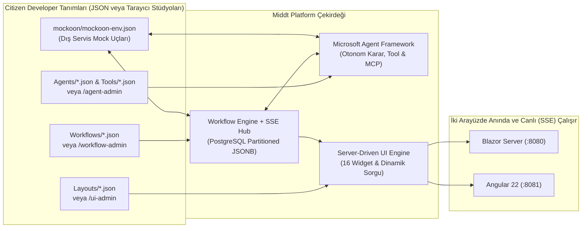
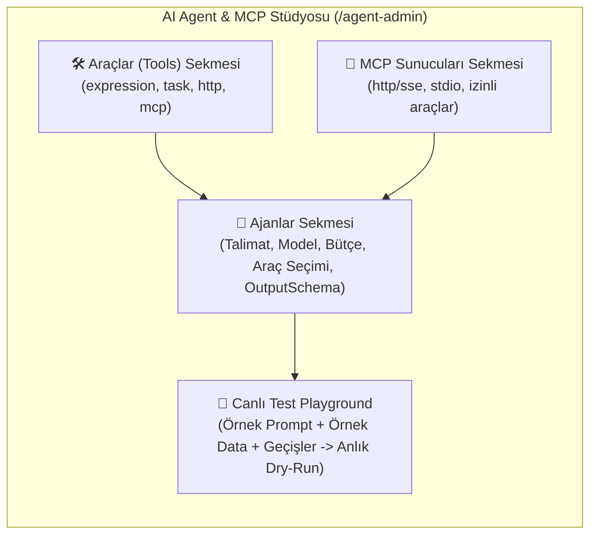

# Citizen Developer Rehberi – Middt Platform ile Kod Yazmadan (Zero-Code) Uygulama Geliştirme

Bu rehber, **Middt Platform** üzerinde C# veya TypeScript/HTML kodu yazmadan; yalnızca **JSON tanımları** ve tarayıcı üzerindeki **3 Görsel Stüdyo** (**Akış Tasarımı `/workflow-admin`**, **Ekran Tasarımı `/ui-admin`**, **AI Agent & MCP Stüdyosu `/agent-admin`**) kullanarak uçtan uca kurumsal uygulamaların (veri modeli, iş akışı motoru, iş kuralları, dış servis entegrasyonları, yapay zeka ajanları, gerçek zamanlı SSE güncellemeleri ve Blazor/Angular ekranları) nasıl geliştirileceğini adım adım anlatır.

---

## İçindekiler

1. [Mimari Genel Bakış: Citizen Developer Neleri Tanımlar?](#1-mimari-genel-bakış-citizen-developer-neleri-tanımlar)
   - [1.1. Tarayıcıdan Görsel Stüdyolar ile Geliştirme vs. JSON Dosyaları](#11-tarayıcıdan-görsel-stüdyolar-ile-geliştirme-vs-json-dosyaları)
2. [Proje Klasör Yapısı (Nereye Ne Eklenir?)](#2-proje-klasör-yapısı-nereye-ne-eklenir)
3. [Bölüm 1: İş Akışı Motoru (Workflow Engine) Kullanımı](#3-bölüm-1-iş-akışı-motoru-workflow-engine-kullanımı)
   - [3.1. Temel İş Akışı İskeleti ve Güvenlik](#31-temel-iş-akışı-iskeleti-ve-güvenlik)
   - [3.2. Veri Şeması, Otomatik İndeksleme ve Arama (`dataSchema`)](#32-veri-şeması-otomatik-indeksleme-ve-arama-dataschema)
   - [3.3. Başlangıç Formu ve Giriş Kuralları (`start`)](#33-başlangıç-formu-ve-giriş-kuralları-start)
   - [3.4. Durumlar (`states`), Sihirbaz Adımları ve Ekran Bağlama](#34-durumlar-states-sihirbaz-adımları-ve-ekran-bağlama)
   - [3.5. Geçişler (`transitions`) ve Tetikleyiciler (`trigger`)](#35-geçişler-transitions-ve-tetikleyiciler-trigger)
   - [3.6. Yerleşik Görevler (Built-in Tasks) ve Ayarları Referansı](#36-yerleşik-görevler-built-in-tasks-ve-ayarları-referansı)
     - [0. Tüm Görevlerde Ortak Ayarlar (`key`, `when`, `background`, `onError`)](#0-tüm-görevlerde-ortak-ayarlar-key-when-background-onerror)
     - [1. `set` — Veri Hesaplama ve Atama](#1-set--veri-hesaplama-ve-atama)
     - [2. `setKey` — İş Anahtarı (Business Key) Üretme](#2-setkey--iş-anahtarı-business-key-üretme)
     - [3. Akışlar Arası Veri Paylaşımı Görevleri (`loadWorkflow`, `queryWorkflow`, `updateWorkflow`, `triggerWorkflow`)](#3-akışlar-arası-veri-paylaşımı-görevleri-loadworkflow-queryworkflow-updateworkflow-triggerworkflow)
     - [4. `http` — Dış Servis Çağrısı](#4-http--dış-servis-çağrısı)
     - [5. `startWorkflow` — Yeni Bir Alt İş Akışı (Sub-Process) Başlatma](#5-startworkflow--yeni-bir-alt-iş-akışı-sub-process-başlatma)
     - [6. `fanOut` — Dizi Üzerinde Paralel Görev Çalıştırma](#6-fanout--dizi-üzerinde-paralel-görev-çalıştırma)
     - [7. `cache` — Önbellekleme (Cache-Aside)](#7-cache--önbellekleme-cache-aside)
     - [8. `publish` & `rabbitmq` — Mesaj Kuyruğuna Olay Yayınlama](#8-publish--rabbitmq--mesaj-kuyruğuna-olay-yayınlama)
     - [9. `operation` — Kayıtlı İş Operasyonu (`IWorkflowOperation`) Çalıştırma](#9-operation--kayıtlı-iş-operasyonu-iworkflowoperation-çalıştırma)
     - [10. `agent` / `aiAgent` — Yapay Zeka Ajanı Çalıştırma](#10-agent--aiagent--yapay-zeka-ajanı-çalıştırma)
     - [11. `mcp` — Model Context Protocol Sunucusu Çağrısı](#11-mcp--model-context-protocol-sunucusu-çağrısı)
     - [12. `log` — Yapılandırılmış Log Yazma](#12-log--yapılandırılmış-log-yazma)
4. [Bölüm 2: Yapay Zeka Ajanları (AI Agents), Araçlar (Tools), MCP ve Görsel Stüdyo (`/agent-admin`)](#4-bölüm-2-yapay-zeka-ajanları-ai-agents-araçlar-tools-ve-mcp)
   - [4.1. AI Ajanı Tanımlama (`Agents/*.json`)](#41-ai-ajanı-tanımlama-agentsjson)
   - [4.2. Kodsuz AI Araçları (`Agents/Tools/*.json`) — Expression, Task (`http`, `set`, `cache`) ve MCP](#42-kodsuz-ai-araçları-agentstoolsjson--expression-task-http-set-cache-ve-mcp)
   - [4.3. Akış İçinde Ajan Çağırma ve Otomatik Geçiş Kararı (`selectedTransition`)](#43-akış-içinde-ajan-çağırma-ve-otomatik-geçiş-kararı-selectedtransition)
   - [4.4. Görsel AI Ajan, Araç ve MCP Stüdyosu (`/agent-admin`) ve Canlı Test Playground](#44-görsel-ai-ajan-araç-ve-mcp-stüdyosu-agent-admin-ve-canlı-test-playground)
5. [Bölüm 3: İfade Dili (Expression Language) Rehberi](#5-bölüm-3-ifade-dili-expression-language-rehberi)
6. [Bölüm 4: Sunucu Güdümlü Ekran Tasarımı (`Layouts/*.json`), 16 Widget ve Canlı Tasarımcılar](#6-bölüm-4-sunucu-güdümlü-ekran-tasarımı-layoutsjson)
   - [6.1. Ekran Bileşenleri (Widgets) Kataloğu (`stat`, `tabs`, `timeline` Dahil 16 Bileşen)](#61-ekran-bileşenleri-widgets-kataloğu)
     - [6.1.1. `stat` — KPI / Metrik Kartı Bileşeni Detaylı Kullanımı](#611-stat--kpi--metrik-kartı-bileşeni-detaylı-kullanımı)
     - [6.1.2. `tabs` — Etkileşimli Sekmeli Panel Konteyneri Detaylı Kullanımı](#612-tabs--etkileşimli-sekmeli-panel-konteyneri-detaylı-kullanımı)
     - [6.1.3. `timeline` — Süreç ve Aktivite Zaman Çizelgesi Detaylı Kullanımı](#613-timeline--süreç-ve-aktivite-zaman-çizelgesi-detaylı-kullanımı)
   - [6.2. Görsel Sürükle-Bırak Ekran Tasarımcısı (`/ui-admin`)](#62-görsel-sürükle-bırak-ekran-tasarımcısı-ui-admin-ve-akış-bağlantısı)
   - [6.3. Görsel İş Akışı ve Görev Tasarımcısı (`/workflow-admin`)](#63-görsel-iş-akışı-ve-görev-tasarımcısı-workflow-admin)
   - [6.4. Sürüm Geçmişi, Simülasyon (Dry-Run), Görev Kutusu (`/inbox`), Operasyon Merkezi ve Paket Taşıma](#64-sürüm-geçmişi-simülasyon-dry-run-görev-kutusu-inbox-operasyon-merkezi-ve-paket-taşıma)
   - [6.5. Gerçek Zamanlı İş Akışı Güncellemeleri (Canlı SSE — Server-Sent Events)](#65-gerçek-zamanlı-iş-akışı-güncellemeleri-canlı-sse--server-sent-events)
7. [Bölüm 5: Dış Servis Simülasyonu (Mockoon) ve Başlangıç Verileri (Seeds)](#7-bölüm-5-dış-servis-simülasyonu-mockoon-ve-başlangıç-verileri-seeds)
8. [Bölüm 6: Uçtan Uca Örnek Proje — "Tedarikçi Satınalma Talebi" Modülü](#8-bölüm-6-uçtan-uca-örnek-proje--tedarikçi-satınalma-talebi-modülü)
9. [Kontrol Listesi ve Doğrulama Komutları](#9-kontrol-listesi-ve-doğrulama-komutları)

---

## 1. Mimari Genel Bakış: Citizen Developer Neleri Tanımlar?

Middt Platform'da veritabanı tablosu açmak, C# Entity/Controller yazmak veya Blazor/Angular sayfası kodlamak gerekmez. Platform tüm iş mantığını ve ekranları deklaratif JSON dosyalarından veya tarayıcıdaki **3 Görsel Stüdyodan** üretir:



Bir iş akışı (`Workflows/*.json` veya `/workflow-admin`) tanımladığınızda platform otomatik olarak:
1. PostgreSQL'de o akışa özel bölümlenmiş (`wf."WorkflowInstances_<Akis>"`, `wf."WorkflowInstanceData_<Akis>"`, vb.) tabloları ve `dataSchema` içindeki alanlara göre arama indekslerini oluşturur.
2. `/api/workflows/<akis-anahtari>`, gerçek zamanlı `/api/workflows/<akis-anahtari>/instances/{id}/events` (SSE) ve `/api/v1/<PascalCaseAkisAdi>/getitems|getall|getbyid` REST uçlarını açar.
3. Hem Blazor (`/workflow/<akis-anahtari>`) hem Angular arayüzünde **Liste**, **Arama Filtreleri**, **Yeni Kayıt Başlatma Formu**, **Sihirbaz (Wizard) Adımları**, **Durum Görünümü (`🟢 Canlı (SSE)`)**, **Aksiyon Butonları** ve **Geçmiş Zaman Çizelgesi** ekranlarını hazır hale getirir.

### 1.1. Tarayıcıdan Görsel Stüdyolar ile Geliştirme vs. JSON Dosyaları

Middt Platform'da tüm bileşenleri ister IDE'de JSON dosyası olarak, ister doğrudan tarayıcı üzerinden **3 Görsel Stüdyo** ile geliştirebilirsiniz. Görsel stüdyolarda yapılan her kayıt anında PostgreSQL veritabanına yazılır ve her iki arayüzde (Blazor `:8080` ve Angular `:8081`) yeniden başlatmaya gerek kalmadan devreye girer:

| Görsel Stüdyo | Tarayıcı Adresi | Ne İşe Yarar? | Veritabanı & Dosya Karşılığı |
|---|---|---|---|
| **Akış Tasarımı** | `/workflow-admin` | Sürükle-bırak 2B durum makinesi tuvali, 16 yerleşik görev bloğu, canlı SVG ok çizimi, `dataSchema` editörü ve değişmez sürümleme (`v1`, `v2`, …). | `wf."WorkflowDefinitions"` tablosu (`Workflows/*.json`) |
| **Ekran Tasarımı** | `/ui-admin` | Sürükle-bırak 16 bileşenli (`stat`, `tabs`, `timeline`, `grid`, `fields`, `section` vb.) ekran editörü, canlı önizleme, özellik denetçisi ve revizyon geçmişi. | `ui."UiLayouts"` & `ui."UiLayoutRevisions"` tabloları (`Layouts/*.json`) |
| **AI Agent & MCP Stüdyosu** | `/agent-admin` | Yapay zeka ajanlarını, deklaratif araçları (`expression`, `task`, `http`, `mcp`) ve MCP sunucularını görsel formlarla oluşturma, doğrulama ve **Canlı Test Playground** üzerinde örnek veriyle anında deneme. | `wf."WorkflowDefinitions"` tablosu (`Key = "__agents__"`) (`Agents/**/*.json`) |

---

## 2. Proje Klasör Yapısı (Nereye Ne Eklenir?)

Citizen Developer olarak tüm geliştirmelerinizi `demo/Middt.Demo.Workflows` (veya kendi API projenizin) altındaki şu klasörlerde yaparsınız:

| Klasör / Dosya | Amacı |
|---|---|
| `demo/Middt.Demo.Workflows/Workflows/*.json` | İş akışı tanımları (durumlar, geçişler, formlar, görevler, veri şeması). |
| `demo/Middt.Demo.Workflows/Agents/*.json` | Yapay zeka ajanı tanımları (sistem talimatları, kullandığı araçlar, çıktı şeması). |
| `demo/Middt.Demo.Workflows/Agents/Tools/*.json` | AI ajanlarının çağırdığı kodsuz araçlar (`expression`, `http`, `task`, `mcp`). |
| `demo/Middt.Demo.Workflows/Agents/McpServers/*.json` | Model Context Protocol (MCP) sunucu tanımları, kaynakları ve şablonları. |
| `demo/Middt.Demo.Workflows/Layouts/*.json` | Sunucu güdümlü ekran tasarımları (`kind: "page"` menü sayfaları, `kind: "view"` durum görünümleri ve ortak alt bileşenler). |
| `demo/Middt.Demo.Workflows/Seeds/*.json` | Uygulama ilk kalktığında otomatik oluşturulacak örnek iş akışı kayıtları. |
| `demo/mockoon/mockoon-env.json` | `http` görevleri ve AI `http` araçları için Mockoon dış servis simülasyon uçları. |

---

## 3. Bölüm 1: İş Akışı Motoru (Workflow Engine) Kullanımı

### 3.1. Temel İş Akışı İskeleti ve Güvenlik

Her iş akışı `Workflows/` klasöründe bir `.json` dosyasıdır:

```json
{
  "key": "credit-allocation",
  "version": 1,
  "title": "Kredi Tahsis & 4-Göz Onay",
  "icon": "account_balance",
  "history": "delta",
  "historySnapshotEvery": 10,
  "roles": ["manager", "credit-officer"],
  "instanceAccess": {
    "mode": "owner",
    "supervisorRoles": ["manager"]
  },
  "timeout": {
    "after": "PT24H",
    "target": "expired"
  }
}
```

- **`key`**: Akışın benzersiz kimliği (`kebab-case`). URL'lerde (`/workflow/credit-allocation`) ve alt akış çağrılarında kullanılır.
- **`title` & `icon`**: Ekran başlığı ve Material ikon adı (`account_balance`, `verified_user`, `receipt_long`, `smart_toy`, `trending_up`, vb.).
- **`history`**: `"full"` (varsayılan; her geçişte tüm veriyi tarihçeye yazar), `"delta"` (sadece değişen alanların RFC 6902 farkını yazar; `historySnapshotEvery` adımda bir tam anlık görüntü alır) veya `"none"`.
- **Akış ve Satır Bazlı Güvenlik (`roles` & `instanceAccess`)**:
  - `roles`: Akışı başlatabilecek ve görüntüleyebilecek roller (boş bırakılırsa oturum açmış tüm kullanıcılar erişebilir).
  - `instanceAccess.mode`: `"all"` (varsayılan) veya `"owner"` (kullanıcılar yalnızca kendi başlattıkları kayıtları görebilir).
  - `instanceAccess.supervisorRoles`: `"owner"` modunda tüm kayıtları görebilecek yönetici/denetçi rolleri (ör. `["manager"]`).

---

### 3.2. Veri Şeması, Otomatik İndeksleme ve Arama (`dataSchema`)

`dataSchema`, iş akışının sakladığı iş verilerini (`instance.data`), liste ekranındaki sütunları, arama filtrelerini ve veri maskelemeyi tanımlar:

```json
"dataSchema": {
  "type": "object",
  "properties": {
    "customerName": {
      "type": "string",
      "title": "Müşteri Adı",
      "x-search": true
    },
    "identityNumber": {
      "type": "string",
      "title": "TCKN / VKN",
      "x-search": true,
      "x-mask": {
        "pattern": "last4",
        "exceptRoles": ["manager", "idp-admin"]
      }
    },
    "segment": {
      "type": "string",
      "title": "Segment",
      "enum": ["Bireysel", "KOBİ", "Kurumsal"],
      "x-search": true
    },
    "amount": {
      "type": "number",
      "title": "Tutar (₺)",
      "x-search": true
    },
    "internalRiskNote": {
      "type": "string",
      "title": "İç Risk Notu",
      "x-roles": ["manager"]
    }
  }
}
```

- **`"x-search": true`**:
  - `string` alanlarda büyük/küçük harf duyarsız arama kutusu (veya `enum` ise açılır kutu) oluşturur.
  - `number` / `integer` alanlarda otomatik olarak **Min (≥)** ve **Max (≤)** aralık filtreleri oluşturur.
- **Alan Gizleme ve Maskeleme (İç İçe Nesneler Dahil)**:
  - `"x-mask": { "pattern": "last4" | "email" | "middle", "exceptRoles": ["manager", "idp-admin"] }`: Yetkisiz kullanıcılara alanı `*******8901` şeklinde maskeler, `exceptRoles` içindeki rollere tam değeri gösterir. (`data.customer.identityNumber` gibi iç içe nesne ve dizilerde de otomatik çalışır.)
  - `"x-roles": ["manager"]`: Yetkisiz kullanıcılardan alanı tamamen gizler (API yanıtından çıkarır) ve yetkisiz kullanıcıların bu alanı yazmasını engeller.
- **`"x-list": false`**: Alanın liste tablosunda sütun olarak görünmesini engeller, yalnızca detayda kullanılır.

---

### 3.3. Başlangıç Formu ve Giriş Kuralları (`start`)

Kullanıcı **"Yeni Başlat"** butonuna bastığında açılan form `start.input.schema` üzerinden otomatik üretilir:

```json
"start": {
  "key": "start",
  "target": "scoring",
  "input": {
    "rule": "input.collateralAmount >= input.amount * 0.5m",
    "ruleMessage": "Teminat tutarı kredi tutarının en az %50'si olmalıdır.",
    "schema": {
      "type": "object",
      "additionalProperties": false,
      "required": ["customerKey", "amount", "termMonths"],
      "properties": {
        "customerKey": {
          "type": "string",
          "title": "Müşteri",
          "x-lookup": {
            "entity": "CustomerOnboarding",
            "valueField": "key",
            "textField": "fullName"
          }
        },
        "amount": {
          "type": "number",
          "minimum": 1000,
          "maximum": 10000000,
          "title": "Talep Tutarı (₺)",
          "default": 250000
        },
        "termMonths": {
          "type": "integer",
          "title": "Vade (Ay)",
          "enum": [6, 12, 24, 36, 48],
          "default": 24
        },
        "notes": {
          "type": "string",
          "format": "textarea",
          "title": "Açıklama"
        }
      }
    }
  },
  "onExecute": [
    {
      "task": "set",
      "config": {
        "values": {
          "createdBy": "user.Name",
          "createdAt": "now"
        }
      }
    }
  ]
}
```

- **`x-lookup`**: Başka bir iş akışının aktif kayıtlarını açılır liste (Dropdown) olarak bağlar (`entity`: diğer akışın PascalCase adı, `valueField`: kaydedilecek alan, `textField`: gösterilecek metin).
- **`input.rule` & `input.ruleMessage`**: Form gönderildiğinde sunucu tarafında çalışan iş kuralı. Sağlanmazsa kullanıcıya `ruleMessage` gösterilir.
- **`input.sensitive`**: `["cardPin", "cvv"]` gibi tanımlanan alanlar yalnızca görev çalışırken bellekte kullanılır; veritabanına ve tarihçeye **asla** kaydedilmez.

#### Canlı Form Alanı Kuralları (`visibleWhen`, `requiredWhen`, `disabledWhen` ve `ui.<alan>`)

Hem iş akışı başlangıç/geçiş formlarında (`input.schema.properties`) hem de ekran tasarımlarındaki (`Layouts/*.json`) tablo arama (`grid.search`) ve CRUD formlarında (`grid.form`), form henüz açıkken (**"Kaydet / Gönder"** butonuna basılmadan önce) kullanıcının seçtiği veya yazdığı değerlere göre diğer alanları **anlık olarak** gizleyip gösterebilir, zorunlu yapabilir veya pasifleştirebilirsiniz:

| Özellik | Takma Ad (JSON Schema) | Açıklama |
|---|---|---|
| **`visibleWhen`** | `x-visibleWhen` | İfade `true` olduğunda alan ekranda gösterilir; `false` olduğunda alan gizlenir, gönderilen veriden çıkarılır ve doğrudan API çağrısıyla gönderilse bile sunucuda (`JsonSchemaValidator`) otomatik olarak **silinir** (doğrulanmamış gizli veri kayda giremez). |
| **`requiredWhen`** | `x-requiredWhen` | İfade `true` olduğunda (alan gizli veya pasif değilse) alan dinamik olarak **zorunlu (`*`)** hale gelir; hem arayüzde hem sunucu doğrulamasında zorunlu tutulur. |
| **`disabledWhen`** | `x-disabledWhen` | İfade `true` olduğunda alan mevcut `data.<alan>` (veya `default`) değeriyle doldurulur, arayüzde salt-okunur / pasif (`disabled`) hale gelir, zorunluluk kontrolünden muaf tutulur ve **sunucuda da korunur** (doğrudan API ile değiştirilmeye çalışılırsa `is disabled` hatasıyla reddedilir). |

> [!TIP]
> **`ui.<alan>`, `data.<alan>` ve `user` Nasıl Çalışır?**
> - **`ui.<alan>`**: Açık olan formun içinde kullanıcının **o an seçtiği veya yazdığı anlık (canlı) bileşen değeridir** (henüz "Kaydet / Gönder"e basılmamıştır).
> - **`data.<alan>`**: İş akışı kaydının veritabanında **kayıtlı olan mevcut verisidir** (henüz kayıt oluşmamış `start` formunda otomatik olarak `ui.<alan>` değerine düşer).
> - **`user`**: Oturum açmış kullanıcının kimlik ve rol bilgisidir (`user.IsInRole("manager")`, `user.Name`); Blazor, Angular ve sunucu (`JsonSchemaValidator`) katmanlarının tamamında aynı oturum kullanıcısıyla (oturum yoksa anonim kullanıcıyla) değerlendirilir.

**Örnek 1 (`customer-onboarding.json`): Segment seçimine göre "Vergi Dairesi" alanını anlık gösterme ve zorunlu kılma**
```json
"segment": {
  "type": "string",
  "title": "Müşteri Segmenti",
  "enum": [ "Bireysel", "KOBİ", "Kurumsal" ],
  "default": "Bireysel"
},
"taxOffice": {
  "type": "string",
  "maxLength": 100,
  "title": "Vergi Dairesi",
  "default": "Büyük Mükellefler V.D.",
  "visibleWhen": "ui.segment != \"Bireysel\"",
  "requiredWhen": "ui.segment == \"Kurumsal\"",
  "disabledWhen": "data.segment == \"Kurumsal\" && !user.IsInRole(\"manager\")"
}
```
- Kullanıcı formda `segment` açılır kutusunu `"Bireysel"` seçtiğinde `taxOffice` alanı gizlenir (`visibleWhen`).
- `"KOBİ"` seçtiğinde `taxOffice` alanı anında ekrana gelir fakat isteğe bağlıdır.
- `"Kurumsal"` seçtiğinde `taxOffice` alanı hem görünür hem de otomatik olarak **zorunlu (`*`)** olur (`requiredWhen`).
- Mevcut kayıt zaten `"Kurumsal"` ise (`data.segment == "Kurumsal"`) ve kullanıcı `manager` rolünde değilse alan pasif (`disabledWhen`) gelir.

**Örnek 2 (`credit-allocation.json`): Teminat türüne ve kredi tutarına göre dinamik pasifleştirme, görünürlük ve zorunluluk**
```json
"collateralType": {
  "type": "string",
  "title": "Teminat Türü",
  "enum": [ "Teminatsız", "Gayrimenkul İpoteği", "Nakdi Blokaj", "KGF Kefaleti" ],
  "default": "Gayrimenkul İpoteği"
},
"collateralAmount": {
  "type": "number",
  "minimum": 0,
  "title": "Teminat Değeri (₺)",
  "default": 500000,
  "disabledWhen": "ui.collateralType == \"Teminatsız\"",
  "requiredWhen": "ui.collateralType != \"Teminatsız\""
},
"appraisalReportNo": {
  "type": "string",
  "maxLength": 50,
  "title": "Gayrimenkul Ekspertiz Rapor No",
  "default": "EKS-2026-1042",
  "visibleWhen": "ui.collateralType == \"Gayrimenkul İpoteği\"",
  "requiredWhen": "ui.collateralType == \"Gayrimenkul İpoteği\" && ui.amount >= 1000000"
}
```
- Kullanıcı `collateralType` olarak `"Teminatsız"` seçtiği anda `collateralAmount` kutusu pasifleşir (`disabledWhen`) ve zorunluluğu kalkar.
- `"Gayrimenkul İpoteği"` seçildiğinde `appraisalReportNo` alanı açılır; eğer talep edilen kredi (`ui.amount`) `1.000.000 ₺` ve üzerine çıkarsa ekspertiz rapor numarası anında zorunlu hale gelir.

---

### 3.4. Durumlar (`states`), Sihirbaz Adımları ve Ekran Bağlama

```json
{
  "key": "specialist-review",
  "title": "Uzman İncelemesi & AI Copilot",
  "type": "Intermediate",
  "subType": "Human",
  "step": 2,
  "view": {
    "layout": "ai-dispute-detail"
  },
  "onEntry": [ ... ],
  "onExit": [ ... ],
  "transitions": [ ... ]
}
```

- **`type`**:
  - `"Intermediate"`: Ara durum.
  - `"SubFlow"`: Alt iş akışı (`subFlow.workflow`) tamamlanana kadar bekleyen durum.
  - `"Finish"`: Bitiş durumu (akış tamamlanır veya iptal olur).
- **`subType`**:
  - `"Human"`: Kullanıcı aksiyonu bekler.
  - `"Success"` / `"Error"` / `"Cancelled"` / `"Timeout"`: Bitiş durumunun rengini ve statüsünü belirler.
- **`step`**: `1, 2, 3...` verildiğinde ekranın üst kısmında otomatik olarak **Sihirbaz (Wizard) Adım Çubuğu** gösterilir.
- **`view.layout`**: Bu durumda hangi JSON ekran tasarımının (`Layouts/<key>.json`) gösterileceğini belirler.

---

### 3.5. Geçişler (`transitions`) ve Tetikleyiciler (`trigger`)

Bir durumdan diğerine (veya `"$self"` ile aynı durumun kendisine) geçişler 4 farklı şekilde tetiklenebilir:

| `trigger` | Açıklama | Önemli Alanlar |
|---|---|---|
| `"Manual"` (Varsayılan) | Kullanıcının ekranda gördüğü aksiyon butonlarıdır. | `title`, `description`, `style` (`primary`, `success`, `warning`, `danger`, `secondary`, `light`), `icon`, `roles`, `inline` (`true` ise popup yerine sayfa içinde form açar), `rule` (butonun görünme koşulu). |
| `"Automatic"` | `onEntry` görevleri biter bitmez motor tarafından otomatik değerlendirilir. | `rule` (koşul ifadesi; ör. `"data.amount <= 5000"` veya `"instance.agents.aiUnderwriter.selectedTransition == \"to-approved\""`), `default: true` (hiçbir kural tutmazsa seçilecek geçiş). |
| `"Scheduled"` | Belirtilen süre sonunda arka plan zamanlayıcısı ile tetiklenir (SLA / Hatırlatma). | `after`: `"00:15:00"` veya dinamik `"{{ data.slaDuration }}"`. |
| `"Event"` | Dış sistemden veya başka akıştan mesaj geldiğinde tetiklenir. | `event`: `"payment.received"`, `rule`: `"input.amount > 0"`. |

**4-Göz (Four-Eyes) Onay Kuralı Örneği**:
Bir önceki adımı onaylayan kişinin ikinci adımı onaylayamaması için `"denyRoles": ["$previousUser"]` kullanılır:
```json
{
  "key": "approve-stage2-four-eyes",
  "title": "2. Kademe Onay (4-Göz)",
  "target": "disbursed",
  "roles": ["manager"],
  "denyRoles": ["$previousUser"]
}
```

**Aynı Durumda Veri Güncelleme (`target: "$self"`)**:
Durumu değiştirmeden not eklemek, SLA uzatmak veya AI ajanını yeniden çalıştırmak için `"target": "$self"` kullanılır. `"reenter": true` verilirse durumun `onEntry` görevleri ve zamanlayıcıları yeniden çalıştırılır.

### 3.5.1. Kurumsal BPM Yönetişimi: Görev Üstlenme (`claim`), Çoklu Kişi / Rol Atama (`assign`) ve Çalışan Sürüm Göçü (`migrate`)

Middt Platform'da insan görevlerinin (`"subType": "Human"`) yetkilendirilmesi ve sahipliği **iki katmanlı** çalışır:
1. **Aday Havuzu (`roles` / `denyRoles`)**: Akış JSON tanımında hangi rol(ler)in veya kişi(ler)in o adımdaki geçişleri görebileceğini belirler.
2. **Çalışma Zamanı Sahipliği (`AssignedTo` — Claim / Unclaim / Assign)**: Aktif bir kaydın çalışma zamanında tek bir kişiye, birden fazla kişiye veya bir role/ekibe atanmasını/üstlenilmesini sağlar.

#### A) Akış Tanımında (`roles` ve `denyRoles`) Kişi ve Rol Belirteçleri

| Belirteç | Açıklama | JSON Örneği |
|---|---|---|
| `"<rol-adi>"` | Sabit rol adı; bu roldeki tüm kullanıcıların görev kutusuna (`Inbox`) düşer. | `"roles": ["underwriter", "credit-committee"]` |
| `"$role:<ifade>"` | Akış verisinden (`data`) dinamik olarak çözümlenen rol adı. | `"roles": ["$role:data.targetDepartmentRole"]` |
| `"$user:<ifade>"` | Doğrudan tek veya birden fazla kişiye (sabit veya `data` içinden dinamik) atama yapar. | `"roles": ["$user:data.primaryApprover", "$user:data.backupApprover", "$user:'ali@sirket.com'"]` |
| `"$starter"` / `"$owner"` | İş akışı kaydını başlatan kullanıcı (`instance.startedBy`). | `"roles": ["$starter"]` |
| `"$previousUser"` | Bir önceki adımı çalıştıran kullanıcı (`instance.lastExecutedBy`). **4-Göz (Four-Eyes)** ilkesi için `denyRoles` içinde kullanılır. | `"denyRoles": ["$previousUser"]` |
| `"$assignee"` | Kaydı çalışma zamanında üstlenen veya kendisine devredilen kullanıcı(lar)/rol (`instance.assignedTo`). | `"roles": ["$assignee", "manager"]` |

#### B) Çalışma Zamanında Görev Üstlenme (`claim`), Bırakma (`unclaim`) ve Vekalet / Atama (`assign`)

Aktif bir insan görevi adımında kayıt detay ekranındaki araç çubuğundan veya REST API üzerinden şu işlemler yapılabilir:

1. **Görevi Üstlenme (`🙋 Üzerime Al` — `POST /api/workflows/{workflow}/instances/{id}/claim`)**:
   - Aday havuzundaki yetkili bir kullanıcı görevi kendi üzerine alır (`instance.assignedTo = user.AuditName`).
   - Görev üstlenildiği anda aynı havuzdaki diğer kullanıcılar geçiş butonlarını çalıştıramaz (`403 Forbidden`) ve görevi tekrar üstlenemez (`409 Conflict`).
2. **Görevi Bırakma (`🔓 Görevi Bırak` — `POST /api/workflows/{workflow}/instances/{id}/unclaim`)**:
   - Görevi üstlenen kullanıcı veya bir yönetici (`manager`, `ui-admin`, `idp-admin`) görevi tekrar ortak aday havuzuna bırakır (`instance.assignedTo = null`).
3. **Kişiye, Çoklu Kişiye veya Role Devretme / Atama (`↪️ Devret / Ata` — `POST /api/workflows/{workflow}/instances/{id}/assign`)**:
   - Hem arayüzdeki **`↪️ Devret / Ata`** kutusundan hem de API üzerinden **tek kişiye**, **birden fazla kişiye** veya **doğrudan bir role** atama yapılabilir:
   ```json
   // 1. Tek bir kullanıcıya atama
   { "assignedTo": "ali@sirket.com" }

   // 2. Birden fazla kullanıcıya atama (dizi veya virgülle ayrılmış metin)
   { "users": ["ali@sirket.com", "veli@sirket.com"] }
   // veya UI kutusundan: "ali@sirket.com, veli@sirket.com"

   // 3. Doğrudan bir role/ekibe atama (dizi veya role:<ad> / @<ad> öneki)
   { "roles": ["kredi-komitesi", "onayci"] }
   // veya UI kutusundan: "role:kredi-komitesi" ya da "@kredi-komitesi"

   // 4. Kişi + Rol karma atama
   { "users": ["ali@sirket.com"], "roles": ["kredi-komitesi"] }
   ```
   - **Havuzdan Tekil Kilitleme**: Görev birden fazla kişiye (`"ali, veli"`) veya bir role (`"role:kredi-komitesi"`) atanmışsa, bu havuzdaki kullanıcıların ekranında hem **`🙋 Üzerime Al`** hem de **`🔓 Görevi Bırak`** butonu görünür. Havuzdaki kullanıcılardan biri **`🙋 Üzerime Al`** dediğinde görev yalnızca o kişinin adına kilitlenir.
   - **4-Göz Koruması ve Otomatik Sıfırlama**: Geçişte `denyRoles` (ör. `["$previousUser"]`) tanımlıysa, görev o kişiye devredilse dahi 4-göz yasağı korunur. Kayıt farklı bir duruma (`target != from`) geçtiğinde `assignedTo` ve `assignedAt` otomatik olarak temizlenir.
   - **Görev Kutusu (`Inbox`) ve Liste Filtreleri**:
     - `GET /api/workflows/inbox?assignment=mine` (bana veya rolüme atananlar), `assignment=unassigned` (henüz kimseye atanmamış olanlar), `assignment=claimed` (atanmış/üstlenilmiş olanlar), `assignment=all` (tümü).
     - `GET /api/workflows/{workflow}/instances?assignedTo=$mine` veya `assignedTo=$unassigned` veya `assignedTo=role:kredi-komitesi`.

#### C) Çalışan Kayıtların Yeni Sürüme Göçü (`POST /api/workflows/{workflow}/migrate`)

- Varsayılan olarak, yayınlanan yeni bir akış sürümü (`v2`, `v3`) yalnızca yeni başlatılan kayıtları etkiler; açık kayıtlar başladıkları sürümde (`instance.workflowVersion`) devam eder.
- Uzun süreli açık (`Active` / `Faulted`) kayıtları yeni sürüme taşımak için **`/workflow-admin` → `🔄 Sürüm & Göç`** sekmesini veya `POST /api/workflows/{workflow}/migrate` uç noktasını kullanabilirsiniz:
  ```json
  {
    "fromVersion": 1,
    "toVersion": 2,
    "stateMap": {
      "eski-inceleme-adimi": "yeni-uzman-inceleme-adimi"
    },
    "includeFaulted": true,
    "dryRun": true
  }
  ```
- **`dryRun: true` (`🔍 Önizle`)**: Veritabanını değiştirmeden kaç kaydın taşınacağını (`migratedCount`), hangi kayıtların hangi durumdan hangi duruma geçeceğini (`items`) ve yeni sürümde karşılığı bulunmayan durumları (`errors`) raporlar.
- **`dryRun: false` (`🚀 Göçü Uygula`)**: Kayıtları atomik olarak hedef sürüme ve yeni durum anahtarlarına taşır, tarihçeye (`WorkflowHistory`) `$migrate` (`Trigger = "Migration"`) kaydı düşer ve açık ekranları SSE (`instance.migrated`) ile anında günceller.

---

### 3.6. Yerleşik Görevler (Built-in Tasks) ve Ayarları Referansı

Görevler `start.onExecute`, `state.onEntry`, `state.onExit` veya `transition.onExecute` dizilerinde tanımlanır. Her görev bloğu; tüm görevlerde geçerli **ortak üst düzey ayarlar** (`key`, `when`, `background`, `onError`) ve göreve özel **`config`** ayarlarından oluşur.

#### 0. Tüm Görevlerde Ortak Ayarlar (`key`, `when`, `background`, `onError`)

| Ayar | Tip | Alabileceği Değerler / Açıklama |
|---|---|---|
| `task` | `string` | Çalıştırılacak görevin adı (`set`, `setKey`, `loadWorkflow`, `queryWorkflow`, `updateWorkflow`, `triggerWorkflow`, `http`, `startWorkflow`, `fanOut`, `cache`, `publish`, `rabbitmq`, `operation`, `agent`, `mcp`, `log`). |
| `key` | `string` | Görevin benzersiz adım anahtarı. Tarihçede (`History`), hata kayıtlarında (`Incidents`) ve AI ajan çıktılarında (`instance.agents.<key>`) bu anahtar görünür. Belirtilmezse `task` adı kullanılır. |
| `when` | `string` | C# mantıksal koşul ifadesi (`"data.amount >= 100000"`). Koşul `false` dönerse görev **atlanır (skip)**. |
| `background` | `boolean` | `false` (varsayılan) \| `true`. Yalnızca durumların `onEntry` dizisinde kullanılır (`Finish` veya `SubFlow` durumlarında ve `setKey` görevinde kullanılamaz). `true` olduğunda durum geçişi hemen kaydedilir, görev arka planda (`WorkflowJobProcessor`) asenkron çalıştırılır. |
| `onError.action` | `string` | Görev tüm tekrar denemelerden (`maxAttempts`) sonra yine hata verirse ne yapılacağını belirler:<br>• **`"Fault"`** *(varsayılan)*: Akışı `Faulted` durumuna alır ve `WorkflowIncidents` tablosuna hata kaydı açar (UI/API üzerinden `retry` edilebilir).<br>• **`"Transition"`**: Akışı hata durumunda `onError.transition` alanında belirtilen geçişe yönlendirir (alternatif/telafi yoluna sokar).<br>• **`"Continue"`**: Hatayı incident olarak kaydeder fakat akışı durdurmadan sıradaki göreve devam eder. |
| `onError.transition` | `string` | `onError.action: "Transition"` seçildiğinde tetiklenecek geçişin `key` adı (ör. `"gateway-fallback"`). |
| `onError.maxAttempts` | `number` | Toplam deneme sayısı (`1` = tekrar deneme yapma, `3` = ilk deneme + 2 tekrar). |
| `onError.delay` | `string` | İlk tekrar deneme öncesi bekleme süresi (`"00:00:01"` veya ISO 8601 `"PT2S"`). |
| `onError.backoffMultiplier` | `number` | Her başarısız denemede bekleme süresinin çarpılacağı üstel katsayı (varsayılan `2.0`; ör. 1s -> 2s -> 4s). |
| `onError.maxDelay` | `string` | Üstel bekleme süresinin çıkabileceği üst sınır (`"00:00:30"`). |
| `onError.useJitter` | `boolean` | `false` (varsayılan) \| `true`. Aynı anda hata alan yüzlerce akışın dış servisi aynı saniyede tekrar vurmasını (thundering herd) önlemek için bekleme süresine `±%20` rastgele sapma ekler. |
| `onError.retryOnStatusCodes` | `string[]` | Yalnızca belirtilen HTTP durum kodlarında tekrar deneme yapar. Tam kod (`"408"`, `"429"`), grup (`"5xx"`) veya hariç tutma (`"!400"`) destekler. |

**Ortak Ayarlar (`when`, `background`, `onError`) JSON Örnekleri:**

```json
// Örnek A: Koşullu (when), arka planda (background) ve hata durumunda alternatif geçişe (Transition) yönlendiren görev
{
  "key": "send-erp-order",
  "task": "http",
  "when": "data.amount >= 50000 && data.requiresErpSync == true",
  "background": true,
  "onError": {
    "maxAttempts": 3,
    "delay": "00:00:02",
    "backoffMultiplier": 2.0,
    "maxDelay": "00:00:30",
    "useJitter": true,
    "retryOnStatusCodes": ["408", "429", "5xx"],
    "action": "Transition",
    "transition": "erp-manual-fallback"
  },
  "config": {
    "method": "POST",
    "url": "http://mockoon:3000/api/v1/erp/orders",
    "body": { "orderCode": "{{ data.orderCode }}" }
  }
}
```
```json
// Örnek B: Hata olsa bile akışı durdurmadan devam eden (Continue) görev
{
  "key": "optional-crm-notify",
  "task": "http",
  "onError": {
    "maxAttempts": 2,
    "delay": "00:00:01",
    "action": "Continue"
  },
  "config": {
    "method": "POST",
    "url": "http://mockoon:3000/api/v1/crm/notify",
    "body": { "customerKey": "{{ data.customerKey }}" }
  }
}
```

---

#### 1. `set` — Veri Hesaplama ve Atama
```json
{
  "task": "set",
  "config": {
    "values": {
      "ltvRatio": "data.collateralAmount > 0 ? Math.Round((data.amount * 100m) / data.collateralAmount, 2) : 100m",
      "statusNote": "\"Onaylayan: \" + user.Name",
      "approvedAt": "now"
    }
  }
}
```
| `config` Ayarı | Tip | Alabileceği Değerler / Açıklama |
|---|---|---|
| `values` *(veya `set`)* | `object` | `{ "hedefAlanYolu": "C# İfadesi" }` çiftlerinden oluşur (`values` ve `set` birbirinin yerine kullanılabilir). Noktalı yol (`"risk.score"`) verilirse iç içe JSON nesnesi oluşturur. |

> [!TIP]
> **Standart Anahtar Kelime Sözleşmesi (`input` / `output` / `select` / `set` / `into`)**:
> Proje genelinde geçişler (`transitions`), alt akışlar (`subFlow`) ve tüm görevler (`tasks`) aynı anahtar kelime sözleşmesini paylaşır:
> - **Girdi (`input` / `data` / `body` / `payload` / `arguments`)**: Karşı tarafa gönderilen veri (`transition.input`, `subFlow.input`, `startWorkflow` (`data`/`input`), `triggerWorkflow` (`input`/`data`/`payload`), `http` (`body`/`payload`/`input`), `operation` (`input`/`args`/`payload`), `mcp` (`arguments`/`args`/`input`), `publish` & `rabbitmq` (`payload`/`body`/`message`/`input`/`data`)).
> - **C# İfadesiyle Atama (`set` / `values`)**: Hedef yol -> C# ifadesi eşlemesi (`transition.input.set` (veya `values`), `set` görevi (`values` veya `set`), `updateWorkflow` (`values` veya `set`)).
> - **Hedef Kök Yol (`into`)**: Dönen yanıtın veya alt akış verisinin `instance.data` içinde yazılacağı alt nesne yolu (`transition.input.into`, `subFlow.into`, tüm görevlerde `config.into`).
> - **Seçmeli Alan / Dönüşüm (`select` / `output`)**: Dönen yanıttan veya alt akıştan yalnızca seçilen alanları (`["field1", "field2"]`) veya C# ifadeleriyle dönüştürülen alanları (`{ "hedefAlan": "result.body.score * 2" }`) `instance.data` içine yazar (`subFlow`, `http`, `loadWorkflow`, `queryWorkflow`, `updateWorkflow`, `triggerWorkflow`, `startWorkflow`, `operation`, `mcp`, `agent`). `select` ve `output` tüm bu yapılarda birbirinin yerine kullanılabilir.

---

#### 2. `setKey` — İş Anahtarı (Business Key) Üretme
```json
{
  "task": "setKey",
  "config": {
    "key": "CUST-{{ data.identityNumber }}",
    "ensureUnique": true
  }
}
```
| `config` Ayarı | Tip | Alabileceği Değerler / Açıklama |
|---|---|---|
| `key` | `string` | Kayda atanacak iş anahtarı şablonu (maksimum 256 karakter). Aynı anahtarla akış tekrar başlatılmak istenirse yeni kayıt açılmaz, mevcut kayıt döner (idempotent). |
| `ensureUnique` | `boolean` | `false` (varsayılan) \| `true`:<br>• **`false`**: Aynı iş anahtarı başka bir kayıtta varsa görev hata fırlatır.<br>• **`true`**: Aynı iş anahtarı başka bir kayıtta zaten varsa çakışmayı önlemek için anahtarın sonuna otomatik olarak `-<6HaneliInstanceId>` (ör. `CUST-12345678901-4A9F1C`) ekler; kaydın zaten bir anahtarı varsa dokunmaz. |

---

#### 3. Akışlar Arası Veri Paylaşımı Görevleri (`loadWorkflow`, `queryWorkflow`, `updateWorkflow`, `triggerWorkflow`)

Middt Platform'da farklı iş akışları birbirinin verisini okuyabilir, filtreleyip özet (toplam/ortalama/adet) çıkarabilir, başka bir akışın verisini güncelleyebilir veya diğer akışta geçiş/olay (`event`) tetikleyebilir.
Tüm akışlar arası görevlerde hedef kayıt(lar) şu seçicilerle belirlenir:

| Ortak Hedef Seçici | Tip | Alabileceği Değerler / Açıklama |
|---|---|---|
| `workflow` | `string` | *(Zorunlu)* Hedef iş akışının anahtarı (ör. `"customer-onboarding"`, `"credit-allocation"`). |
| `id` | `string` | Hedef kaydın benzersiz `Guid` kimliği (`"{{ data.customerInstanceId }}"`). |
| `key` | `string` | Hedef kaydın `BusinessKey` değeri (`"{{ data.customerKey }}"`). |
| `where` | `string` | Hedef akışın **Instance Data (`WorkflowInstanceData`)** alanları üzerinde tek bir birleşik C# koşul ifadesi (`"target.taxNumber == data.taxNumber && target.segment == \"Corporate\""`). Motor, `where` içindeki eşitlik ve büyüktür/küçüktür koşullarını otomatik olarak PostgreSQL bölüm (partition) indekslerine indirger ve kalan ifadeyi JSON verisi üzerinde çalıştırır. |
| `state` | `string` | Yalnızca belirli bir durumda olan kayıtları filtreler (ör. `"approved"`, `"waiting-payment"`). |
| `status` | `string` | Yalnızca belirli yaşam döngüsü statüsündeki kayıtları filtreler:<br>• **`"Active"`**: Devam eden akışlar<br>• **`"Completed"`**: Tamamlanmış (`Finish`) akışlar<br>• **`"Cancelled"`**: İptal edilmiş akışlar<br>• **`"Faulted"`**: Hataya düşmüş akışlar |

##### 3a. `loadWorkflow` (veya `getWorkflow`) — Tekil Akış Kaydı ve AI Çıktılarını Okuma
Başka bir iş akışı kaydını `key`, `id` veya `where` (instance data filtresi) ile bulur; seçilen alanları (`select`), varsa AI ajanı çıktılarını (`includeAgents: true`) ve geçiş tarihçesini (`includeHistory: true`) mevcut akışın içerisine yükler:

```json
{
  "task": "loadWorkflow",
  "config": {
    "workflow": "customer-onboarding",
    "where": "target.identityNumber == data.identityNumber",
    "includeAgents": true,
    "includeHistory": true,
    "failIfNotFound": false,
    "select": {
      "companyName": "companyName",
      "creditScore": "creditScore",
      "availableLimit": "(target.approvedLimit ?? 0) - (target.usedLimit ?? 0)",
      "kycAiSummary": "agents.kycRiskAgent.summary"
    },
    "into": "customer"
  }
}
```
| `loadWorkflow` Ayarı | Tip | Alabileceği Değerler / Açıklama |
|---|---|---|
| `select` *(veya `output`)* | `string[]` veya `object` | • **Belirtilmezse**: Hedef kaydın tüm `data` alanlarını ve üst verilerini (`id`, `key`, `state`, `status`, `found`) kopyalar.<br>• **Dizi (`["companyName", "creditScore"]`)**: Yalnızca listedeki alanları ve üst verileri kopyalar.<br>• **Nesne (`{ "hedefAlan": "ifade" }`)**: Hedef akışın verisi (`target.*` veya `result.*`) ve mevcut akışın verisi (`data.*`) üzerinden C# ifadesi hesaplayarak alanı dönüştürür. |
| `includeAgents` | `boolean` | `false` (varsayılan) \| `true`. `true` ise hedef akışta çalışmış AI ajanlarının çıktılarını `target.agents.<ajanKey>` ve `target.agentRuns` altında getirir. |
| `includeHistory` | `boolean` | `false` (varsayılan) \| `true`. `true` ise hedef akışın durum geçiş tarihçesini `target.history` dizisi olarak getirir. |
| `failIfNotFound` | `boolean` | `false` (varsayılan) \| `true`:<br>• **`false`**: Kayıt bulunamazsa akışı durdurmaz; `into` içerisine `{ "found": false, "state": null, "status": null }` yazar.<br>• **`true`**: Kayıt bulunamazsa `WorkflowTaskException` fırlatır (`onError` politikasını tetikler). |
| `into` | `string` | Sonucun `data` içinde yazılacağı alan yolu (ör. `"customer"`). `select` nesne olarak verilmiş ve `into` boş bırakılmışsa alanlar doğrudan `data` kök nesnesine yazılır. |

##### 3b. `queryWorkflow` (veya `searchWorkflow` / `findWorkflow`) — Çoklu Akış Sorgulama, Filtreleme ve Toplama (`aggregate`)
Başka bir akışın (veya aynı akışın geçmiş kayıtlarının) birden fazla kaydını tek bir **`where`** koşuluyla (PostgreSQL partition indekslerini otomatik kullanarak) sorgular, sıralar ve `sum`, `avg`, `min`, `max`, `count` toplamalarını hesaplar:

```json
{
  "task": "queryWorkflow",
  "config": {
    "workflow": "credit-allocation",
    "state": "approved",
    "excludeSelf": true,
    "where": "target.customerKey == data.customerKey && target.amount >= 50000 && target.termMonths >= 12",
    "orderBy": "amount",
    "descending": true,
    "take": 20,
    "select": ["id", "key", "amount", "termMonths", "state", "createdAt"],
    "aggregate": {
      "totalExposure": { "op": "sum", "field": "amount" },
      "maxLoanAmount": { "op": "max", "field": "amount" },
      "avgLoanAmount": "avg:amount",
      "activeLoanCount": "count"
    },
    "into": "customerLoanSummary"
  }
}
```
| `queryWorkflow` Ayarı | Tip | Alabileceği Değerler / Açıklama |
|---|---|---|
| `excludeSelf` *(veya `excludeCurrent`)* | `boolean` | `false` (varsayılan) \| `true`. Aynı akış (`workflow == instance.workflow`) sorgulanırken, şu an çalışmakta olan kaydın kendisini sonuçlardan ve toplamalardan (`sum`/`count`) hariç tutar. |
| `orderBy` | `string` | Sıralama alanı: `"createdAt"` (varsayılan), `"updatedAt"`, `"key"`, `"state"`, `"status"` veya hedef kaydın `data` içindeki herhangi bir alanı (ör. `"amount"`). |
| `descending` | `boolean` | `true` (varsayılan: azalan / en yeniden eskiye) \| `false` (artan). |
| `take` *(veya `limit`)* | `number` | Getirilecek maksimum kayıt sayısı (`1` ile `500` arası, varsayılan `50`). |
| `first` | `boolean` | `false` (varsayılan) \| `true`. `true` verilirse `into` alanına liste özeti yerine doğrudan **eşleşen ilk kaydın nesnesi** (bulunamazsa `{ "found": false }`) yazılır. |
| `select` | `string[]` veya `object` | Her bir kayıt için hangi alanların seçileceğini veya dönüştürüleceğini belirler. |
| `aggregate` | `object` | Eşleşen kayıtlar üzerinde toplama hesaplar. İki yazım biçimini destekler:<br>1. Nesne: `{ "op": "sum", "field": "amount" }`<br>2. Kısa metin: `"sum:amount"`, `"avg:amount"`, `"min:amount"`, `"max:amount"`, `"count"`<br>**Desteklenen `op` değerleri**:<br>• **`"count"`**: Kayıt adedi (veya `field` verilirse o alanı dolu olanların adedi)<br>• **`"sum"`**: Sayısal alanın toplamı<br>• **`"avg"`**: Sayısal alanın ortalaması<br>• **`"min"`**: En küçük değer<br>• **`"max"`**: En büyük değer |
| `into` | `string` | *(Zorunlu)* Sonucun yazılacağı alan. İçerisine `{ count, exists, items, first, aggregates, <toplamaAlanlari> }` nesnesi yazılır. |

##### 3c. `updateWorkflow` (veya `patchWorkflow` / `setWorkflowData`) — Başka Bir Akışın Verisini Güncelleme
Mevcut akış içerisinden başka bir akış kaydını (veya `"all": true` ile eşleşen tüm kayıtları) `key`, `id` ya da **`where`** (instance data koşulu) ile bulup `values` ifadeleriyle, `merge` şablonuyla veya RFC 6902 `patch` dizisiyle güvenli biçimde günceller ve versiyonunu (`DataVersion`) artırır:

```json
// Örnek 1: Tekil kaydı (all: false) Instance Data (where) ile bulup C# ifadeleriyle (values) güncelleme
{
  "task": "updateWorkflow",
  "config": {
    "workflow": "customer-onboarding",
    "where": "target.customerNumber == data.customerNumber && target.segment == \"Corporate\"",
    "all": false,
    "values": {
      "usedLimit": "(target.usedLimit ?? 0) + data.amount",
      "lastAllocationKey": "instance.key",
      "lastAllocationAt": "now"
    },
    "into": "updatedCustomer"
  }
}
```
```json
// Örnek 2: Eşleşen TÜM kayıtları (all: true) topluca güncelleme
{
  "task": "updateWorkflow",
  "config": {
    "workflow": "invoice-collection",
    "state": "waiting-payment",
    "where": "target.customerKey == data.customerKey && target.remainingAmount <= 5000",
    "all": true,
    "values": {
      "discountApplied": "true",
      "remainingAmount": "Math.Round(target.remainingAmount * 0.90m, 2)"
    },
    "into": "bulkDiscountResult"
  }
}
```
```json
// Örnek 3: JSON şablonu birleştirme (merge) veya RFC 6902 JSON Patch (patch) ile güncelleme
{
  "task": "updateWorkflow",
  "config": {
    "workflow": "customer-onboarding",
    "key": "{{ data.customerKey }}",
    "merge": {
      "contact": {
        "email": "{{ data.newEmail }}",
        "phone": "{{ data.newPhone }}"
      }
    },
    "patch": [
      { "op": "replace", "path": "/riskSegment", "value": "{{ data.calculatedSegment }}" }
    ],
    "validateSchema": true,
    "into": "patchedCustomer"
  }
}
```
| `updateWorkflow` Ayarı | Tip | Alabileceği Değerler / Açıklama |
|---|---|---|
| `all` | `boolean` | `false` (varsayılan) \| `true`:<br>• **`false`**: `where` koşuluyla eşleşen **en güncel tek kaydı** günceller.<br>• **`true`**: `where` koşulunu sağlayan **tüm aktif/eşleşen kayıtları** tek seferde günceller ve `into` içerisine `{ "updatedCount": N, "items": [...] }` yazar. |
| `values` *(veya `set`)* | `object` | `{ "hedefAlan": "C# İfadesi" }`. İfade içinde **`target`** (güncellenen karşı akışın mevcut verisi) ve **`data`** (içinde bulunduğumuz akışın verisi) birlikte kullanılabilir. |
| `merge` *(veya `data` / `input`)* | `object` | `{{ }}` şablonları içeren JSON nesnesi; hedef akışın verisiyle derinlemesine birleştirilir (deep-merge). |
| `patch` | `array` | RFC 6902 JSON Patch operasyon dizisi (`[{ "op": "replace", "path": "/limit", "value": "{{ data.newLimit }}" }]`). |
| `targetInto` | `string` | `merge` ile gönderilen nesnenin hedef kaydın kök verisi yerine belirli bir alt alanına (ör. `"paymentSummary"`) yazılmasını sağlar. |
| `validateSchema` | `boolean` | `false` (varsayılan) \| `true`. `true` ise güncelleme sonrası hedef akışın `dataSchema` kurallarını yeniden doğrular. |
| `failIfNotFound` | `boolean` | `true` (varsayılan) \| `false`. Hedef kayıt bulunamazsa hata fırlatılıp fırlatılmayacağını belirler. |
| `select` *(veya `output`)* | `string[]` veya `object` | Güncellenen kayıttan yalnızca belirli alanları seçer veya dönüştürür (`into` olmadan verilirse doğrudan `data` içine yazar). |
| `into` | `string` | Güncelleme sonucunun (`{ updated, id, key, state, status, dataVersion, data }`) yazılacağı alan. |

##### 3d. `triggerWorkflow` (veya `transitionWorkflow` / `sendWorkflowEvent`) — Başka Bir Akışta Geçiş veya Olay Tetikleme
Başka bir akış kaydını `key`, `id` veya **`where`** (instance data koşulu) ile bulup doğrudan bir geçişi (`transition`) çalıştırır veya o akışa bir olay mesajı (`event`) gönderir:

```json
// Örnek 1: Hedef akışa olay mesajı (event) gönderme ve hazır değilse 5 dakika kuyrukta bekletme (bufferFor)
{
  "task": "triggerWorkflow",
  "config": {
    "workflow": "order-payment-orchestration",
    "where": "target.orderCode == data.orderCode",
    "event": "PaymentCaptured",
    "bufferFor": "00:05:00",
    "all": false,
    "input": {
      "paymentReference": "{{ data.paymentId }}",
      "paidAmount": "{{ data.amount }}"
    },
    "into": "orderStateAfterPayment"
  }
}
```
```json
// Örnek 2: Hedef akışta doğrudan geçiş (transition) tetikleme (senkron veya runAsync: true ile asenkron)
{
  "task": "triggerWorkflow",
  "config": {
    "workflow": "credit-allocation",
    "key": "{{ data.allocationKey }}",
    "transition": "approve-stage1",
    "runAsync": false,
    "input": {
      "approvalNote": "Üst akış tarafından otomatik onaylandı."
    },
    "into": "allocationTransitionResult"
  }
}
```
| `triggerWorkflow` Ayarı | Tip | Alabileceği Değerler / Açıklama |
|---|---|---|
| `transition` | `string` | Hedef akışta doğrudan tetiklenecek geçişin anahtarı (ör. `"approve"`, `"cancel"`). `event` ile birlikte kullanılmaz. |
| `event` | `string` | Hedef akışta `"trigger": "Event"` olan geçişe gönderilecek olay adı (ör. `"PaymentCaptured"`). |
| `bufferFor` | `string` | Yalnızca `event` modunda geçerlidir (`"00:05:00"` veya `"PT5M"`). Hedef akış o anda başka bir işlemle meşgulse veya **henüz o olayı bekleyen duruma (`state`) gelmemişse**, mesajı çöpe atmak yerine belirtilen süre boyunca `WorkflowJobs` tablosunda (`Kind = "Message"`) bekletir; hedef akış ilgili duruma girdiği anda mesaj otomatik işlenir. |
| `runAsync` | `boolean` | `false` (varsayılan) \| `true`. Yalnızca `transition` modunda geçerlidir:<br>• **`false`**: Geçişi anında senkron çalıştırır ve yeni durumu `into` alanına yazar.<br>• **`true`**: Geçişi arka plan işi (`WorkflowJobs`) olarak kuyruğa alır ve mevcut akışı bekletmeden devam eder (`into` içinde `"queued": true` döner). |
| `all` | `boolean` | `false` (varsayılan) \| `true`. `where` kullanıldığında eşleşen **tüm** kayıtlarda geçişi/olayı tetikler. |
| `input` *(veya `data`)* | `object` | Hedef geçişe veya olaya gönderilecek girdi verisi (`input`). |
| `failIfNotFound` | `boolean` | `true` (varsayılan) \| `false`. Hedef kayıt bulunamazsa hata fırlatılıp fırlatılmayacağını belirler. |
| `into` | `string` | Tetikleme sonucunun (`{ triggered, id, key, state, status, data }`) yazılacağı alan. |

---

#### 4. `http` — Dış Servis Çağrısı ve Yanıttan Seçmeli Alan Yazma (`select` / `output`)
> [!IMPORTANT]
> `http` görevlerinde her zaman `http://` veya `https://` ile başlayan **tam (absolute) URL** kullanılmalıdır. Güvenlik (SSRF koruması) gereği URL'nin `host` (alan adı) kısmında `{{ }}` şablonu kullanılamaz; şablonlar yalnızca yol (path) ve `queryParams` içinde kullanılabilir.

```json
// Örnek 1: Yanıtın yalnızca belirli alanlarını seçerek (select: nesne veya dizi) into alanına yazma
{
  "key": "charge-http",
  "task": "http",
  "onError": {
    "maxAttempts": 3,
    "delay": "00:00:01",
    "backoffMultiplier": 2.0,
    "retryOnStatusCodes": ["408", "429", "5xx"],
    "action": "Transition",
    "transition": "gateway-fallback"
  },
  "config": {
    "method": "POST",
    "url": "http://mockoon:3000/api/v1/OrderPaymentOrchestration/ping",
    "queryParams": {
      "channel": "web"
    },
    "headers": {
      "X-Channel": "Middt-Workflow"
    },
    "body": {
      "orderCode": "{{ data.orderCode }}",
      "amount": "{{ data.amount }}"
    },
    "acceptedStatusCodes": [200, 201],
    "failOnError": true,
    "timeoutSeconds": 30,
    "select": {
      "body.referenceCode": "result.body.referenceCode",
      "body.status": "result.body.status",
      "statusCode": "result.statusCode",
      "isSuccess": "result.isSuccess"
    },
    "into": "gatewayResponse"
  }
}
```
```json
// Örnek 2: into kullanmadan doğrudan instance.data içindeki hedef yollara yazma (output / select eşlemesi)
{
  "key": "fetch-fx-rate",
  "task": "http",
  "config": {
    "method": "GET",
    "url": "http://mockoon:3000/api/v1/fx/rates",
    "output": {
      "paymentTxId": "result.body.referenceCode",
      "convertedAmount": "data.amount * result.body.rate",
      "audit.gatewayStatus": "result.statusCode"
    }
  }
}
```
| `http` Ayarı | Tip | Alabileceği Değerler / Açıklama |
|---|---|---|
| `url` | `string` | *(Zorunlu)* `http://` veya `https://` ile başlayan tam URL. |
| `method` | `string` | `"GET"` (varsayılan), `"POST"`, `"PUT"`, `"PATCH"`, `"DELETE"`. |
| `queryParams` *(veya `query`)* | `object` | URL sonuna güvenli (`Uri.EscapeDataString`) olarak eklenecek sorgu parametreleri. |
| `headers` | `object` | İsteğe eklenecek HTTP başlıkları (`{{ }}` şablonu destekler). |
| `body` | `any` | Gönderilecek JSON gövdesi veya metin (`{{ }}` şablonu destekler). |
| `contentType` | `string` | Gövde içerik tipi (varsayılan `"application/json"`). |
| `acceptedStatusCodes` | `number[]` veya `string[]` | Başarılı kabul edilecek HTTP durum kodları (ör. `[200, 201, 404]`). Belirtilmezse tüm `2xx` kodları başarılı sayılır. |
| `failOnError` | `boolean` | `true` (varsayılan) \| `false`:<br>• **`true`**: Kabul edilmeyen durum kodlarında veya ağ hatalarında `WorkflowTaskException` fırlatır (`onError` devreye girer).<br>• **`false`**: Hata fırlatmaz; akışı kesmeden `into` / `select` / `output` içerisine `{ "statusCode": 503, "isSuccess": false, "error": "...", "body": ... }` yazar. |
| `timeoutSeconds` | `number` | İstek zaman aşımı süresi (saniye, varsayılan `30`, üst sınır `300`). |
| `select` *(veya `output`)* | `string[]` veya `object` | Tüm HTTP yanıt zarfı ve başlıkları yerine **yalnızca seçili alanları** `instance.data` içine yazar (`loadWorkflow.select` ve `subFlow.output` ile aynı yapıda):<br>• **Dizi (`string[]`)**: `["body.referenceCode", "statusCode"]` veya doğrudan JSON gövde alanları `["referenceCode", "status"]`.<br>• **Eşleme nesnesi (`object`)**: `{ "hedefAlan": "result.body.referenceCode", "tutar": "result.body.amount * 1.2" }`. `into` belirtilmişse `data.<into>` altına, `into` belirtilmemişse doğrudan `instance.data` içindeki hedef yollara yazar. İfadelerde `result.*` (`result.body`, `result.headers`, `result.statusCode`, `result.isSuccess`) ve `target.*` kullanılabilir. |
| `into` | `string` | Yanıtın yazılacağı alan yolu (`select` / `output` kullanılmazsa tüm `{ statusCode, isSuccess, headers, body }` zarfını yazar; `select` / `output` nesnesi kullanıldığında isteğe bağlıdır). |

---

#### 5. `startWorkflow` — Yeni Bir Alt İş Akışı (Sub-Process) Başlatma
Başka bir iş akışını yeni bir kayıt olarak başlatır ve oluşan kaydın `id` değerini `into` alanına yazar:
```json
{
  "key": "start-shipping-flow",
  "task": "startWorkflow",
  "config": {
    "workflow": "order-payment-orchestration",
    "key": "ORD-{{ data.orderCode }}",
    "data": {
      "orderCode": "{{ data.orderCode }}",
      "customerKey": "{{ data.customerKey }}",
      "amount": "{{ data.amount }}"
    },
    "into": "spawnedOrderInstanceId"
  }
}
```
| `startWorkflow` Ayarı | Tip | Alabileceği Değerler / Açıklama |
|---|---|---|
| `workflow` | `string` | *(Zorunlu)* Başlatılacak akışın anahtarı. |
| `key` | `string` | Yeni kayda verilecek `BusinessKey` şablonu (aynı anahtarla kayıt zaten varsa mevcut kaydın `id` değerini döndürür). |
| `data` | `object` | Yeni akışa başlangıç verisi (`input`) olarak gönderilecek JSON şablonu. |
| `into` | `string` | Başlatılan akış kaydının `Guid` (`id`) değerinin yazılacağı alan. |

---

#### 6. `fanOut` — Dizi Üzerinde Paralel Görev Çalıştırma
Bir dizi (`items`) içindeki her eleman için `subTask` görevini izole bir kopya üzerinde paralel çalıştırır ve tüm sonuçları `into` dizisinde toplar:
```json
{
  "key": "parallel-risk-checks",
  "task": "fanOut",
  "config": {
    "items": "new string[] { \"Fraud Kontrolü\", \"Stok Kontrolü\", \"Limit Kontrolü\" }",
    "maxConcurrency": 3,
    "into": "parallelChecks",
    "subTask": {
      "task": "startWorkflow",
      "when": "item.value != null",
      "config": {
        "workflow": "risk-limit-eval",
        "data": {
          "checkType": "{{ item.value }}",
          "checkIndex": "{{ index }}",
          "amount": "{{ data.amount }}"
        },
        "into": "checkResult"
      }
    }
  }
}
```
| `fanOut` Ayarı | Tip | Alabileceği Değerler / Açıklama |
|---|---|---|
| `items` | `string` | *(Zorunlu)* Üzerinde dönülecek diziyi üreten C# ifadesi (`"data.orderLines"` veya `"new string[] { \"A\", \"B\" }"`). Alt görev (`subTask`) içinde dizinin o anki elemanına **`item`** (ilkel metin/sayı dizilerinde `item.value`), 0 tabanlı sırasına **`index`** değişkeni ile erişilir. |
| `maxConcurrency` | `number` | Aynı anda paralel çalışacak maksimum alt görev sayısı (varsayılan `5`, üst sınır `64`). |
| `subTask` *(veya `task` / `innerTask`)* | `TaskDefinition` | *(Zorunlu)* Her eleman için çalıştırılacak görev tanımı. `subTask.when` kullanılarak belirli dizi elemanları filtrelenebilir. |
| `into` | `string` | Tüm paralel alt görevlerin ürettiği çıktıların sırasıyla `JsonArray` olarak yazılacağı alan. |

---

#### 7. `cache` — Önbellekleme (Cache-Aside)
Önce `key` ile dağıtık önbelleği (`IDistributedCache` / `IMemoryCache`) kontrol eder; veri önbellekte varsa `subTask` görevini **hiç çalıştırmadan** doğrudan `into` alanına yazar, yoksa `subTask` görevini çalıştırıp ürettiği sonucu `ttl` süresi boyunca önbelleğe kaydeder:
```json
{
  "key": "cache-payment-receipt",
  "task": "cache",
  "config": {
    "key": "payment:{{ data.orderCode }}",
    "ttl": "00:20:00",
    "into": "paymentReceipt",
    "subTask": {
      "task": "set",
      "config": {
        "values": {
          "paymentReceipt": "data.gatewayResponse.body.referenceCode"
        }
      }
    }
  }
}
```
| `cache` Ayarı | Tip | Alabileceği Değerler / Açıklama |
|---|---|---|
| `key` | `string` | *(Zorunlu)* Önbellek anahtarı şablonu (ör. `"fx:{{ data.currency }}"`). Sistemde `middt:wf:cache:<key>` önekiyle saklanır. |
| `ttl` | `string` | Önbellekte tutulma süresi (`"00:15:00"` veya ISO 8601 `"PT15M"`, varsayılan `"PT5M"` / 5 dakika). |
| `into` | `string` | *(Zorunlu)* Önbellekten okunan veya `subTask` tarafından `into` yoluna üretilen verinin yazılacağı alan yolu. |
| `subTask` *(veya `task` / `innerTask`)* | `TaskDefinition` | *(Zorunlu)* Önbellekte veri bulunamadığında (cache miss) çalıştırılacak görev (`http`, `loadWorkflow`, `queryWorkflow`, `set` vb.). |

---

#### 8. `publish` & `rabbitmq` — Mesaj Kuyruğuna Olay Yayınlama
```json
{
  "key": "publish-domain-event",
  "task": "publish",
  "config": {
    "type": "OrderPaymentCaptured",
    "payload": {
      "orderCode": "{{ data.orderCode }}",
      "amount": "{{ data.amount }}"
    }
  }
}
```
```json
{
  "key": "publish-rabbitmq-topic",
  "task": "rabbitmq",
  "config": {
    "exchange": "banking.events",
    "routingKey": "credit.approved.{{ data.segment }}",
    "headers": {
      "X-Workflow-Instance": "{{ instance.id }}"
    },
    "payload": {
      "customerKey": "{{ data.customerKey }}",
      "amount": "{{ data.amount }}"
    },
    "into": "rabbitPublishResult"
  }
}
```
| Görev & Ayar | Tip | Alabileceği Değerler / Açıklama |
|---|---|---|
| `publish.type` | `string` | *(Zorunlu)* `IWorkflowMessagePublisher` (Rebus) üzerinden yayınlanacak olay tipi. Diğer akışlardaki `"trigger": "Event"` geçişlerini tetiklemek için kullanılır. |
| `publish.payload` | `object` | Olay gövdesi (`workflow` ve `instanceId` alanları otomatik eklenir). |
| `rabbitmq.routingKey` *(veya `queue` / `topic`)* | `string` | *(Zorunlu)* Mesajın yönlendirileceği RabbitMQ kuyruk veya routing anahtarı (`{{ }}` şablonu destekler). |
| `rabbitmq.exchange` | `string` | RabbitMQ exchange adı (varsayılan `"middt.workflow.events"`). |
| `rabbitmq.headers` | `object` | Mesaj üst bilgileri (`x-workflow`, `x-instance-id`, `x-routing-key` otomatik eklenir). |
| `rabbitmq.payload` *(veya `body` / `message`)* | `any` | Gönderilecek JSON mesaj gövdesi. |
| `rabbitmq.into` | `string` | Yayınlama onay bilgisinin (`{ published: true, exchange, routingKey, publishedAt }`) yazılacağı alan. |

---

#### 9. `operation` — Kayıtlı İş Operasyonu (`IWorkflowOperation`) Çalıştırma
```json
{
  "key": "run-ledger-operation",
  "task": "operation",
  "config": {
    "operation": "calculate-amortization",
    "input": {
      "principal": "{{ data.amount }}",
      "termMonths": "{{ data.termMonths }}"
    },
    "into": "amortizationSchedule"
  }
}
```
| `operation` Ayarı | Tip | Alabileceği Değerler / Açıklama |
|---|---|---|
| `operation` *(veya `name`)* | `string` | *(Zorunlu)* DI konteynerine kaydedilmiş `IWorkflowOperation` sınıfının adı. |
| `input` *(veya `params`)* | `object` | Operasyona geçirilecek girdi parametreleri (`{{ }}` şablonu destekler). |
| `into` | `string` | Operasyonun döndürdüğü JSON çıktısının `data` içinde yazılacağı alan. |

---

#### 10. `agent` / `aiAgent` — Yapay Zeka Ajanı Çalıştırma
```json
// Örnek 1: Tekil ajan (mode: "single") ve otomatik geçiş yönlendirme
{
  "key": "aiUnderwriter",
  "task": "agent",
  "config": {
    "agent": "risk-limit-underwriter",
    "mode": "single",
    "allowedTransitions": ["auto-approve", "send-to-committee", "auto-reject"],
    "transitionProperty": "nextTransition",
    "transitionInto": "aiSelectedRoute",
    "prompt": "Müşteri: {{ data.customerKey }}, Tutar: {{ data.amount }} TL, Mevcut Açık Risk: {{ data.customerLoanSummary.totalExposure }} TL. Başvuruyu değerlendir."
  }
}
```
```json
// Örnek 2: Çoklu ajan orkestrasyonu (mode: "sequential" | "concurrent" | "handoff")
{
  "key": "committeeMultiAgentReview",
  "task": "agent",
  "config": {
    "mode": "sequential",
    "agents": [
      "kyc-compliance-agent",
      "risk-limit-underwriter",
      "dispute-resolution-specialist"
    ],
    "prompt": "Kurumsal kredi başvurusunu uyum, kredi riski ve hukuki açıdan sırayla değerlendirip nihai komite kararını oluşturun."
  }
}
```
| `agent` Ayarı | Tip | Alabileceği Değerler / Açıklama |
|---|---|---|
| `mode` | `string` | Ajan orkestrasyon çalışma modu:<br>• **`"single"`** *(varsayılan)*: Tek bir AI ajanını (`agent` / `name`) çalıştırır.<br>• **`"sequential"`**: `agents` dizisindeki ajanları sırayla (boru hattı / pipeline olarak, birinin çıktısını diğerine aktararak) çalıştırır.<br>• **`"concurrent"`** *(veya `"parallel"`)*: `agents` dizisindeki ajanları aynı anda paralel çalıştırır ve tüm görüşleri birleştirir.<br>• **`"handoff"`**: `agents` dizisindeki ajanlar arasında dinamik görev devri (triage -> uzman ajan devri) yapar. |
| `agent` *(veya `name`)* | `string` | `mode: "single"` iken çalıştırılacak kayıtlı ajan adı (`Agents/*.json`) veya satır içi ajan adı. |
| `agents` | `array` | `mode: "sequential" \| "concurrent" \| "handoff"` iken çalıştırılacak ajan adları dizisi (`["fraud-agent", "credit-agent"]`) veya ajan nesneleri dizisi. |
| `prompt` *(veya `input` / `message`)* | `string` | Ajana gönderilecek kullanıcı istemi (`{{ }}` şablonu destekler). Çok turlu mesaj dizisi için `messages` kullanılabilir. |
| `instructions` *(veya `system`)* | `string` | Kayıtlı ajanın sistem talimatlarını (`instructions`) bu görev özelinde ezmek veya satır içi ajan tanımlamak için kullanılır. |
| `tools` | `string[]` | Ajana tanımlı araçlara ek olarak bu adımda açılacak araç (`Tools/*.json`) listesi. |
| `mcpServers` | `string[]` | Ajana bu adımda bağlanacak MCP sunucu adları listesi. |
| **Otomatik Geçiş Yönlendirme (Auto-Routing)** | | Ajanın bulunduğu durumdaki (`state`) `Automatic` geçişler motor tarafından **otomatik olarak keşfedilir** ve ajanın JSON çıktı şemasına (`outputSchema`) enum olarak enjekte edilir. Ajanın seçtiği geçiş `instance.agents.<key>.selectedTransition` üzerinden akışı yönlendirir: |
| `allowedTransitions` | `string[]` | Ajanın seçmesine izin verilen geçiş anahtarlarının açık listesi (ör. `["auto-approve", "auto-reject"]`). Belirtilmezse durumdaki uygun tüm geçişler otomatik verilir. |
| `transitionProperty` | `string` | Ajanın JSON yanıtındaki hangi alanın geçiş kararı olarak okunacağını belirler (varsayılan **`"selectedTransition"`**). |
| `transitionInto` | `string` | Ajanın seçtiği geçiş anahtarının ayrıca `instance.data` içinde yazılacağı alan yolu (ör. `"aiSelectedRoute"`). |
| `sessionKey` | `string` | Çok turlu (multi-turn) konuşma geçmişi anahtarı (varsayılan: görev `key` değeri). Aynı `sessionKey` kullanılan adımlar önceki konuşma geçmişini hatırlar. |
| `model` *(veya `modelId`)* | `string` | Varsayılan LLM modelini bu görev için değiştirir. |
| `temperature` | `number` | Yaratıcılık/deterministiklik katsayısı (ör. `0.1`). |
| `maxOutputTokens` | `number` | Maksimum yanıt token sınırı. |
| `maxToolCalls` | `number` | Ajanın tek bir çalışmada yapabileceği maksimum araç (Tool/MCP) çağrısı bütçesi (aşılırsa görev hata verir). |
| `maxTotalTokens` | `number` | Ajanın tek bir çalışmada tüketebileceği maksimum toplam (girdi + çıktı) token bütçesi. |
| `outputSchema` | `object` | Ajanın yanıtını zorunlu kılacak JSON Schema tanımı. |
| `into` | `string` | Ajan çıktıları varsayılan olarak `instance.agents.<key>` tablosuna kaydedilir; ayrıca `instance.data` içine de kopyalanması isteniyorsa hedef alan yolu verilir. |

---

#### 11. `mcp` — Model Context Protocol Sunucusu Çağrısı
Dış veya yerel bir MCP sunucusuna bağlanarak araç çağırır (`callTool`), kaynak okur (`readResource`), hazır istem şablonu alır (`getPrompt`) veya sunucu yeteneklerini listeler (`listTools`, `listResources`):
```json
// Örnek 1: MCP Aracı Çağırma (action: "callTool")
{
  "key": "call-banking-mcp",
  "task": "mcp",
  "config": {
    "server": "core-banking-mcp",
    "action": "callTool",
    "tool": "get_customer_exposure",
    "arguments": {
      "customerKey": "{{ data.customerKey }}"
    },
    "into": "mcpExposureResult",
    "metaInto": "mcpCallMeta"
  }
}
```
```json
// Örnek 2: MCP Kaynağı Okuma (action: "readResource")
{
  "key": "read-policy-resource",
  "task": "mcp",
  "config": {
    "server": "core-banking-mcp",
    "action": "readResource",
    "uri": "banking://policies/credit-limits/{{ data.segment }}",
    "into": "segmentPolicyDoc"
  }
}
```
```json
// Örnek 3: MCP İstem Şablonu Alma (action: "getPrompt")
{
  "key": "get-underwriting-prompt",
  "task": "mcp",
  "config": {
    "server": "core-banking-mcp",
    "action": "getPrompt",
    "prompt": "corporate_credit_review",
    "arguments": {
      "companyName": "{{ data.companyName }}",
      "requestedAmount": "{{ data.amount }}"
    },
    "into": "preparedPrompt"
  }
}
```
| `mcp` Ayarı | Tip | Alabileceği Değerler / Açıklama |
|---|---|---|
| `server` | `string` | *(Zorunlu)* `appsettings.json` (`AgentSettings.McpServers`) içinde tanımlı MCP sunucu anahtarı. |
| `action` *(veya `op`)* | `string` | MCP sunucusunda gerçekleştirilecek işlem türü:<br>• **`"callTool"`** *(veya `"call"`, `"tool"` — varsayılan)*: MCP sunucusundaki bir aracı (`tool`) `arguments` parametreleriyle çalıştırır.<br>• **`"listTools"`**: MCP sunucusunun sunduğu tüm araçların listesini ve JSON şemalarını döndürür.<br>• **`"readResource"`** *(veya `"resource"`)*: MCP sunucusundaki bir veri kaynağını (`uri`) okur.<br>• **`"listResources"`**: MCP sunucusundaki tüm okunabilir kaynakların listesini döndürür.<br>• **`"getPrompt"`** *(veya `"prompt"`)*: MCP sunucusundaki hazır bir istem şablonunu (`prompt`) `arguments` parametreleriyle alır. |
| `tool` *(veya `name`)* | `string` | `action: "callTool"` seçildiğinde çağrılacak MCP aracının adı. |
| `uri` *(veya `resource`)* | `string` | `action: "readResource"` seçildiğinde okunacak kaynağın URI adresi (`{{ }}` şablonu destekler). |
| `prompt` *(veya `name`)* | `string` | `action: "getPrompt"` seçildiğinde alınacak istem şablonunun adı. |
| `arguments` *(veya `args` / `input`)* | `object` | `callTool` veya `getPrompt` işlemine gönderilecek parametreler (`{{ }}` şablonu destekler). |
| `into` | `string` | MCP yanıtının `data` içinde yazılacağı alan yolu (varsayılan `"mcpResult"`). |
| `metaInto` | `string` | Çağrı üst verisinin (`{ server, action, executedAt }`) yazılacağı alan yolu. |

---

#### 12. `log` — Yapılandırılmış Log Yazma
```json
{
  "key": "log-decision",
  "task": "log",
  "config": {
    "level": "Information",
    "message": "Kredi başvurusu ({{ instance.key }}) {{ data.customer.companyName }} için değerlendirildi."
  }
}
```
| `log` Ayarı | Tip | Alabileceği Değerler / Açıklama |
|---|---|---|
| `message` | `string` | *(Zorunlu)* Loglanacak metin şablonu (`{{ }}` destekler). |
| `level` | `string` | `"Trace"`, `"Debug"`, `"Information"` *(varsayılan)*, `"Warning"`, `"Error"`, `"Critical"`. |

---

## 4. Bölüm 2: Yapay Zeka Ajanları (AI Agents), Araçlar (Tools) ve MCP

Middt Platform, **Microsoft Agent Framework** (`Microsoft.Agents.AI`) üzerinde çalışan, tamamen JSON ile tanımlanan yapay zeka ajanlarını destekler.

> [!NOTE]
> Ajan çıktı verileri, çok turlu konuşma geçmişi (Session) ve araç çağrıları (Tool Calls) iş akışının `instance.data` nesnesini kirletmez; PostgreSQL'de ayrı bölümlenmiş tablolarda (`wf."WorkflowAgentSessions"`, `wf."WorkflowAgentRuns"`, `wf."WorkflowAgentToolCalls"`) saklanır ve `instance.agents.<taskKey>`, `instance.agentRuns`, `instance.toolCalls` üzerinden okunur.

### 4.1. AI Ajanı Tanımlama (`Agents/*.json`)

`demo/Middt.Demo.Workflows/Agents/risk-limit-underwriter.json` örneği:

```json
{
  "name": "risk-limit-underwriter",
  "description": "Müşterinin KKB risk skorunu, ödeme geçmişini ve TCMB sicilini analiz eden AI Tahsis Ajanı.",
  "maxToolCalls": 10,
  "maxTotalTokens": 16000,
  "instructions": "Sen otonom bir Kredi Tahsis ajanısın. Araçları çağırarak müşteriyi analiz et ve uygun geçişi (selectedTransition) seç.",
  "tools": [
    "query_customer_risk_score",
    "lookup_customer_payment_history",
    "verify_central_bank_registry_http",
    "evaluate_collateral_and_sector_exposure"
  ],
  "outputSchema": {
    "type": "object",
    "required": ["decision", "riskLevel", "riskScore", "recommendedLimit", "summary", "recommendation"],
    "properties": {
      "decision": { "type": "string", "default": "Otomatik Limit Onayı" },
      "riskLevel": { "type": "string", "enum": ["Düşük", "Orta", "Yüksek"], "default": "Düşük" },
      "riskScore": { "type": "integer", "minimum": 0, "maximum": 1900, "default": 810 },
      "recommendedLimit": { "type": "number", "minimum": 0, "default": 250000 },
      "summary": { "type": "string" },
      "recommendation": { "type": "string" }
    }
  }
}
```

### 4.2. Kodsuz AI Araçları (`Agents/Tools/*.json`) — Expression, Task (`http`, `set`, `cache`), MCP ve Rol Bazlı Yetki (`roles`)

Bir AI ajanının kullanabileceği araçlar `Agents/Tools/*.json` altında C# kodu yazmadan tanımlanır. Bir araca `"roles": ["manager"]` eklendiğinde, akışı çalıştıran kullanıcının bu rolü yoksa araç ajana sunulmaz ve çağrılamaz:

#### Tür A: İfade / Hesaplama Aracı (`"kind": "expression"`)
```json
{
  "name": "query_customer_risk_score",
  "kind": "expression",
  "description": "Müşterinin KKB kredi risk skorunu ve önerilen limiti sorgular.",
  "parameters": {
    "type": "object",
    "properties": {
      "customerKey": { "type": "string" },
      "amount": { "type": "number" }
    }
  },
  "output": {
    "riskScore": "{{ args.amount > 500000 ? 640 : 810 }}",
    "creditGrade": "{{ args.amount > 500000 ? \"B+ (Yakın İzleme)\" : \"A+ (Prime)\" }}",
    "recommendedLimit": "{{ args.amount * 1.25 }}"
  }
}
```

#### Tür B: HTTP Task Aracı (`"kind": "task", "task": "http"`)
İş akışı motorunun `http` görevini doğrudan bir AI aracı olarak çalıştırır (tam URL zorunludur):

```json
{
  "name": "verify_central_bank_registry_http",
  "kind": "task",
  "task": "http",
  "description": "TCMB Risk Merkezi ve KKB HTTP Gateway servisine HTTP POST çağrısı yapar.",
  "parameters": {
    "type": "object",
    "properties": {
      "customerKey": { "type": "string" },
      "amount": { "type": "number" },
      "checkType": { "type": "string" }
    }
  },
  "config": {
    "method": "POST",
    "url": "http://mockoon:3000/api/v1/credit-bureau/check",
    "headers": {
      "X-Bureau-Channel": "TCMB-KKB-Gateway-v1"
    },
    "body": {
      "customerKey": "{{ args.customerKey ?? data.customerKey ?? \"CUST-GENEL\" }}",
      "amount": "{{ args.amount ?? data.amount ?? 0 }}",
      "checkType": "{{ args.checkType ?? data.checkType ?? \"Kredi Limit Analizi\" }}"
    }
  }
}
```

> [!TIP]
> `"kind": "task"` ile sadece `http` değil; `"task": "loadWorkflow"`, `"task": "set"`, `"task": "cache"`, `"task": "publish"` gibi **tüm** iş akışı görevlerini AI ajanına araç olarak verebilirsiniz. `"writeToWorkflowData": true` eklerseniz aracın ürettiği alanlar doğrudan iş akışının `data` nesnesine de yazılır.

### 4.3. Akış İçinde Ajan Çağırma ve Otomatik Geçiş Kararı (`selectedTransition`)

Bir durumun `onEntry` adımında `aiAgent` görevi çalıştırıldığında:
1. Motor, o durumdan çıkabilecek `Automatic` geçişleri (`key`, `title`, `description`, `target`) otomatik olarak bulur ve ajana bildirir.
2. Ajan araçlarını çalıştırır, `outputSchema` formatında raporunu üretir ve geçilecek hedefi `selectedTransition` olarak kaydeder.
3. Durumun `transitions` listesinde bu karar okunarak akış yönlendirilir:

```json
{
  "key": "evaluate",
  "title": "AI Risk Skoru & Ödeme Geçmişi Analizi",
  "onEntry": [
    {
      "key": "riskLimitUnderwriter",
      "task": "aiAgent",
      "config": {
        "agent": "risk-limit-underwriter",
        "prompt": "{{ data.customerKey }} müşterisi için {{ data.amount }} TL tutarlı talebi analiz et ve uygun geçişi (nextTransition) seç.",
        "context": {
          "customerKey": "{{ data.customerKey }}",
          "amount": "{{ data.amount }}",
          "requireUnderwriting": "{{ data.requireUnderwriting }}"
        }
      }
    }
  ],
  "transitions": [
    {
      "key": "to-rejected",
      "title": "Otomatik Red (Limit Aşımı)",
      "description": "Talep edilen tutar 5.000.000 TL kurum üst limitini aşıyorsa doğrudan reddedilir.",
      "target": "rejected",
      "trigger": "Automatic",
      "rule": "instance.agents.riskLimitUnderwriter != null && instance.agents.riskLimitUnderwriter.selectedTransition == \"to-rejected\""
    },
    {
      "key": "to-underwriting",
      "title": "Tahsis Uzmanı İncelemesine Sevk",
      "description": "Talep tutarı 500.000 TL üzerindeyse tahsis uzmanı incelemesine yönlendirilir.",
      "target": "manual-underwriting",
      "trigger": "Automatic",
      "rule": "instance.agents.riskLimitUnderwriter != null && instance.agents.riskLimitUnderwriter.selectedTransition == \"to-underwriting\""
    },
    {
      "key": "to-approved",
      "title": "Otomatik Limit Onayı",
      "description": "500.000 TL ve altı standart talepler otomatik onaylanır.",
      "target": "approved",
      "trigger": "Automatic",
      "default": true
    }
  ]
}
```

> [!IMPORTANT]
> Otomatik geçişlerde `title` ve `description` alanlarını açıkça yazın. AI ajanı hangi geçişi seçeceğine karar verirken geçişlerin `key`, `title` ve `description` bilgilerini birlikte değerlendirir.

### 4.4. Görsel AI Ajan, Araç ve MCP Stüdyosu (`/agent-admin`) ve Canlı Test Playground

Citizen Developer'lar yeni bir yapay zeka ajanı, deklaratif araç (Tool) veya MCP sunucusu eklemek için diskteki JSON dosyalarını açmak zorunda değildir. Sol menüdeki **AI Agent & MCP Stüdyosu** (`/agent-admin` — hem Blazor `http://localhost:8080/agent-admin` hem Angular `http://localhost:8081/agent-admin` üzerinde mevcuttur) 3 sekmeli bir görsel stüdyo ve **Canlı Test Playground** sunar:



#### 1. 🤖 Ajanlar (Agents) Sekmesi
- Sol listedeki **"+ Yeni"** butonuna tıklayarak yeni bir ajan başlatabilir veya mevcut bir ajanı (`dispute-orchestrator`, `risk-limit-underwriter`, `invoice-collection-advisor` vb.) seçebilirsiniz.
- **Görsel Form Editörü**:
  - **Ajan Adı (`name`)** ve **Açıklama (`description`)**
  - **Sağlayıcı (`provider`)**: `DeepSeek`, `OpenAI`, `Ollama` veya boş bırakıldığında sistem varsayılanı
  - **Model ID (`modelId`)**, **Temperature (`temperature`)**, **Maks. Araç Çağrısı (`maxToolCalls`)** ve **Maks. Toplam Token (`maxTotalTokens`)** bütçeleri
  - **Sistem Talimatları (`instructions`)**: Ajanın rolünü, iş kurallarını ve çıktı beklentilerini anlatan doğal dil yönergesi
  - **Kullanılabilir Araçlar (`tools`)**: Sistemde kayıtlı tüm deklaratif araçlar onay kutusu (checkbox) listesi olarak gelir; ajanın kullanmasını istediğiniz araçları tek tıkla işaretleyebilirsiniz.
  - **MCP Sunucuları (`mcpServers`)**: Kayıtlı MCP sunucularını onay kutusuyla ajana bağlayabilirsiniz.
  - **Çıktı Şeması (`outputSchema` JSON)**: Ajanın üreteceği yapılandırılmış JSON yanıtının şeması.
- Üst barda yer alan **"Görsel Form / JSON Kodu"** geçişiyle istediğiniz an tam JSON tanımını da görüntüleyip düzenleyebilirsiniz.
- **"Doğrula"** (`POST /api/agents/validate`) şema ve araç referanslarını kontrol eder; **"Kaydet"** (`PUT /api/agents/{name}`) ajanı anında belleğe ve PostgreSQL `wf."WorkflowDefinitions"` (`Key = "__agents__"`) kaydına yazar.

#### 2. 🛠️ Araçlar (Declarative Tools) Sekmesi
Sol üstten **Araçlar (Tools)** sekmesine geçip **"+ Yeni"** butonuna tıklayarak kod yazmadan 4 farklı tipte araç oluşturabilirsiniz:
1. **`kind: "expression"` (Taşınabilir İfade Aracı)**:
   - `output` alanına yazdığınız `{{ ... }}` şablonlarını ve matematiksel/mantıksal ifadeleri (`args.*` ve `data.*` üzerinden) hesaplayıp ajana döndürür.
2. **`kind: "task"` (İş Akışı Görevi Köprüsü)**:
   - **Alt Görev Tipi (`task`)** açılır kutusundan `http`, `loadWorkflow`, `queryWorkflow`, `updateWorkflow`, `triggerWorkflow`, `startWorkflow`, `cache`, `set`, `publish`, `rabbitmq`, `operation` görevlerinden herhangi birini seçebilirsiniz.
   - Örneğin `"task": "loadWorkflow"` veya `"task": "queryWorkflow"` seçerek ajanın başka bir iş akışındaki müşteri/fatura/sipariş kayıtlarını sorgulamasını sağlayabilirsiniz.
   - **`writeToWorkflowData: true`** işaretlenirse aracın ürettiği veri doğrudan aktif iş akışı kaydının `data` nesnesine de kalıcı olarak yazılır.
3. **`kind: "http"` (Doğrudan REST API Aracı)**:
   - `config` içinde `url` (`http://...` tam URL), `method` (`GET`/`POST`) ve `body` şablonu tanımlayarak dış servisleri ajana araç olarak açar.
4. **`kind: "mcp"` (MCP Köprü Aracı)**:
   - Kayıtlı bir MCP sunucusundaki (`mcpServer`) belirli bir aracı (`mcpTool`) RBAC rol kontrolüyle (`roles`) sarmalar.

#### 3. 🔌 MCP Sunucuları (MCP Servers) Sekmesi
- **Taşıma Tipi (`transport`)**: Uzak HTTP JSON-RPC 2.0 sunucuları için `http` / `sse` (`endpoint`: `https://...` ve `headers`), yerel süreçler için `stdio` (`command` ve `arguments`) seçilir.
- **İzin Verilen Araçlar (`allowedTools`)**: Sunucudaki araçlardan yalnızca izin verilenlerin ajana açılmasını sağlayan beyaz liste.

#### 4. 🧪 Canlı Test Playground (Dry-Run Test Paneli)
Ajanlar sekmesinde sağ tarafta yer alan **Canlı Test Playground** paneli, tasarladığınız ajanı herhangi bir iş akışı başlatmadan ve veritabanını kirletmeden (`WriteToWorkflowData` kapalı izole modda) saniyeler içinde test etmenizi sağlar:
1. **Test Prompt (`prompt`)**: Ajana gönderilecek örnek kullanıcı mesajını yazın.
2. **İzin Verilen Geçişler (`allowedTransitions`)**: Virgülle ayrılmış örnek geçiş anahtarları girin (ör. `to-approved, to-underwriting, to-rejected`).
3. **Örnek İş Akışı Verisi (`data` JSON)**: Ajanın ve araçlarının `data.*` üzerinden okuyacağı örnek JSON verisini girin (ör. `{ "customerKey": "CUST-101", "amount": 350000 }`).
4. **"▶️ Testi Çalıştır"** (`POST /api/agents/test`) butonuna tıkladığınızda:
   - Ajan gerçek LLM (`DeepSeek` / `OpenAI` / `Ollama`) veya `LocalAgentChatClient` üzerinde çalışır,
   - Gerekli araçları (`tools` / `mcpServers`) canlı olarak çağırır,
   - Sağ panelde **Seçilen Geçiş (`selectedTransition`)** rozeti, **Çalışma Süresi (`ms`)**, **Token Kullanımı (`prompt` + `completion`)**, **Üretilen Yapılandırılmış Çıktı (`output` JSON)** ve **Çağrılan Araçların (`toolCalls`)** girdi/çıktı detayları anında listelenir.

#### 5. İş Akışı Tasarımcısından (`/workflow-admin`) Tek Tıkla Ajan Stüdyosuna Geçiş
`/workflow-admin` içinde bir duruma `agent` / `aiAgent` görevi eklediğinizde, sağ denetçideki ajan seçimi açılır kutusunun hemen yanında **"🤖 Ajanı Stüdyoda Aç (`/agent-admin`)"** kısayolu yer alır; tıkladığınızda doğrudan ilgili ajan `/agent-admin` üzerinde açılır.

| AI Agent & MCP Stüdyosu REST Ucu | Açıklama |
|---|---|
| `GET /api/agents` | Kayıtlı tüm ajanların, deklaratif araçların ve MCP sunucularının özet listesini döner. |
| `GET /api/agents/catalog`<br>`POST /api/agents/catalog` | Tüm kataloğu (`agents`, `tools`, `mcpServers`) tek bir `AgentCatalogFile` olarak okur veya topluca yayımlar (`replace: true/false`). |
| `PUT /api/agents/{name}`<br>`DELETE /api/agents/{name}` | Tekil bir AI ajanını çalışma zamanında kaydeder/günceller veya siler (`wf."WorkflowDefinitions"` içindeki `__agents__` kaydına kalıcı yazar). |
| `PUT /api/agents/tools/{name}`<br>`DELETE /api/agents/tools/{name}` | Tekil bir deklaratif aracı (`expression`, `task`, `http`, `mcp`) çalışma zamanında kaydeder veya siler. |
| `PUT /api/agents/mcp-servers/{name}`<br>`DELETE /api/agents/mcp-servers/{name}` | Tekil bir MCP sunucu tanımını çalışma zamanında kaydeder veya siler. |
| `POST /api/agents/validate` | Ajan, araç veya MCP sunucu tanımını kaydetmeden önce şema ve referans kurallarına göre doğrular. |
| `POST /api/agents/test` | Seçilen (veya satır içi gönderilen) ajanı örnek `prompt`, `data` ve `allowedTransitions` ile izole ortamda çalıştırıp `output`, `selectedTransition`, `toolCalls` ve `usage` sonuçlarını döner. |

---

## 5. Bölüm 3: İfade Dili (Expression Language) Rehberi

Middt Platform'da iki yerde ifade kullanılır:

| Kapsam | Kullanıldığı Yerler | Erişilebilen Değişkenler | Örnek |
|---|---|---|---|
| **Taşınabilir UI İfadeleri** (.NET & TypeScript ortak) | `Layouts/*.json` (`{{ }}` şablonları, `visibleWhen`, `requiredWhen`, `disabledWhen`), `Workflows/*.json` form şeması alanları (`visibleWhen`, `requiredWhen`, `disabledWhen`), `Agents/Tools/*.json` (`output` şablonları) | `ui` (açık formdaki veya satır içi sihirbaz adımındaki **anlık bileşen değerleri**: `ui.segment`, `ui.amount`), `data` (kayıtlı akış verisi), `instance` (`id`, `key`, `state`, `stateTitle`, `workflow`, `status`, `assignedTo`, `assignedAt`, `agents`, `agentRuns`, `toolCalls`), `row` (liste/tablo satırı), `record`, `user` (`Name`, `Id`, `Roles`, `IsInRole("manager")`), `query`, `now`, `Math` | `"visibleWhen": "ui.segment != \"Bireysel\""`<br>`"requiredWhen": "ui.segment == \"Kurumsal\""`<br>`"disabledWhen": "ui.collateralType == \"Teminatsız\""` |
| **Sunucu İş Akışı İfadeleri** | `Workflows/*.json` (`transition.rule`, `input.rule`, `set.values`, `http` URL/body şablonları) | `data`, `input`, `instance` (`id`, `key`, `state`, `workflow`, `version`, `assignedTo`, `assignedAt`, `agents`, `agentRuns`, `toolCalls`), `user` (`Id`, `Name`, `Roles`, `IsInRole("manager")`), `now`, `Math` | `"rule": "data.amount > 50000 && user.IsInRole(\"manager\")"` |

**Sık Kullanılan İfade Örnekleri**:
- Sayı formatlama (UI): `{"label": "Tutar", "value": "{{ data.amount }}", "format": "N2"}`
- Tarih formatlama (UI): `{"label": "Tarih", "value": "{{ data.createdAt }}", "format": "g"}`
- Boş değer kontrolü (Null-coalescing): `{{ data.customerName ?? "Belirtilmedi" }}`
- Koşullu metin (Ternary): `{{ data.amount > 500000 ? "Yüksek Tutar" : "Standart" }}`
- Dizi eleman sayısı: `instance.toolCalls != null && instance.toolCalls.Count > 0`
- Açık formdaki anlık değere göre alan veya uyarı gösterme (`ui.<alan>`): `"visibleWhen": "ui.conditionalApproval == true"`

---

## 6. Bölüm 4: Sunucu Güdümlü Ekran Tasarımı (`Layouts/*.json`)

Tüm ekranlar `demo/Middt.Demo.Workflows/Layouts/*.json` altında tanımlanır ve `spec/ui-layout.schema.json` şemasına göre doğrulanır.

### 6.1. Ekran Bileşenleri (Widgets) Kataloğu

Middt Platform'da tüm ekranlar (`kind: "page"` ve `kind: "view"`) 16 yerleşik bileşenin (`UiWidgets.All`) birleşiminden oluşur ve hem Blazor Server, hem Angular 22 hem de statik HTML (`UiHtmlRenderer`) üzerinde birebir aynı `middt-ui-*` CSS sınıfları ve semantiğiyle çalışır:

| Widget | Kategori | Amacı | Temel Özellikler |
|---|---|---|---|
| `heading` | Görsel & Metin | Başlık (H1–H4) | `text`, `level` (`1`–`4`), `visibleWhen` |
| `text` | Görsel & Metin | Paragraf / satır içi metin | `text`, `style` (`body` \| `lead` \| `muted` \| `small` \| `code`), `visibleWhen` |
| `stat` | Görsel & KPI | **KPI / Metrik Kartı** (büyük biçimlendirilmiş değer, alt açıklama, renk vurgu ve ikon) | `label`, `value` (`{{ }}`), `format` (`N0`–`N6`, `F0`–`F6`, `d`, `D`, `g`, `t`), `subtitle` (`{{ }}`), `icon`, `color` (`primary` \| `secondary` \| `success` \| `warning` \| `danger` \| `info`), `visibleWhen` |
| `alert` | Görsel & Metin | Bilgi / Uyarı / Hata kutusu | `severity` (`info` \| `success` \| `warning` \| `danger`), `text`, `visibleWhen` |
| `badge` | Görsel & Metin | Renkli durum rozeti | `color` (`primary` \| `secondary` \| `success` \| `warning` \| `danger` \| `info`), `text`, `visibleWhen` |
| `divider` | Görsel & Metin | Yatay ayırıcı çizgi | `visibleWhen` |
| `link` | Görsel & Metin | Güvenli yönlendirme bağlantısı / butonu | `text`, `href` (`/` ile başlayan yerel veya güvenli URL), `style` (`link` \| `button`), `visibleWhen` |
| `fields` | Veri Gösterimi | Etiket–Değer (`dt`/`dd`) özet listesi | `items`: `[{ "label": "...", "value": "{{ ... }}", "format": "N2", "visibleWhen": "..." }]`, `visibleWhen` |
| `timeline` | Veri & Süreç | **Süreç / Aktivite Zaman Çizelgesi** (statik `items` veya dinamik `source` dizisi) | `source` (dizi ifadesi) + `title`, `subtitle`, `time`, `color`, `empty` veya statik `items` (`[{ title, subtitle, time, color, visibleWhen }]`), `visibleWhen` |
| `section` | Kapsayıcı | Başlıklı kart / bölüm kutusu | `title`, `subtitle`, `visibleWhen`, `children` |
| `columns` | Kapsayıcı | Yan yana duyarlı sütun yerleşimi | `widths` (ör. `["2", "1"]` veya `["1", "1", "1"]`), `visibleWhen`, `children` |
| `tabs` | Kapsayıcı | **Etkileşimli Sekmeli Panel** (her alt düğümü sekme olarak gösterir) | `titles` (isteğe bağlı sekme başlıkları dizisi), `children` (her çocuk bileşenin `title` alanı sekme başlığı olarak kullanılır), `visibleWhen` |
| `list` | Kapsayıcı | Dizi (`JsonArray`) öğelerini tekrarlayarak listeleme ve satır aksiyonu tetikleme | `source` (ör. `"instance.toolCalls"` veya `"data.partialPayment"`), `emptyText`, `rowTransition` / `rowTransitions`, `children` (her öğe `row` ve 1 tabanlı `rowNumber` değişkeniyle okunur) |
| `layout` | Kapsayıcı / Ortak | Başka bir `kind: "view"` ekranı alt bileşen olarak gömme | `key` (ör. `"workflow-footer"`), `data` (isteğe bağlı alt nesne ifadesi), `title`, `visibleWhen` |
| `grid` | Etkileşimli CRUD | Sunucu sayfalamalı, sıralamalı, aramalı veri tablosu | `entity`, `pageSize`, `filter`, `columns`, `search` (`visibleWhen`, `disabledWhen`), `create`, `edit`, `delete`, `form` (`visibleWhen`, `requiredWhen`, `disabledWhen`), `rowActions` |
| `record` | Etkileşimli | Tekil kayıt (`getbyid`) yükleyici kapsayıcı | `entity`, `recordId` (`"{{ query.id }}"`), `emptyText`, `children` (yüklenen kayıt `record` değişkeniyle okunur) |

---

#### 6.1.1. `stat` — KPI / Metrik Kartı Bileşeni Detaylı Kullanımı

`stat` bileşeni; finansal tutarları, risk skorlarını, SLA yüzdelerini veya tahsilat oranlarını özetleyen **KPI kartları** oluşturmak için kullanılır. Genellikle `columns` kapsayıcısı içinde 2, 3 veya 4 sütunlu gösterge panelleri olarak yerleştirilir.

| Özellik | Tip | Zorunlu | Açıklama ve Örnek Değerler |
|---|---|---|---|
| `widget` | `"stat"` | Evet | Bileşen tipi |
| `label` | `string` (`{{ }}`) | Evet | Üst kısımda gösterilen metrik başlığı (ör. `"Fatura Tutarı"`, `"Kalan Alacak"`). |
| `value` | `string` (`{{ }}`) | Evet | Ana metrik değeri (ör. `"{{ data.total }}"`, `"{{ instance.agents.riskAdvisor.riskScore }}"`). |
| `format` | `string` | Hayır | Sayı veya tarih biçimi: `N0`–`N6` (binlik ayraçlı), `F0`–`F6` (ondalık), `d`, `D`, `g`, `t`. |
| `subtitle` | `string` (`{{ }}`) | Hayır | Alt açıklama veya trend/oran metni (ör. `"Tahsilat: %{{ Math.Round((data.paidAmount / data.total) * 100, 0) }}"`). |
| `icon` | `string` | Hayır | Sağ üst köşede gösterilen Material ikon adı (ör. `"receipt_long"`, `"payments"`, `"trending_up"`). |
| `color` | `string` | Hayır | Kartın vurgu rengi: `"primary"`, `"secondary"`, `"success"`, `"warning"`, `"danger"`, `"info"`. |
| `visibleWhen` | `string` | Hayır | Kartın görünürlük koşulu (ör. `"data.total > 0"`). |

**Örnek: 3 Sütunlu Dinamik KPI Gösterge Paneli (`columns` + `stat`)**:
```json
{
  "widget": "columns",
  "widths": ["1", "1", "1"],
  "children": [
    {
      "widget": "stat",
      "label": "Fatura Tutarı (₺)",
      "value": "{{ data.total }}",
      "format": "N2",
      "icon": "receipt_long",
      "color": "info",
      "subtitle": "Fatura No: {{ data.invoiceNo }}"
    },
    {
      "widget": "stat",
      "label": "Tahsil Edilen (₺)",
      "value": "{{ data.paidAmount ?? 0 }}",
      "format": "N2",
      "icon": "payments",
      "color": "success",
      "subtitle": "Müşteri: {{ data.customerName }}"
    },
    {
      "widget": "stat",
      "label": "Kalan Tutar (₺)",
      "value": "{{ data.remainingAmount ?? data.total }}",
      "format": "N2",
      "icon": "account_balance_wallet",
      "color": "warning",
      "subtitle": "Durum: {{ instance.stateTitle }}"
    }
  ]
}
```

---

#### 6.1.2. `tabs` — Etkileşimli Sekmeli Panel Konteyneri Detaylı Kullanımı

`tabs` bileşeni, karmaşık iş akışı detay ekranlarını veya yönetim sayfalarını sayfa boyunu uzatmadan **etkileşimli sekmeler (`role="tablist"`)** halinde gruplar.
- `tabs` düğümünün `children` dizisine eklediğiniz her alt bileşen (tipik olarak `section`) bir sekme (tab) olur.
- Alt bileşenin `"title"` özelliği (`{{ }}` şablonu destekler) veya `tabs` üzerindeki isteğe bağlı `"titles": ["Sekme 1", "Sekme 2"]` dizisi sekme başlığı olarak kullanılır.
- Alt bileşenlerdeki `"visibleWhen"` koşulları değerlendirilir; koşulu sağlamayan sekmeler otomatik olarak gizlenir.

**Örnek: 3 Sekmeli İş Akışı Detay Ekranı (`tabs` + `section`)**:
```json
{
  "widget": "tabs",
  "children": [
    {
      "widget": "section",
      "title": "Genel Bilgiler & Finansal Özet",
      "children": [
        {
          "widget": "fields",
          "items": [
            { "label": "Müşteri Adı", "value": "{{ data.customerName }}" },
            { "label": "Fatura Tutarı", "value": "{{ data.total }}", "format": "N2" },
            { "label": "Kalan Tutar", "value": "{{ data.remainingAmount }}", "format": "N2" }
          ]
        }
      ]
    },
    {
      "widget": "section",
      "title": "AI Tahsilat & Risk Analizi",
      "visibleWhen": "instance.agents != null && instance.agents.invoiceRiskAuditor != null",
      "children": [
        {
          "widget": "fields",
          "items": [
            { "label": "Risk Seviyesi", "value": "{{ instance.agents.invoiceRiskAuditor.riskLevel }}" },
            { "label": "Risk Skoru", "value": "{{ instance.agents.invoiceRiskAuditor.score }}" },
            { "label": "AI Özeti", "value": "{{ instance.agents.invoiceRiskAuditor.summary }}" }
          ]
        }
      ]
    },
    {
      "widget": "section",
      "title": "Tahsilat Zaman Çizelgesi",
      "children": [
        {
          "widget": "timeline",
          "source": "data.partialPayment",
          "empty": "Henüz ödeme hareketi kaydedilmedi.",
          "title": "#{{ row.rowNumber }} — {{ row.reference }} ({{ row.amount }} ₺)",
          "subtitle": "Kaydeden: {{ row.recordedBy ?? 'Sistem' }}",
          "time": "{{ row.paidAt }}",
          "color": "success"
        }
      ]
    }
  ]
}
```

---

#### 6.1.3. `timeline` — Süreç ve Aktivite Zaman Çizelgesi Detaylı Kullanımı

`timeline` bileşeni; süreç aşamalarını, ödeme hareketlerini, onay adımlarını veya AI ajanlarının yaptığı araç çağrılarını (`instance.toolCalls`) dikey bir zaman çizelgesi olarak görselleştirir. İki farklı çalışma modunu destekler:

1. **Mod 1: Dinamik Dizi Kaynağı (`source`)**:
   - `source` özelliğine bir dizi ifadesi (`"data.partialPayment"`, `"instance.toolCalls"`, `"instance.agentRuns"`) verilir.
   - Dizideki her eleman için `row` (elemanın kendisi) ve `rowNumber` (`1..N` sıra numarası) kapsam içine alınır ve `title` *(zorunlu)*, `subtitle`, `time`, `color` şablonları hesaplanır.
2. **Mod 2: Statik Adım Listesi (`items`)**:
   - `items` dizisi içinde sabit veya `{{ }}` şablonlu adımlar (`title`, `subtitle`, `time`, `color`, `visibleWhen`) tanımlanır.

| Özellik | Tip | Açıklama ve Alabileceği Değerler |
|---|---|---|
| `source` | `string` (İfade) | Dinamik dizi kaynağı (ör. `"data.partialPayment"` veya `"instance.toolCalls"`). |
| `title` | `string` (`{{ }}`) | `source` modunda her adımın başlık şablonu (`source` kullanıldığında zorunludur; ör. `"{{ row.name }}"`). |
| `subtitle` | `string` (`{{ }}`) | `source` modunda her adımın alt açıklama şablonu (ör. `"Çağrı ID: {{ row.callId }}"`). |
| `time` | `string` (`{{ }}`) | `source` modunda her adımın zaman damgası veya rozet şablonu (ör. `"{{ row.paidAt }}"` veya `"Adım #{{ row.rowNumber }}"`). |
| `color` | `string` | Nokta vurgu rengi: `"primary"`, `"secondary"`, `"success"`, `"warning"`, `"danger"`, `"info"`. |
| `empty` | `string` | `source` dizisi boş olduğunda gösterilecek metin (ör. `"Henüz kayıt bulunmuyor."`). |
| `items` | `array` | Statik modda adım dizisi: `[{ "title": "...", "subtitle": "...", "time": "...", "color": "success", "visibleWhen": "..." }]`. |

**Örnek A — Dinamik AI Araç Çağrıları Zaman Çizelgesi (`source: "instance.toolCalls"`)**:
```json
{
  "widget": "timeline",
  "source": "instance.toolCalls",
  "empty": "Henüz AI araç çağrısı yapılmadı.",
  "title": "{{ row.name }} ({{ row.agent }})",
  "subtitle": "Çağrı ID: {{ row.callId }}",
  "time": "Adım #{{ row.rowNumber }}",
  "color": "info"
}
```

**Örnek B — Statik Aşama Zaman Çizelgesi (`items`)**:
```json
{
  "widget": "timeline",
  "items": [
    {
      "title": "1. Fatura Oluşturuldu",
      "subtitle": "Müşteri: {{ data.customerName }} ({{ data.invoiceNo }})",
      "time": "{{ data.total }} ₺",
      "color": "success"
    },
    {
      "title": "2. Tahsilat ve Ödeme Takibi",
      "subtitle": "Ödenen: {{ data.paidAmount ?? 0 }} ₺ · Kalan: {{ data.remainingAmount ?? data.total }} ₺",
      "time": "{{ instance.stateTitle }}",
      "color": "info"
    },
    {
      "title": "3. Muhasebe Mutabakatı & Kapanış",
      "subtitle": "Arka plan mutabakat kaydı tamamlandı.",
      "time": "{{ instance.status }}",
      "color": "primary",
      "visibleWhen": "instance.state == \"paid\" || instance.state == \"reconciling\""
    }
  ]
}
```

---

### 6.2. Görsel Sürükle-Bırak Ekran Tasarımcısı (`/ui-admin`) ve Akış Bağlantısı

Sol menüdeki **Ekran Tasarımı** (`/ui-admin`) sayfası, Citizen Developer'ların JSON kodu yazmadan hem bağımsız sayfaları (`kind: "page"`) hem de iş akışı durum ekranlarını (`kind: "view"`) **sürükle-bırak (drag-and-drop)** yöntemiyle tasarlayabildiği 3 sütunlu görsel stüdyodur:

1. **Sol Sürükle-Bırak Bileşen Paleti (`middt-ui-editor-palette` — 16 Bileşen)**:
   - **Yerleşim & Kapsayıcılar**: `📦 Bölüm / Kart (section)`, `🏛️ Yan Yana Sütunlar (columns)`, `🗂️ Sekmeli Panel (tabs)`, `🔁 Tekrarlı Liste (list)`, `🧩 Gömülü Alt Ekran (layout)`.
   - **Veri & Etkileşimli Bileşenler**: `📋 Etiket–Değer Alanları (fields)`, `🕒 Zaman Çizelgesi (timeline)`, `📊 Veri Tablosu / CRUD (grid)`, `🗂️ Tekil Kayıt Yükleyici (record)`.
   - **Görsel, KPI & Metin Bileşenleri**: `📈 KPI / İstatistik Kartı (stat)`, `🔤 Başlık (heading)`, `📝 Metin / Paragraf (text)`, `⚠️ Uyarı / Bilgi Kutusu (alert)`, `🏷️ Durum Rozeti (badge)`, `➖ Ayırıcı Çizgi (divider)`, `🔗 Bağlantı / Buton (link)`.
   - Palet üzerindeki bileşenleri sürükleyip ortadaki görsel tuvale (veya `section`, `columns`, `tabs`, `list`, `record` kapsayıcılarının iç bırakma alanlarına) bırakabilir ya da `+` butonuyla seçili kapsayıcıya tek tıkla ekleyebilirsiniz.
2. **Orta Görsel Tuval, Canlı Önizleme ve JSON Sekmeleri**:
   - **`🎨 Görsel Tasarım (Sürükle & Bırak)`**: Bileşen ağacını kartlar halinde gösterir; her bileşeni seçebilir, yukarı/aşağı (`↑`/`↓`) sıralayabilir, çoğaltabilir (`📑`), silebilir (`🗑️`) veya kapsayıcılar arasında sürükleyebilirsiniz.
   - **`👁️ Canlı Önizleme`**: Düzenlenen ekranı örnek `data` ve `instance` verileriyle gerçek zamanlı olarak render eder.
   - **`{ } JSON Kodu`**: Görsel tuvalle çift yönlü senkronize tam JSON editörü.
3. **Sağ Bağlama Duyarlı Özellikler Denetçisi (`middt-ui-editor-inspector`)**:
   - Seçili bileşenin `id`, `visibleWhen` ve tipe özel tüm ayarlarını form kontrolleriyle düzenler:
     - **`stat` (`KPI / İstatistik Kartı`)**: `label`, `value` (`{{ data.* }}`), `format` (`N0`–`N6`, `F0`–`F6`, `d`, `D`, `g`, `t`), `delta`, `trend` (`up` / `down` / `neutral`), `variant` (`neutral` / `info` / `success` / `warning` / `danger`), `icon` ve `subtitle` alanları.
     - **`tabs` (`Sekmeli Panel`)**: İçine eklenen her alt bileşenin (`section` vb.) `title` özelliğini sekme başlığı olarak otomatik bağlar.
     - **`timeline` (`Zaman Çizelgesi`)**: Dinamik dizi ifadesi (`source`, `titleTemplate`, `subtitleTemplate`, `timestampTemplate`, `statusTemplate`, `badgeTemplate`, `emptyText`) veya statik `items` JSON dizisi düzenleyicisi.
     - **`fields` (`Etiket–Değer Listesi`)**: Satır ekleme/silme/sıralama, `label`, `value` (`{{ data.* }}`), `format` ve `visibleWhen` görsel tablosu.
     - **`grid` (`Veri Tablosu`)**: `entity` (iş akışı seçimi), `pageSize`, görsel **Sütunlar (`columns`)** editörü, **Arama Filtreleri (`search`)** editörü ve **Form Alanları (`form`)** editörü.
     - **`columns` (`Yan Yana Sütunlar`)**: Sütun oranları (`widths`, ör. `2, 1`) ve otomatik sütun senkronizasyonu.
     - **`layout` (`Gömülü Alt Ekran`)**: Sistemdeki `kind: "view"` ekranlarından açılır kutuyla seçim (`key`) ve alt veri kapsamı (`data`).
   - Üst kısımda ekranın genel ayarları (`title`, `kind`, `roles`, `kind: "page"` için sol menü `menu.title`, `menu.icon`, `menu.group`, `menu.order`) ve **Sürüm Geçmişi (`Sürümler`)** yer alır.
4. **İş Akışı Tasarımcısı (`/workflow-admin`) ile Çift Yönlü Entegrasyon**:
   - `/workflow-admin` içinde herhangi bir durumun (`Human` veya `Finish`) sağ denetçisindeki **"Durum Ekranı (`view.layout`)"** bölümünden:
     - Mevcut bir `view` ekranını açılır listeden seçebilir ve **"🎨 Ekranı Tasarla"** butonuyla doğrudan o ekranı `/ui-admin` içinde açabilirsiniz.
     - Veya **"+ Yeni Ekran Oluştur & Tasarla"** butonuna tıklayarak akışın `dataSchema` alanlarını otomatik içeren yeni bir ekran oluşturup `/ui-admin`'e geçebilir, tasarımınızı kaydedip üstteki **"← Akış Tasarımcısına Dön"** butonuyla kaldığınız duruma geri dönebilirsiniz.

### 6.3. Görsel İş Akışı ve Görev Tasarımcısı (`/workflow-admin`)

Sol menüdeki **Akış Tasarımı** (`/workflow-admin`) sayfası, Citizen Developer'ların JSON ezberlemeden iş akışlarını ve 16 yerleşik görevi (`set`, `setKey`, `loadWorkflow`, `queryWorkflow`, `updateWorkflow`, `triggerWorkflow`, `startWorkflow`, `http`, `publish`, `rabbitmq`, `operation`, `fanOut`, `cache`, `agent`, `mcp`, `log`) **sürükle-bırak (drag-and-drop)** yöntemiyle 2B tuval üzerinde çizip yapılandırmasını sağlayan 3 sütunlu bir stüdyodur:

1. **Sol Sürükle-Bırak Bileşen Paleti (`middt-wf-palette`)**:
   - **Durum Şablonları (Tuvale Sürükle)**: `👤 İnsan Görevi Durumu`, `⚙️ Otomatik Sistem Durumu`, `🔀 Alt İş Akışı Durumu`, `✅ Başarılı Bitiş Durumu`, `❌ Red / Hata Bitişi`, `🚫 İptal Bitiş Durumu` kartlarını sürükleyip 2B tuvalin istediğiniz `(x, y)` noktasına bırakarak yeni durum düğümü oluşturabilirsiniz (`Finish` tipindeki bitiş durumlarında yalnızca `onEntry` yer alır; akış sonlandığı için `onExit` veya çıkış oku bulunmaz).
   - **16 Görev Bloğu (Durum veya Geçiş Üzerine Sürükle)**: Kategorilere ayrılmış ve aranabilir 16 yerleşik görevi paletten sürükleyerek:
     - Herhangi bir durumun **`onEntry`** veya (bitiş durumu değilse) **`onExit`** bırakma alanına (dropzone),
     - **`Başlangıç (start)`** düğümünün **`onExecute`** alanına,
     - Tuval üzerindeki herhangi bir **SVG geçiş (transition) etiketinin** üzerine,
     - Veya doğrudan **boş tuval alanına** (otomatik olarak o görevi içeren yeni bir sistem durumu oluşturur) bırakabilirsiniz.
     - Mevcut görev haplarını da durumlar ve kancalar (`onEntry`, `onExit`, `onExecute`) arasında sürükleyip taşıyabilirsiniz.
2. **Orta 2B Sürükle-Bırak Tuvali, El (Pan) / Seçim Modları, Canlı Ok Çizimi ve Grup Seçimi (`middt-wf-board`)**:
   - **Seç / Taşı (`🖱️`) ve Kaydır / El (`✋`) Araçları**: Üst araç çubuğundan **`🖱️ Seç / Taşı`** modunda kutu seçimi (lasso) yapabilir ve nesneleri taşıyabilirsiniz; **`✋ Kaydır (Pan)`** modunda (veya `Space` tuşuna basılı tutarak / orta fare tuşuyla) tuvali istediğiniz yöne serbestçe kaydırabilirsiniz.
   - **Canlı Fare İle Ok Çizimi (`pointerdown` → `pointermove` → `pointerup`)**: Bir durumun sağındaki **çıkış noktasından (`●`)** fareyle basılı tutup sürüklediğinizde imlecinizi takip eden **canlı önizleme oku (SVG Bezier)** çizilir; hedef durumun üzerine bıraktığınızda ilişki (`transition`) anında kurulur.
   - **Okları Seçme ve Tek Tıkla Silme**: Doğrudan SVG ok eğrisinin kendisine veya üzerindeki etikete tıklayarak oku seçebilirsiniz (`Shift/Ctrl/Cmd + Tık` ile birden fazla oku seçebilirsiniz). Her ok etiketinin sağındaki **`✕`** butonuyla veya klavyeden **`Delete` / `Backspace`** tuşuyla seçili okları silebilirsiniz.
   - **Kutu Seçimi (Rubber-Band / Marquee Lasso) ve Gruplama**: Tuvalin boş bir alanına tıklayıp fareyi sürükleyerek **seçim dikdörtgeni (`middt-wf-lasso`)** çizebilir, kutunun içine giren tüm durumları ve geçiş oklarını tek seferde gruplayarak seçebilirsiniz (veya üst araç çubuğundaki **"Tümünü Seç"** butonunu kullanabilirsiniz).
   - **Grup Taşıma, Hizalama, Çoğaltma ve Toplu Silme (`middt-wf-selection-bar`)**:
     - Birden fazla durum seçiliyken herhangi birinin başlığından tutup sürüklediğinizde **tüm grup birlikte gerçek zamanlı olarak taşınır** ve bağlı tüm oklar canlı güncellenir.
     - Çoklu seçim yapıldığında tuvalin üst kısmında yüzen **Grup İşlem Çubuğu** belirir: **`📐 Yatay Hizala`**, **`📐 Dikey Hizala`**, **`📑 Çoğalt`** (seçili durumları kopyalar) ve **`🗑️ Seçilenleri Sil`** (seçili tüm durumları, okları ve yetim kalan bağlantıları tek tıkla veya `Delete` tuşuyla siler).
   - **Alt Akış (`SubFlow`) Rozeti ve Gezinme**: `SubFlow` tipindeki durum kartlarının üzerinde çağrılan hedef alt akışın anahtarı (`🔀 Alt Akış: risk-limit-eval ↗`) rozet olarak gösterilir; üzerine tıkladığınızda tasarımcıda doğrudan o alt akış açılır. Çalışma zamanında da `SubFlow` durumları kendi ekranı yerine otomatik olarak aktif alt akışın ekranını (`view.layout`) ve geçiş butonlarını gösterir.
   - **Otomatik Hizalama & Yakınlaştırma**: **"Otomatik Hizala"** (`Auto-Layout`) butonu tüm düğümleri topolojik katmanlarına göre otomatik dizer; `Zoom (+/-)` ile tuvali yakınlaştırıp uzaklaştırabilirsiniz.
3. **Sağ Bağlama Duyarlı Özellikler Denetçisi (`middt-wf-inspector`)**:
   - Tuvalde bir **Göreve** tıkladığınızda: Görevin ortak ayarları (`key`, `when`, `background`, `onError.action`, `maxRetries`, `delay`, `transition`), sıra değiştirme (`↑`/`↓`) ve `GET /api/workflows/tasks` kataloğundan gelen tipe özel parametre kontrolleri açılır.
   - Bir **Geçişe (Transition)** tıkladığınızda: `key`, `title`, `target`, `trigger` (`Manual`, `Automatic`, `Scheduled`, `Event`), `rule`, `description`, buton stili/rolleri, `default`, `after`, `event` ve `onExecute` görev listesi açılır.
   - Bir **Duruma (State)** tıkladığınızda: `key` (değiştirildiğinde tüm geçiş referanslarını otomatik günceller), `title`, `type`, `subType`, `step` (ekranın üstündeki aşama çubuğunda `1 -> 2 -> 3` sırasını belirleyen **Aşama Sıra No**), `view.layout` (**"🎨 Ekranı Tasarla"** ve **"+ Yeni Ekran Oluştur & Tasarla"** kısayollarıyla) ve çıkan geçişler açılır.
4. **Veri Şeması (`dataSchema`), Kalıcı Sürümleme ve Otomatik Sol Menü**:
   - **`🗂️ Veri Şeması (dataSchema)`** sekmesinden akış alanlarını (`string`, `number`, `integer`, `boolean`, `array`, `object`), maskeleme kuralını (`x-mask`), zorunluluğu (`required`), liste kolonunu (`x-list`) ve otomatik PostgreSQL indeks + arama filtresini (`x-search`) yönetebilirsiniz.
   - **`{ } JSON Kodu`** sekmesi 2B tuvalle çift yönlü senkronizedir. **"Doğrula"** (`POST /api/workflows/validate`) tüm ifadeleri kontrol eder; **"Kaydet"** (`PUT /api/workflows/{workflow}/definition`) mevcut akışı ezmek yerine **yeni bir değişmez sürüm (`v2`, `v3`, …)** oluşturur (böylece çalışmakta olan eski kayıtlar kendi sürümlerinde güvenle devam eder, yeni kayıtlar yeni sürümle başlar), `Workflows/` klasörüne yazar, `WorkflowRegistry` + PostgreSQL bölüm/indekslerine canlı yükler ve sol menüdeki **İş Akışları** altına otomatik olarak ekler.

### 6.4. Sürüm Geçmişi, Simülasyon (Dry-Run), Görev Kutusu (`/inbox`), Operasyon Merkezi ve Paket Taşıma

Platform, tasarlanan iş akışlarının güvenli yayımlanması ve işletilmesi için yerleşik yönetişim uçları sunar:

| Özellik | REST Ucu | Açıklama |
|---|---|---|
| **Sürüm Listesi & Fark (Diff)** | `GET /api/workflows/{workflow}/versions`<br>`GET /api/workflows/{workflow}/diff?fromVersion=1&toVersion=2` | Akışın tüm sürümlerini listeler; iki sürüm arasındaki eklenen/silinen/değişen durumları, geçişleri ve RFC 6902 JSON Patch farkını döndürür. |
| **Sürüme Geri Dönme (Rollback)** | `POST /api/workflows/{workflow}/versions/{version}/rollback` | Seçilen eski sürümün tanımını yeni en güncel sürüm (`latestVersion + 1`) olarak yayımlar. |
| **Yan Etkisiz Simülasyon (Dry-Run)** | `POST /api/workflows/{workflow}/simulate` | Veritabanına kayıt yazmadan ve dış HTTP/mesaj servislerini çağırmadan, verilen başlangıç verisi (`startInput`) ve adım dizisini (`steps`) bellek içi izole kopyada çalıştırır; ziyaret edilen durumları, çalışan görevleri ve nihai `data` durumunu döndürür. |
| **Birleşik Görev Kutusu (Inbox)** | `GET /api/workflows/inbox` | Oturum açmış kullanıcının tüm iş akışları genelinde onay/aksiyon bekleyen (`subType: "Human"`) ve çalıştırma yetkisine (`roles`, `denyRoles`, `$previousUser`, `rule`) sahip olduğu kayıtları tek listede toplar. |
| **Operasyon Merkezi & Toplu Retry** | `GET /api/workflows/operations`<br>`POST /api/workflows/operations/retry-batch` | `Faulted` durumundaki kayıtları, açık `WorkflowIncidents` hatalarını ve bekleyen `WorkflowJobs` işlerini tek ekranda özetler; seçilen kayıtları (isteğe bağlı yeni `input` verisiyle) topluca yeniden dener. |
| **Taşınabilir Paket (Bundle Export/Import)** | `GET /api/workflows/bundle`<br>`POST /api/workflows/bundle/import` | İş akışlarını, ekran tasarımlarını (`Layouts`) ve AI ajan/araç/MCP tanımlarını SHA-256 bütünlük özetiyle (`checksum`) tek pakette dışa/içe aktarır (`dryRun: true` ile CI/CD doğrulaması destekler). |
| **Veri Saklama Temizliği (Purge)** | `POST /api/workflows/maintenance/purge` | Tamamlanmış (`Completed`, `Cancelled`, `Faulted`) eski kayıtları saklama süresi (`olderThanDays`) ve parti sınırı (`batchSize`) ile temizler (`dryRun` destekli). |
| **Gerçek Zamanlı Olay Akışı (SSE)** | `GET /api/workflows/events`<br>`GET /api/workflows/{workflow}/instances/{id}/events` | İş akışı durum geçişlerini, arka plan (`background: true`) görev tamamlamalarını, zamanlayıcıları ve gelen `Event` mesajlarını `text/event-stream` (`event: workflow-event`) olarak anlık yayınlar. |

### 6.5. Gerçek Zamanlı İş Akışı Güncellemeleri (Canlı SSE — Server-Sent Events)

Hem Blazor (`WorkflowInstanceDetail`) hem de Angular (`MiddtWorkflowInstanceDetailComponent`) iş akışı detay ekranları, aktif (`Active`) veya hatalı (`Faulted`) bir iş akışı kaydı açıldığında otomatik olarak sunucunun **Server-Sent Events (`GET /api/workflows/{workflow}/instances/{id}/events`)** akışına abone olur ve durum başlığının yanında yeşil **`🟢 Canlı (SSE)`** rozetini gösterir.

#### Hangi Durumlarda Ekran Sayfa Yenilemeden Otomatik Güncellenir?
1. **Arka Plan Görevleri (`"background": true`)**:
   - Örneğin `invoice-collection` (Fatura Tahsilatı) akışında fatura tam ödendiğinde akış `reconciling` (*Muhasebe Mutabakatı*) durumuna girer ve `post-ledger` görevi arka planda (`background: true`) çalışır. Görev tamamlandığında `WorkflowEventStreamHub` üzerinden SSE bildirimi gönderilir ve açık olan ekran **hiçbir tuşa basmadan** otomatik olarak `paid` (*Tahsil Edildi*) durumuna ve sonuç ekranına (`invoice-result`) geçer.
2. **Dış Sistem Olay Mesajları (`"trigger": "Event"`)**:
   - Bir ödeme sistemi, ERP veya başka bir mikroservis `POST /api/workflows/invoice-collection/messages/payment.received?key=INV-FTR-2026-0001` çağrısı yaptığında, o faturayı ekranda görüntüleyen kullanıcının ekranındaki KPI kartları (`stat`), ödeme listesi (`list`), zaman çizelgesi (`timeline`) ve durum diyagramı anında güncellenir.
3. **Zamanlanmış Geçişler (`"trigger": "Scheduled"`, `"after": "PT30S"`)**:
   - Süresi dolan bir SLA veya eskalasyon zamanlayıcısı (`WorkflowJobProcessor`) çalıştığında ekran anında yeni duruma geçer.
4. **Başka Bir Kullanıcı veya Alt Akış (`SubFlow` / `triggerWorkflow`) Güncellemeleri**:
   - Aynı kaydı iki farklı kullanıcı veya iki farklı sekme (ör. biri Blazor `:8080`, diğeri Angular `:8081`) açtığında, bir kullanıcının yaptığı işlem diğer kullanıcının ekranına milisaniyeler içinde yansır.

> [!TIP]
> **Canlı SSE'yi 10 Saniyede Test Etme**:
> 1. Sol menüden **Fatura Tahsilatı** (`/workflow/invoice-collection`) sayfasına gidin ve `Ödeme Bekleniyor` durumundaki bir faturayı açın (üstte **`🟢 Canlı (SSE)`** rozetini göreceksiniz).
> 2. **"Ödemeyi Kaydet (Tam)"** veya **"Arka Plan Mutabakatını Başlat"** işlemini çalıştırın; akış önce `Muhasebe Mutabakatı (Arka Plan)` durumuna geçecek, arka plan işi biter bitmez sayfa yenilenmeden otomatik olarak `Tahsil Edildi` durumuna ilerleyecektir.
> 3. Veya aynı fatura detay ekranını hem Blazor (`http://localhost:8080`) hem Angular (`http://localhost:8081`) sekmesinde yan yana açıp birinde **"Kısmi Ödeme Kaydet"** yapın; diğer sekmenin anında güncellendiğini görebilirsiniz.

---

## 7. Bölüm 5: Dış Servis Simülasyonu (Mockoon) ve Başlangıç Verileri (Seeds)

### 7.1. Mockoon ile Dış HTTP Servisi Ekleme (`demo/mockoon/mockoon-env.json`)
`docker-compose.yml` içerisinde `mockoon/cli:latest` konteyneri (`http://mockoon:3000`, host üzerinde `http://127.0.0.1:3080`) çalışır. Yeni bir dış servis simülasyonu gerektiğinde API koduna dokunmadan `demo/mockoon/mockoon-env.json` dosyasındaki `routes` dizisine yeni uç ekleyebilirsiniz:
- İş akışı `http` görevlerinden ve AI `http` araçlarından `http://mockoon:3000/api/v1/...` tam adresiyle çağrılır.
- Mockoon Handlebars şablonlarını (`{{body 'amount' 0}}`, `{{urlParam 'entity'}}`, `{{faker 'string.alphanumeric' length=8 casing='upper'}}`, `{{now}}`) destekler.

### 7.2. Başlangıç Verileri (`demo/Middt.Demo.Workflows/Seeds/initial-instances.json`)
Uygulama ilk kez ayağa kalktığında listelerin boş gelmemesi için `Seeds/initial-instances.json` içine başlangıç kayıtları eklenir:
```json
[
  {
    "workflow": "risk-limit-eval",
    "data": {
      "customerKey": "CUST-12345678901",
      "amount": 250000,
      "checkType": "Kredi Limit Analizi",
      "requireUnderwriting": false
    }
  }
]
```

---

## 8. Bölüm 6: Uçtan Uca Örnek Proje — "Tedarikçi Satınalma Talebi" Modülü

Yeni bir iş gereksinimi geldiğinde Citizen Developer'ın izleyeceği **5 adımlı** standart geliştirme süreci (bu adımları ister JSON dosyalarıyla, ister doğrudan **`/agent-admin` → `/workflow-admin` → `/ui-admin`** görsel stüdyolarıyla tarayıcıdan yapabilirsiniz):

### Adım 1: Mockoon'a Bütçe Kontrol Servisi Ekle (`demo/mockoon/mockoon-env.json`)
`routes` listesine `POST api/v1/budget/check` rotasını ekleyin (ör. `{"budgetStatus": "Uygun", "costCenterRef": "CC-2026-01"}`).

### Adım 2: AI Aracı ve Ajanını Oluştur (`/agent-admin` veya `Agents/`)
1. **`/agent-admin` → Araçlar (Tools)** sekmesinden (veya `demo/Middt.Demo.Workflows/Agents/Tools/verify-department-budget-http.json` dosyası olarak):
```json
{
  "name": "verify_department_budget_http",
  "kind": "task",
  "task": "http",
  "description": "Departman bütçe uygunluğunu HTTP servisi üzerinden sorgular.",
  "parameters": {
    "type": "object",
    "properties": {
      "department": { "type": "string" },
      "amount": { "type": "number" }
    }
  },
  "config": {
    "method": "POST",
    "url": "http://mockoon:3000/api/v1/budget/check",
    "body": {
      "department": "{{ args.department ?? data.department }}",
      "amount": "{{ args.amount ?? data.amount }}"
    }
  }
}
```
2. **`/agent-admin` → Ajanlar (Agents)** sekmesinden (veya `demo/Middt.Demo.Workflows/Agents/procurement-approver.json` dosyası olarak):
   - `tools` listesinden `verify_department_budget_http` aracını işaretleyin.
   - `outputSchema` içinde `decision`, `riskLevel`, `budgetStatus`, `summary`, `recommendation` alanlarını tanımlayın.
   - Sağdaki **Canlı Test Playground** panelinden örnek `{ "department": "BT", "amount": 45000 }` verisiyle ajanı hemen test edin.

### Adım 3: İş Akışını Tanımla (`/workflow-admin` veya `Workflows/purchase-request.json`)
- `key`: `"purchase-request"`, `title`: `"Satınalma Talebi"`, `icon`: `"shopping_bag"`
- `dataSchema`: `requestNo`, `department`, `supplierName`, `amount` (`"x-search": true`)
- `start`: Giriş formu şeması ve `target: "ai-triage"`
- `states`:
  - `ai-triage`: `onEntry` içinde `setKey` ve `aiAgent` (`key: "procurementApprover"`, `agent: "procurement-approver"`), `transitions` içinde `to-auto-approved` (≤ 25.000 ₺) ve `to-manager-review` (> 25.000 ₺).
  - `manager-review` (`subType: "Human"`, `view.layout: "purchase-detail"`): `approve` ve `reject` manuel geçişleri.
  - `approved` (`type: "Finish"`, `subType: "Success"`, `view.layout: "purchase-detail"`).
  - `rejected` (`type: "Finish"`, `subType: "Error"`, `view.layout: "purchase-detail"`).

### Adım 4: Durum Ekranını Tanımla (`/ui-admin` veya `Layouts/purchase-detail.json`)
1. `/workflow-admin` içinde `manager-review` durumuna tıklayıp **"+ Yeni Ekran Oluştur & Tasarla"** butonuna basın (veya `demo/Middt.Demo.Workflows/Layouts/purchase-detail.json` dosyasını oluşturun). Aşağıdaki örnek; yeni **`stat` (KPI kartları)**, **`tabs` (Sekmeli panel)** ve **`timeline` (Zaman çizelgesi)** bileşenlerinin tamamını kullanır:
```json
{
  "$schema": "../../../../spec/ui-layout.schema.json",
  "key": "purchase-detail",
  "title": "Satınalma Talebi Detay Ekranı",
  "kind": "view",
  "version": 1,
  "body": [
    {
      "widget": "columns",
      "widths": ["1", "1", "1"],
      "children": [
        {
          "widget": "stat",
          "label": "Talep Tutarı (₺)",
          "value": "{{ data.amount }}",
          "format": "N2",
          "icon": "payments",
          "color": "warning",
          "subtitle": "Departman: {{ data.department }}"
        },
        {
          "widget": "stat",
          "label": "AI Risk Seviyesi",
          "value": "{{ instance.agents.procurementApprover.riskLevel ?? \"Değerlendiriliyor\" }}",
          "icon": "shield",
          "color": "info",
          "subtitle": "Öneri: {{ instance.agents.procurementApprover.decision ?? \"-\" }}"
        },
        {
          "widget": "stat",
          "label": "Bütçe Uygunluğu",
          "value": "{{ instance.agents.procurementApprover.budgetStatus ?? \"Kontrol Edildi\" }}",
          "icon": "account_balance",
          "color": "success",
          "subtitle": "Tedarikçi: {{ data.supplierName }}"
        }
      ]
    },
    {
      "widget": "tabs",
      "children": [
        {
          "widget": "section",
          "title": "Satınalma & Tedarikçi Bilgileri",
          "children": [
            {
              "widget": "fields",
              "items": [
                { "label": "Talep No", "value": "{{ instance.key }}" },
                { "label": "Departman", "value": "{{ data.department }}" },
                { "label": "Tedarikçi Firma", "value": "{{ data.supplierName }}" },
                { "label": "Talep Tutarı (₺)", "value": "{{ data.amount }}", "format": "N2" }
              ]
            }
          ]
        },
        {
          "widget": "section",
          "title": "AI Ajan Analizi & Araç Geçmişi",
          "visibleWhen": "instance.agents != null && instance.agents.procurementApprover != null",
          "children": [
            {
              "widget": "fields",
              "items": [
                { "label": "AI Özeti", "value": "{{ instance.agents.procurementApprover.summary }}" },
                { "label": "Aksiyon Önerisi", "value": "{{ instance.agents.procurementApprover.recommendation }}" }
              ]
            },
            {
              "widget": "timeline",
              "source": "instance.toolCalls",
              "empty": "Araç çağrısı kaydı bulunmuyor.",
              "title": "{{ row.name }} ({{ row.agent }})",
              "subtitle": "Çağrı No: {{ row.callId }}",
              "time": "Adım #{{ row.rowNumber }}",
              "color": "success"
            }
          ]
        }
      ]
    },
    { "widget": "layout", "key": "workflow-footer" }
  ]
}
```
2. İş akışı kaydedildiğinde sol menüdeki **İş Akışları** grubunun altında (`title` ve `icon` bilgileriyle) otomatik olarak görünür; ayrıca bir menü dosyası düzenlemenize gerek yoktur. (Bağımsız `kind: "page"` ekranlarının sol menüde görünmesi için ise layout JSON'una `"menu": { "title": "...", "icon": "...", "order": 10 }` eklenir.)

### Adım 5: Çalıştır ve Görüntüle
Tarayıcı stüdyolarından (`/agent-admin`, `/workflow-admin`, `/ui-admin`) kaydettiyseniz değişiklikler **anında** aktif olur; dosyadan eklediyseniz `docker compose up -d --build` komutuyla hem Blazor (`http://localhost:8080/workflow/purchase-request`) hem Angular (`http://localhost:8081/workflow/purchase-request`) üzerinde yeni modülünüzü hemen kullanmaya başlayabilirsiniz.

---

## 9. Kontrol Listesi ve Doğrulama Komutları

Hazırladığınız JSON dosyalarının şema kurallarına, ifade diline ve güvenlik kısıtlarına uygunluğunu tek komutla doğrulayabilirsiniz:

```bash
# 1. Tüm iş akışı JSON tanımlarını, ifadeleri ve şemaları doğrula
dotnet test --project tests/Middt.Framework.Tests -- --filter-class "*WorkflowDefinitionTests"

# 2. Tüm ekran tasarımı (Layouts/*.json) dosyalarını doğrula
dotnet test --project tests/Middt.Framework.Tests -- --filter-class "*UiSampleLayoutTests"

# 3. Demo iş akışlarını ve AI ajanlarını uçtan uca test et
dotnet test --project tests/Middt.Framework.Tests -- --filter-class "*SampleJsonWorkflowTests"
dotnet test --project tests/Middt.Framework.Tests -- --filter-class "*MiddtAgentTests"

# 4. Tüm sistemi Docker Compose ile ayağa kaldır
docker compose up -d --build
```

### Altın Kurallar
- **`http` Görevleri ve Araçları**: Her zaman `http://` veya `https://` ile başlayan **tam URL** yazın (`http://mockoon:3000/api/v1/...`). Şema ve host kısmında `{{ }}` değişkeni kullanmayın (SSRF koruması).
- **AI Yönlendirme Geçişleri**: `aiAgent` görevinin bulunduğu durumdaki `Automatic` geçişlere mutlaka anlamlı `title` ve `description` yazın; geçiş kurallarında `instance.agents.<taskKey>.selectedTransition == "<transition-key>"` kontrolü kullanın ve bir geçişi `"default": true` olarak işaretleyin.
- **Temiz İş Verisi (`instance.data`)**: AI ajanlarının çıktılarını ve araç çağrılarını `data` içine kopyalamayın; ekran tasarımlarında doğrudan `instance.agents.<taskKey>` ve `instance.toolCalls` üzerinden okuyun.
